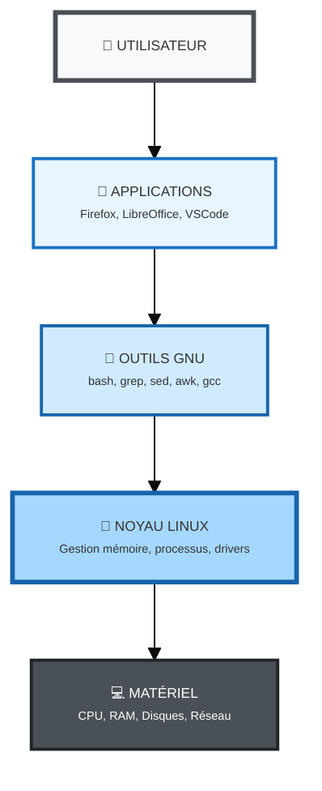
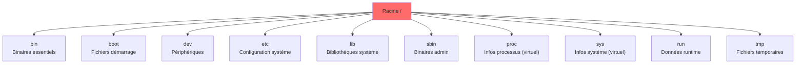
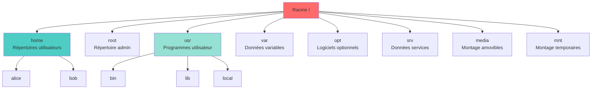

<a name="introduction-unix-linux" id="introduction-unix-linux"></a>

# 🧱 Module 1
## Introduction et rappels Unix/Linux

### Découverte de l'écosystème Unix/Linux

---

# Qu'est-ce qu'Unix ? 🖥️

Unix est un système d'exploitation né en 1969 aux laboratoires Bell (AT&T).

**Créateurs principaux :**
- **Ken Thompson** et **Dennis Ritchie**
- Développé initialement en assembleur, puis réécrit en C (1973)

**Caractéristiques révolutionnaires :**
- Multi-utilisateurs et multi-tâches
- Portabilité grâce au langage C
- Architecture modulaire et simple

---

# Analogie : Unix, c'est comme... 🏗️

Imaginez Unix comme **les fondations d'une maison** :

- **Solides** : éprouvées depuis plus de 50 ans
- **Universelles** : utilisées dans presque toutes les constructions modernes
- **Invisibles** : on ne les voit pas, mais tout repose dessus

Aujourd'hui, Unix et ses descendants sont partout :
- Serveurs web (Google, Facebook, Amazon...)
- Smartphones (Android, iOS)
- Supercalculateurs
- Objets connectés

---

# De Unix à Linux 🐧

**Problème des années 80-90 :**
- Unix était propriétaire et coûteux
- Les universités voulaient un système libre pour l'enseignement

**La révolution GNU (1983) :**
- Richard Stallman lance le projet GNU (GNU's Not Unix)
- Objectif : créer un système d'exploitation libre compatible Unix
- Développement des outils : shell bash, compilateur gcc, éditeurs...

---

# La naissance de Linux (1991) 🎂

**Linus Torvalds**, étudiant finlandais de 21 ans :

> "I'm doing a (free) operating system (just a hobby, won't be big and professional like gnu)"

**Le noyau Linux :**
- Développé initialement pour son ordinateur personnel
- Combiné avec les outils GNU → GNU/Linux
- Publié sous licence GPL (libre et open source)

---

<div class="grid grid-cols-2 gap-8">

<div>

#### Architecture en couches

<small>



</small>

</div>

<div>

#### Les deux composants essentiels

<small>

**🔧 GNU (Projet GNU)**
- Outils en ligne de commande
- Compilateurs et bibliothèques
- Shell (bash)
- Utilitaires système

**🐧 Linux (Noyau)**
- Interface avec le matériel
- Gestion de la mémoire
- Ordonnancement des processus
- Pilotes de périphériques

**= GNU/Linux** 🎯
Un système d'exploitation complet et fonctionnel

</small>

</div>

</div>

---

# Les distributions Linux 📦

Une **distribution** = Linux + outils GNU + logiciels + gestionnaire de paquets

**Principales familles :**

**Debian/Ubuntu** (apt)
- Stable, grande communauté
- Parfait pour débuter et serveurs
- Ubuntu, Debian, Linux Mint, Pop!_OS

**Red Hat/Fedora** (dnf/yum)
- Entreprise, certifications
- RHEL, CentOS, AlmaLinux, Rocky Linux, Fedora

---

# Les distributions Linux (suite) 📦

**Arch** (pacman)
- Rolling release, minimaliste
- Pour utilisateurs avancés
- Arch Linux, Manjaro, EndeavourOS

**SUSE** (zypper)
- Entreprise européenne
- openSUSE, SLES

**Autres**
- Gentoo (compilation source)
- Alpine (ultra-léger, conteneurs)
- NixOS (reproductibilité)

---

# Pourquoi tant de distributions ? 🤔

**Analogie : les restaurants** 🍽️

Tous servent de la nourriture (Linux), mais :
- **Fast-food** (Ubuntu) : rapide, facile, populaire
- **Restaurant gastronomique** (Arch) : personnalisable, pour connaisseurs
- **Cantine d'entreprise** (RHEL) : fiable, support professionnel
- **Food truck** (Alpine) : léger, mobile, efficace

**Principe :** le cœur (noyau Linux) est le même, seul l'emballage change !

---

# La philosophie Unix 🧘

**"Tout est fichier"**
- Les périphériques sont des fichiers (`/dev/sda`, `/dev/tty`)
- La configuration = fichiers texte
- Les processus = fichiers dans `/proc`

**Principe KISS (Keep It Simple, Stupid)**
- Programmes simples qui font une seule chose bien
- Combiner les outils avec des pipes `|`

---

# Exemples de philosophie Unix 🔧

**Un programme = une fonction**

```bash
# Mauvais : un programme qui fait tout
super_outil --search --sort --count fichier.txt

# Unix way : combiner des outils simples
cat fichier.txt | grep "motif" | sort | wc -l
```

**Avantage :** flexibilité et réutilisabilité

---

# Architecture d'un système Linux 🏛️

<small>

**4 couches principales :**

1. **Matériel (Hardware)**
   - Processeur, RAM, disques, cartes réseau

2. **Noyau (Kernel)**
   - Gestion du matériel
   - Gestion de la mémoire et des processus
   - Pilotes de périphériques

3. **Shell**
   - Interface entre l'utilisateur et le noyau
   - Interprète les commandes

4. **Applications utilisateur**
   - Programmes que vous utilisez

</small>

---

# Le noyau Linux en détail 🎯

**Rôles principaux :**

**Gestion des processus**
- Création, ordonnancement, terminaison
- Communication inter-processus (IPC)

**Gestion de la mémoire**
- Allocation/libération mémoire
- Mémoire virtuelle (swap)
- Cache disque

---

# Le noyau Linux en détail (suite) 🎯

**Gestion du système de fichiers**
- VFS (Virtual File System)
- Support ext4, xfs, btrfs, NFS, etc.

**Gestion des périphériques**
- Pilotes de périphériques (drivers)
- Accès aux périphériques via `/dev`

**Gestion réseau**
- Pile TCP/IP
- Interfaces réseau
- Pare-feu (netfilter/iptables)

---

# Le Shell : votre interface avec le système 🐚

**Qu'est-ce qu'un shell ?**
- Programme qui interprète vos commandes
- Interface entre vous et le noyau

**Shells populaires :**
- **bash** (Bourne Again Shell) : le plus courant
- **zsh** (Z Shell) : moderne, plugins
- **fish** (Friendly Interactive Shell) : convivial
- **sh** (Bourne Shell) : le shell historique original

---

# Le Shell : analogie 💬

Le shell, c'est comme un **interprète dans une réunion internationale** :

- Vous parlez en "langage humain" (commandes)
- L'interprète traduit au noyau en "langage machine"
- Le noyau exécute et renvoie la réponse
- L'interprète vous traduit le résultat

**Exemple :**

```bash
$ ls -la
# Vous : "montre-moi les fichiers"
# Shell : traduit en appels système
# Noyau : liste les fichiers
# Shell : affiche le résultat formaté
```

---

# Le système de fichiers Unix/Linux 📁

**Hiérarchie unifiée :**
- Tout part de la racine `/`
- Pas de lettre de lecteur (C:, D:) comme Windows
- Les disques sont "montés" dans l'arborescence

**Principe :** une arborescence, un point d'entrée

---

# Structure des répertoires principaux 🗂️ (1/2)

### Répertoires système essentiels



---

# Structure des répertoires principaux 🗂️ (2/2)

### Répertoires utilisateur et données



---

# Rappels : commandes essentielles (1/4) 🔧

**Navigation :**

```bash
pwd                  # Afficher le répertoire courant
cd /chemin          # Changer de répertoire
cd ..               # Remonter d'un niveau
cd ~                # Aller dans votre home
cd -                # Retourner au répertoire précédent
```

---

# Rappels : commandes essentielles (2/4) 🔧

**Lister et afficher :**

```bash
ls                  # Lister les fichiers
ls -l               # Liste détaillée
ls -la              # Inclure les fichiers cachés
ls -lh              # Tailles lisibles (K, M, G)
cat fichier.txt     # Afficher le contenu
less fichier.txt    # Parcourir un fichier (q pour quitter)
head fichier.txt    # 10 premières lignes
tail fichier.txt    # 10 dernières lignes
tail -f fichier.log # Suivre un fichier en temps réel
```

---

# Rappels : commandes essentielles (3/4) 🔧

**Manipuler fichiers et répertoires :**

```bash
cp source dest      # Copier
cp -r dir1 dir2     # Copier un répertoire
mv source dest      # Déplacer/renommer
rm fichier          # Supprimer un fichier
rm -r dossier       # Supprimer un répertoire
rm -rf dossier      # Force (ATTENTION : dangereux!)
mkdir nouveau_dir   # Créer un répertoire
mkdir -p a/b/c      # Créer une arborescence
touch fichier.txt   # Créer un fichier vide
```

---

# Rappels : commandes essentielles (4/4) 🔧

**Recherche et filtres :**

```bash
find /chemin -name "*.txt"        # Trouver des fichiers
find /home -type f -size +100M    # Fichiers > 100 Mo
grep "motif" fichier.txt          # Rechercher dans un fichier
grep -r "motif" /repertoire       # Recherche récursive
grep -i "motif" fichier           # Insensible à la casse
which commande                     # Localiser un exécutable
whereis commande                   # Trouver binaire, source, man
```

---

# Les pipes : combiner les commandes 🔗

**Le pipe `|` :** connecte la sortie d'une commande à l'entrée d'une autre

```bash
# Compter les lignes d'un fichier
cat fichier.txt | wc -l

# Trouver un processus
ps aux | grep "nginx"

# Les 10 plus gros fichiers du répertoire
ls -lh | sort -k5 -h | tail -10

# Extraire et trier des données
cat /etc/passwd | cut -d: -f1 | sort
```

**Analogie :** comme une chaîne de production en usine, chaque outil fait sa partie du travail.

---

# Redirections : entrées/sorties 📤📥

**Rediriger la sortie :**

```bash
ls -la > liste.txt           # Écraser le fichier
ls -la >> liste.txt          # Ajouter à la fin
commande 2> erreurs.txt      # Rediriger les erreurs
commande &> tout.txt         # Rediriger tout (stdout + stderr)
commande > /dev/null 2>&1    # Ignorer toutes les sorties
```

---

# Redirections : entrées/sorties (suite) 📤📥

**Rediriger l'entrée :**

```bash
sort < liste.txt             # Lire depuis un fichier
wc -l < fichier.txt          # Compter les lignes
```

---

# Permissions : rappels de base 🔒

**Chaque fichier a :**
- Un **propriétaire** (owner)
- Un **groupe**
- Des **permissions** pour : owner, group, others

**Types de permissions :**
- `r` (read) : lecture
- `w` (write) : écriture
- `x` (execute) : exécution

```bash
-rw-r--r--  1 alice  users  1024 Jan 10 10:30 fichier.txt
drwxr-xr-x  2 alice  users  4096 Jan 10 10:31 dossier/
```

---

# Changer les permissions 🔐

```bash
chmod 755 script.sh          # rwxr-xr-x
chmod u+x script.sh          # Ajouter exécution pour user
chmod g-w fichier.txt        # Retirer écriture pour group
chmod o-r fichier.txt        # Retirer lecture pour others

chown alice:users fichier    # Changer propriétaire et groupe
chown alice fichier          # Changer seulement propriétaire
chgrp users fichier          # Changer seulement groupe
```

---

# Les processus : bases 🏃

**Qu'est-ce qu'un processus ?**
- Un programme en cours d'exécution
- Chaque processus a un PID (Process ID) unique

```bash
ps                           # Processus de votre session
ps aux                       # Tous les processus
top                          # Vue en temps réel
htop                         # Version améliorée (à installer)
pgrep nginx                  # Trouver PID d'un processus
```

---

# Gérer les processus 🎮

```bash
command &                    # Lancer en arrière-plan
jobs                         # Lister les tâches en cours
fg                           # Ramener en avant-plan
bg                           # Mettre en arrière-plan
Ctrl+Z                       # Suspendre un processus
Ctrl+C                       # Interrompre un processus

kill 1234                    # Terminer processus PID 1234
kill -9 1234                 # Tuer de force (SIGKILL)
killall nginx                # Tuer tous les processus nginx
pkill -f "nom_pattern"       # Tuer par nom/motif
```

---

# L'éditeur de texte : nano/vim 📝

**nano** : simple et intuitif

```bash
nano fichier.txt
# Ctrl+O : sauvegarder
# Ctrl+X : quitter
# Ctrl+K : couper une ligne
# Ctrl+U : coller
```

**vim** : puissant mais courbe d'apprentissage

```bash
vim fichier.txt
# i : passer en mode insertion
# Esc : revenir en mode commande
# :w : sauvegarder
# :q : quitter
# :wq : sauvegarder et quitter
# :q! : quitter sans sauvegarder
```

---

# Variables d'environnement 🌍

**Variables système importantes :**

```bash
echo $HOME                   # Répertoire personnel
echo $USER                   # Nom d'utilisateur
echo $PATH                   # Chemins des exécutables
echo $SHELL                  # Shell par défaut
echo $PWD                    # Répertoire actuel

export MA_VAR="valeur"       # Définir une variable
env                          # Lister toutes les variables
printenv                     # Idem
```

---

# Le PATH : où sont les commandes ? 🔍

**Le PATH** : liste des répertoires où le shell cherche les commandes

```bash
echo $PATH
# Résultat typique :
# /usr/local/bin:/usr/bin:/bin:/usr/sbin:/sbin

# Ajouter un répertoire au PATH
export PATH=$PATH:/mon/nouveau/chemin

# Rendre permanent (dans ~/.bashrc ou ~/.zshrc)
echo 'export PATH=$PATH:/mon/nouveau/chemin' >> ~/.bashrc
source ~/.bashrc
```

---

# Fichiers de configuration du shell 🔧

**Pourquoi 2 fichiers différents ?**

| Fichier | Quand il est lu ? | On met quoi dedans ? |
|---------|-------------------|----------------------|
| `~/.bash_profile`<br>`~/.zprofile` | À la **connexion** (SSH, login) | Variables d'environnement (PATH) |
| `~/.bashrc`<br>`~/.zshrc` | À **chaque nouveau terminal** | Alias, fonctions, prompt |

**💡 En gros :**
- `.bash_profile` = 1 fois quand tu te connectes
- `.bashrc` = à chaque fois que tu ouvres un terminal

---

# Configuration du shell : Exemples 🛠️

**Dans `~/.bash_profile` (ou `~/.zprofile` pour Zsh) :**

```bash
# Variables d'environnement
export PATH=$PATH:~/bin
export EDITOR=vim
```

**Dans `~/.bashrc` (ou `~/.zshrc` pour Zsh) :**

```bash
# Alias
alias ll='ls -lah'
alias update='sudo apt update && sudo apt upgrade'

# Fonction personnalisée
mkcd() {
    mkdir -p "$1" && cd "$1"
}
```

**Appliquer les changements :**

```bash
source ~/.bashrc     # Pour Bash
source ~/.zshrc      # Pour Zsh
```

---

# Aide et documentation 📚

**Obtenir de l'aide :**

```bash
man ls                       # Manuel de la commande ls
man -k "keyword"             # Rechercher dans les manuels
info ls                      # Info pages (alternative à man)
ls --help                    # Aide rapide
whatis ls                    # Description courte
apropos "keyword"            # Rechercher par mot-clé
```

**Sections du manuel :**
- Section 1 : Commandes utilisateur
- Section 5 : Formats de fichiers
- Section 8 : Commandes d'administration

---

# Raccourcis clavier Bash ⌨️

**Navigation :**

```
Ctrl+A          # Début de ligne
Ctrl+E          # Fin de ligne
Ctrl+U          # Effacer jusqu'au début
Ctrl+K          # Effacer jusqu'à la fin
Ctrl+W          # Effacer le mot précédent
Ctrl+R          # Rechercher dans l'historique
Ctrl+L          # Effacer l'écran (comme clear)
```

---

# Historique des commandes 📜

```bash
history                      # Afficher l'historique
history | grep "ssh"         # Chercher dans l'historique
!123                         # Exécuter la commande #123
!!                           # Répéter la dernière commande
!$                           # Dernier argument de la commande précédente
sudo !!                      # Relancer la dernière commande avec sudo

# Recherche interactive
Ctrl+R                       # Puis taper des lettres
```

---

# Alias : raccourcis personnalisés 🔖

```bash
# Définir un alias temporaire
alias ll='ls -lah'
alias ..='cd ..'
alias ...='cd ../..'
alias update='sudo apt update && sudo apt upgrade'

# Rendre permanent (dans ~/.bashrc)
echo "alias ll='ls -lah'" >> ~/.bashrc
source ~/.bashrc

# Lister les alias
alias

# Supprimer un alias
unalias ll
```

---

# Quelques conseils de débutant 💡

**1. Lisez les messages d'erreur**
- Ils contiennent souvent la solution

**2. Utilisez la complétion automatique (Tab)**
- Gagne du temps et évite les erreurs

**3. Attention avec `rm -rf`**
- Pas de corbeille en ligne de commande !
- Vérifiez toujours avant de supprimer

**4. Sauvegardez vos données**
- Avant toute manipulation importante

---

# Quelques conseils de débutant (suite) 💡

**5. Testez dans un environnement sûr**
- Machine virtuelle ou conteneur Docker

**6. Prenez des notes**
- Créez votre propre "cheat sheet"

**7. Pratiquez régulièrement**
- La ligne de commande devient naturelle avec la pratique

**8. Consultez la documentation**
- `man` est votre meilleur ami

---

# Pour aller plus loin 🚀

**Ressources utiles :**

- **Linux Journey** : tutoriels interactifs
- **OverTheWire** : jeux pour apprendre Linux
- **ExplainShell** : explique les commandes shell
- **TLDR pages** : alternatives simplifiées à man

**Communautés :**
- Forums Ubuntu/Debian/Arch
- Stack Overflow
- Reddit : r/linux, r/linuxquestions
- IRC : #linux sur libera.chat

---

# Récapitulatif du Module 1 ✅

**Ce que vous avez appris :**

<small>

- ✅ Historique d'Unix et naissance de Linux
- ✅ Philosophie Unix ("tout est fichier", modularité)
- ✅ Architecture d'un système Linux (noyau, shell, applications)
- ✅ Structure du système de fichiers
- ✅ Commandes essentielles de base
- ✅ Pipes et redirections
- ✅ Permissions de base
- ✅ Processus et leur gestion
- ✅ Variables d'environnement
- ✅ Aide et documentation

</small>

---

# Environnement de travail 🐳

**Pour la suite, on a besoin d'un terminal Linux !**

**Option simple : Docker** (pas besoin de VM lourde)

1. **Installer Docker Desktop :**
   - Windows : https://docs.docker.com/desktop/install/windows-install/
   - Mac : https://docs.docker.com/desktop/install/mac-install/
   - Linux : https://docs.docker.com/desktop/install/linux-install/

2. **Créer un fichier `docker-compose.yml` :**

```yaml
services:
  ubuntu:
    image: ubuntu:24.04
    container_name: formation-unix
    stdin_open: true
    tty: true
    command: /bin/bash
```

---

# Lancer l'environnement 🚀

**3 commandes, c'est tout :**

```bash
# Démarrer le conteneur Ubuntu
docker-compose up -d

# Se connecter au terminal Linux
docker exec -it formation-unix bash

# Quitter : Ctrl+D ou
exit
```

**Arrêter/supprimer :**

```bash
docker-compose down       # Arrêter
docker-compose down -v    # Arrêter et tout supprimer
```

**💡 C'est tout !** On va passer 90% du temps dans le terminal, pas besoin de se prendre la tête avec une VM graphique.

---

# Prochaine étape 🎯

**Module 2 : Commandes de base essentielles**

- Navigation dans le système de fichiers
- Manipulation de fichiers et répertoires
- Recherche avec find et grep
- Visualisation de fichiers
- Redirections et pipes avancés

---
layout: default
---

# Questions ? 🤔

N'hésitez pas à poser vos questions maintenant !

Le prochain module approfondira la gestion des utilisateurs et des permissions.
