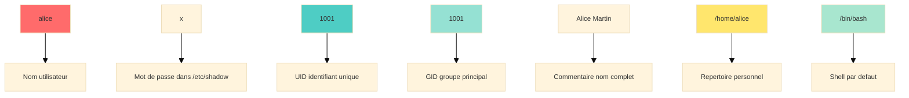
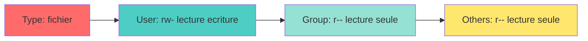

<a name="gestion-systeme-utilisateurs" id="gestion-systeme-utilisateurs"></a>

# 👥 Module 4
## Gestion du système et des utilisateurs

### Maîtriser les comptes, groupes et permissions

---

# Pourquoi gérer les utilisateurs ? 👥

**Unix/Linux est multi-utilisateurs par conception**

Imaginez un immeuble :
- Chaque locataire (utilisateur) a sa clé (mot de passe)
- Chacun a son appartement (home directory)
- Certaines zones sont communes (dossiers partagés)
- Le gardien (root) a accès à tout

**Objectifs :**
- Sécurité : qui peut faire quoi ?
- Isolation : chacun ses données
- Organisation : groupes de travail

---

# L'utilisateur root : le super-admin 👑

**root** : l'utilisateur tout-puissant (UID 0)

**Pouvoirs :**
- Accès à tous les fichiers
- Modification de toute configuration
- Installation de logiciels
- Gestion des utilisateurs
- Redémarrage, arrêt du système

**⚠️ Avec de grands pouvoirs viennent de grandes responsabilités**

```bash
# Danger ! Peut détruire le système
rm -rf /
```

---

# Ne jamais travailler en root ! 🚨

**Pourquoi ?**

1. **Erreur humaine** : une faute de frappe peut être fatale
2. **Sécurité** : un malware aurait tous les droits
3. **Audit** : difficile de tracer qui a fait quoi
4. **Bonnes pratiques** : utiliser `sudo` pour les tâches admin

**Analogie :**
Utiliser root en permanence, c'est comme conduire une voiture de sport à 200 km/h en ville : possible, mais dangereux !

---

# Les fichiers d'authentification 📄

**Fichiers clés du système :**

`/etc/passwd` : informations des utilisateurs

```bash
alice:x:1001:1001:Alice Martin:/home/alice:/bin/bash
bob:x:1002:1002:Bob Dupont:/home/bob:/bin/bash
```

Format : `username:x:UID:GID:comment:home:shell`

---

# Décryptage de /etc/passwd 🔍

**Format :** `alice:x:1001:1001:Alice Martin:/home/alice:/bin/bash`



**UID remarquables :**
- 0 : root
- 1-999 : comptes système
- 1000+ : utilisateurs normaux

---

# Le fichier /etc/shadow 🔒

Contient les mots de passe chiffrés (accessible uniquement par root)

```bash
alice:$6$rounds=5000$salt$hashedpassword:19000:0:99999:7:::
```

**Format :**

```bash
username:password_hash:last_change:min:max:warn:inactive:expire
```

**Paramètres :**
- `last_change` : jours depuis 1970 du dernier changement
- `min` : jours minimum entre changements
- `max` : jours maximum avant expiration
- `warn` : jours d'avertissement avant expiration

---

# Le fichier /etc/group 👥

Définit les groupes et leurs membres

```bash
users:x:100:
developers:x:1010:alice,bob,charlie
admins:x:1020:alice
docker:x:999:alice,bob
```

**Format :** `group_name:x:GID:member_list`

**Pourquoi des groupes ?**
- Simplifier la gestion des permissions
- Organiser les utilisateurs par projet/département
- Partager l'accès à des ressources

---

# Créer un utilisateur : useradd 🆕

```bash
# Méthode simple
sudo useradd alice

# Méthode complète
sudo useradd -m -s /bin/bash -c "Alice Martin" -G sudo,developers alice

# Options importantes :
# -m : créer le home directory
# -s : définir le shell
# -c : commentaire (nom complet)
# -G : groupes supplémentaires
# -d : spécifier le home directory
# -u : spécifier l'UID
```

---

# Créer un utilisateur : adduser 🆕

**Alternative interactive (Debian/Ubuntu) :**

```bash
sudo adduser alice
```

Cette commande :
- Crée l'utilisateur
- Crée le home directory
- Demande le mot de passe
- Demande les informations (nom, téléphone, etc.)
- Configure les permissions

**Plus simple pour les débutants !**

---

# Définir un mot de passe 🔑

```bash
# Définir le mot de passe d'un utilisateur
sudo passwd alice

# Changer son propre mot de passe
passwd

# Forcer le changement au prochain login
sudo passwd -e alice

# Verrouiller un compte
sudo passwd -l alice

# Déverrouiller un compte
sudo passwd -u alice
```

---

# Politique de mot de passe fort 💪

**Bonnes pratiques :**

✅ Au moins 12 caractères

✅ Mélange majuscules/minuscules

✅ Chiffres et caractères spéciaux

✅ Pas de mots du dictionnaire

✅ Pas d'informations personnelles

**Outils :**

```bash
# Générer un mot de passe aléatoire
pwgen 16 1

# Ou avec openssl
openssl rand -base64 16
```

---

# Modifier un utilisateur : usermod 🔧

```bash
# Changer le shell
sudo usermod -s /bin/zsh alice

# Changer le home directory
sudo usermod -d /home/newdir alice

# Ajouter à des groupes supplémentaires
sudo usermod -aG docker,sudo alice

# Changer l'UID
sudo usermod -u 2000 alice

# Changer le nom d'utilisateur
sudo usermod -l newalice alice

# Verrouiller le compte
sudo usermod -L alice

# Déverrouiller
sudo usermod -U alice
```

---

# ⚠️ Option -aG vs -G

**Différence CRITIQUE :**

```bash
# MAUVAIS : remplace TOUS les groupes
sudo usermod -G docker alice
# → alice n'est plus que dans 'docker'

# BON : ajoute aux groupes existants
sudo usermod -aG docker alice
# → alice garde ses groupes ET gagne 'docker'
```

**Pensez-y comme :**
- `-G` : réinitialiser la liste
- `-aG` : ajouter (append)

---

# Supprimer un utilisateur : userdel 🗑️

```bash
# Supprimer seulement le compte
sudo userdel alice

# Supprimer le compte ET le home directory
sudo userdel -r alice

# Vérifier avant de supprimer
ls -la /home/alice
ps -u alice  # Vérifier si des processus tournent
```

**⚠️ Attention :**
- Les fichiers appartenant à l'utilisateur ailleurs restent
- Les processus en cours doivent être arrêtés

---

# Gérer les groupes 👥

**Créer un groupe :**

```bash
sudo groupadd developers
sudo groupadd -g 2000 project_team  # Avec GID spécifique
```

**Modifier un groupe :**

```bash
sudo groupmod -n newname oldname     # Renommer
sudo groupmod -g 3000 developers     # Changer GID
```

**Supprimer un groupe :**

```bash
sudo groupdel developers
```

---

# Gérer l'appartenance aux groupes 🎫

```bash
# Ajouter un utilisateur à un groupe
sudo usermod -aG developers alice
sudo gpasswd -a alice developers     # Alternative

# Retirer un utilisateur d'un groupe
sudo gpasswd -d alice developers

# Lister les groupes d'un utilisateur
groups alice
id alice

# Changer temporairement de groupe principal
newgrp developers
```

---

# Groupes primaires vs secondaires 🔀

**Groupe primaire (primary group) :**
- Un seul par utilisateur
- Défini dans `/etc/passwd`
- Les nouveaux fichiers créés lui appartiennent

**Groupes secondaires (supplementary groups) :**
- Multiples possibles
- Listés dans `/etc/group`
- Donnent des accès supplémentaires

```bash
id alice
# uid=1001(alice) gid=1001(alice) groups=1001(alice),27(sudo),999(docker)
#                     ↑ primaire          ↑ secondaires
```

---

# Permissions Unix : les bases 🔐

**3 types d'actions :**
- **r** (read) : lire
- **w** (write) : écrire
- **x** (execute) : exécuter

**3 catégories d'utilisateurs :**
- **u** (user) : propriétaire
- **g** (group) : groupe
- **o** (others) : autres

**Exemple :** `-rw-r--r--  1 alice  developers  1024 Jan 10 10:30 fichier.txt`



---

# Permissions en notation octale 🔢

**Chaque trio = un chiffre :**

```
r (4) + w (2) + x (1) = 7
r (4) + w (2)         = 6
r (4)         + x (1) = 5
r (4)                 = 4
        w (2) + x (1) = 3
        w (2)         = 2
                x (1) = 1
                      = 0
```

**Exemples courants :**
- `644` : rw-r--r-- (fichier texte)
- `755` : rwxr-xr-x (script exécutable)
- `700` : rwx------ (fichier privé)
- `777` : rwxrwxrwx (tout le monde peut tout faire - DANGEREUX)

---

# Changer les permissions : chmod 🔧

**Notation symbolique :**

```bash
chmod u+x script.sh          # Ajouter exécution pour user
chmod g-w fichier.txt        # Retirer écriture pour group
chmod o-r secret.txt         # Retirer lecture pour others
chmod a+r public.txt         # Ajouter lecture pour all
chmod u=rwx,g=rx,o=r file    # Définir explicitement
```

---

# Changer les permissions : chmod (suite) 🔧

**Notation octale :**

```bash
chmod 644 fichier.txt        # rw-r--r--
chmod 755 script.sh          # rwxr-xr-x
chmod 700 private.txt        # rwx------
chmod 600 ~/.ssh/id_rsa      # rw------- (clé SSH privée)
```

**Récursif :**

```bash
chmod -R 755 /var/www/html   # Applique à tous les fichiers
```

---

# Permissions sur les répertoires 📁

**Particularités des répertoires :**

- **r** : lister le contenu (ls)
- **w** : créer/supprimer des fichiers dedans
- **x** : traverser (cd) le répertoire

**Exemple pratique :**

```bash
# Répertoire accessible mais non listable
chmod 711 /home/alice/secret
# → On peut aller dedans si on connaît le nom,
#   mais on ne peut pas lister son contenu
```

---

# Changer propriétaire et groupe : chown/chgrp 👤

```bash
# Changer le propriétaire
sudo chown alice fichier.txt

# Changer propriétaire et groupe
sudo chown alice:developers fichier.txt

# Seulement le groupe
sudo chgrp developers fichier.txt

# Récursif
sudo chown -R alice:developers /projet

# Préserver le groupe actuel avec :
sudo chown alice: fichier.txt
```

---

# umask : permissions par défaut 🎭

**umask** : masque qui définit les permissions des nouveaux fichiers/dossiers

**Le problème :** quand on crée un fichier, quelles permissions lui donner ?

**La solution :** umask définit automatiquement les permissions par défaut

**Important :** umask **retire** des permissions, il ne les ajoute pas !

---

# Analogie : le moule à gâteau 🧁

**Imaginez umask comme un moule à gâteau :**

**Sans moule (umask 0000)** :
- Le gâteau déborde partout
- Fichiers : 666 (rw-rw-rw-) → tout le monde peut écrire ⚠️
- Dangereux !

**Avec un moule (umask 0022)** :
- Le moule bloque certaines parties
- Fichiers : 644 (rw-r--r--) → seul le propriétaire peut écrire ✅
- Sécurisé !

**Le moule définit la forme finale en bloquant ce qu'on ne veut pas**

---

# Autre analogie : le filtre de confidentialité 🔒

**Pensez à un filtre de confidentialité sur un écran :**

**Écran sans filtre (umask 0000)** :
- Tout le monde voit tout
- Permissions maximales

**Écran avec filtre (umask 0022)** :
- Certaines personnes ne peuvent que regarder, pas toucher
- Permissions contrôlées

**Filtre opaque (umask 0077)** :
- Personne d'autre ne peut rien voir ni toucher
- Permissions minimales

---

# Comment fonctionne umask ? 🧮

**umask fonctionne par SOUSTRACTION :**

```
Permissions maximales - umask = Permissions finales
```

**Permissions maximales par défaut :**
- **Fichiers** : 666 (rw-rw-rw-)
- **Dossiers** : 777 (rwxrwxrwx)

**umask retire des permissions à ces valeurs maximales**

---

# Voir le umask actuel 👀

```bash
# Afficher le umask actuel
umask
```

---

# Résultat de umask

```
# Résultat typique :
0022
```

**Lecture du nombre : 0022**
- Premier 0 : permissions spéciales (on l'ignore généralement)
- 0 : permissions retirées au **propriétaire** (user)
- 2 : permissions retirées au **groupe** (group)
- 2 : permissions retirées aux **autres** (others)

---

# Calcul détaillé : fichiers 📄

**Exemple avec umask 0022 :**

```
Fichier : 666 (rw-rw-rw-)
umask :  -022
         ----
Résultat: 644 (rw-r--r--)
```

**Détail du calcul :**
- **User** : 6 - 0 = 6 (rw-)
- **Group** : 6 - 2 = 4 (r--)
- **Others** : 6 - 2 = 4 (r--)

**Résultat : rw-r--r--** = Le propriétaire peut lire/écrire, les autres seulement lire

---

# Calcul détaillé : dossiers 📁

**Exemple avec umask 0022 :**

```
Dossier : 777 (rwxrwxrwx)
umask :  -022
         ----
Résultat: 755 (rwxr-xr-x)
```

**Détail du calcul :**
- **User** : 7 - 0 = 7 (rwx)
- **Group** : 7 - 2 = 5 (r-x)
- **Others** : 7 - 2 = 5 (r-x)

**Résultat : rwxr-xr-x** = Le propriétaire a tous les droits, les autres peuvent lire et entrer

---

# Tableau de conversion umask 📊

| umask | Fichiers (666-umask) | Dossiers (777-umask) | Description |
|-------|---------------------|---------------------|-------------|
| 0000  | 666 (rw-rw-rw-)    | 777 (rwxrwxrwx)    | Tout permis ⚠️ |
| 0002  | 664 (rw-rw-r--)    | 775 (rwxrwxr-x)    | Groupe = user |
| 0022  | 644 (rw-r--r--)    | 755 (rwxr-xr-x)    | Standard ✅ |
| 0027  | 640 (rw-r-----)    | 750 (rwxr-x---)    | Restrictif |
| 0077  | 600 (rw-------)    | 700 (rwx------)    | Privé 🔒 |

---

# Test pratique : umask 0022 🧪

```bash
# Vérifier le umask actuel
umask
```

---

# Résultat du test (umask 0022)

```
# Résultat
0022
```

---

# Créer un fichier test

```bash
# Créer un fichier
touch test1.txt

# Voir ses permissions
ls -l test1.txt
```

---

# Permissions obtenues

```
-rw-r--r-- 1 user group 0 Dec  2 10:00 test1.txt
```

**Explication :**
- **rw-** : propriétaire peut lire et écrire
- **r--** : groupe peut seulement lire
- **r--** : autres peuvent seulement lire

**C'est exactement 644** = 666 - 022 ✅

---

# Test pratique : umask 0077 🔐

```bash
# Changer le umask (très restrictif)
umask 0077

# Créer un nouveau fichier
touch test2.txt

# Voir ses permissions
ls -l test2.txt
```

---

# Résultat avec umask 0077

```
-rw------- 1 user group 0 Dec  2 10:00 test2.txt
```

**Explication :**
- **rw-** : propriétaire peut lire et écrire
- **---** : groupe ne peut RIEN faire
- **---** : autres ne peuvent RIEN faire

**C'est exactement 600** = 666 - 077 ✅

**Fichier totalement privé !** 🔒

---

# Cas d'usage : umask 0022 (défaut) 🏢

**Situation :** environnement de bureau normal

```bash
umask 0022
```

**Résultat :**
- Fichiers : 644 (rw-r--r--)
- Dossiers : 755 (rwxr-xr-x)

**Avantages :**
- ✅ Vous pouvez modifier vos fichiers
- ✅ Les autres peuvent les lire (partage facile)
- ✅ Les autres ne peuvent pas les modifier (sécurité)

**Idéal pour :** postes de travail, serveurs web

---

# Cas d'usage : umask 0027 (restrictif) 🔐

**Situation :** travail en équipe avec groupes

```bash
umask 0027
```

**Résultat :**
- Fichiers : 640 (rw-r-----)
- Dossiers : 750 (rwxr-x---)

**Avantages :**
- ✅ Vous avez tous les droits
- ✅ Votre groupe peut lire
- ✅ Les autres ne voient RIEN

**Idéal pour :** projets d'équipe, données sensibles partagées

---

# Cas d'usage : umask 0077 (privé) 🚫

**Situation :** données personnelles sensibles

```bash
umask 0077
```

**Résultat :**
- Fichiers : 600 (rw-------)
- Dossiers : 700 (rwx------)

**Avantages :**
- ✅ Vous seul pouvez accéder
- ✅ Sécurité maximale
- ❌ Aucun partage possible

**Idéal pour :** clés SSH, mots de passe, données bancaires

---

# Modifier le umask temporairement ⏱️

```bash
# Changer pour la session actuelle
umask 0027
```

---

# Vérifier le changement

```bash
# Vérifier
umask
```

---

# Résultat de la vérification

```
# Résultat
0027
```

---

# Créer un fichier avec le nouveau umask

```bash
# Créer un fichier
touch test3.txt

# Vérifier les permissions
ls -l test3.txt
```

---

# Permissions avec umask 0027

```
-rw-r----- 1 user group 0 Dec  2 10:00 test3.txt
```

**Le groupe peut lire, mais pas les autres !**

**⚠️ ATTENTION :** ce changement est temporaire
- Valable uniquement pour cette session
- Disparaît quand vous fermez le terminal

---

# Modifier le umask de façon permanente 💾

**Pour votre utilisateur uniquement :**

```bash
# Ouvrir votre fichier de configuration
nano ~/.bashrc
```

---

# Ajouter la ligne umask

```bash
# Ajouter à la fin du fichier
umask 0027
```

---

# Activer les changements

```bash
# Recharger la configuration
source ~/.bashrc

# Vérifier
umask
```

---

# Modifier le umask système 🌍

**Pour tous les utilisateurs :**

```bash
# Éditer le fichier système
sudo nano /etc/profile
```

---

# Ajouter umask dans /etc/profile

```bash
# Ajouter à la fin
umask 0022
```

---

# Cas pratiques complets 💼

**Scénario 1 : Développeur freelance**

```bash
# Fichiers privés par défaut
umask 0077

# Créer un projet
mkdir mon-projet
touch mon-projet/code.py

# Résultat : personne d'autre ne peut voir
ls -ld mon-projet        # drwx------
ls -l mon-projet/code.py # -rw-------
```

---

# Cas pratiques (suite) 💼

**Scénario 2 : Équipe de développement**

```bash
# Partage avec le groupe
umask 0027

# Créer un projet d'équipe
mkdir projet-equipe
touch projet-equipe/README.md

# Résultat : le groupe peut collaborer
ls -ld projet-equipe          # drwxr-x---
ls -l projet-equipe/README.md # -rw-r-----
```

---

# Cas pratiques (suite) 💼

**Scénario 3 : Serveur web public**

```bash
# Fichiers lisibles par tous
umask 0022

# Créer un site web
mkdir /var/www/html/site
touch /var/www/html/site/index.html

# Résultat : tout le monde peut lire
ls -ld /var/www/html/site            # drwxr-xr-x
ls -l /var/www/html/site/index.html  # -rw-r--r--
```

---

# Comprendre les valeurs en octal 🔢

**Rappel des valeurs :**
- **4** = r (read)
- **2** = w (write)
- **1** = x (execute)

**Quand umask retire 2 :**
- Retire uniquement le droit d'écriture (w)
- 6 - 2 = 4 : reste seulement la lecture (r--)
- 7 - 2 = 5 : reste lecture + exécution (r-x)

---

# Exemples de calcul pas à pas 🧮

**umask 0002 :**
```
Fichier : 666 - 002 = 664
User   : 6 - 0 = 6 (rw-)
Group  : 6 - 0 = 6 (rw-)
Others : 6 - 2 = 4 (r--)
→ Groupe a les mêmes droits que le propriétaire
```

---

# Exemples de calcul pas à pas (suite) 🧮

**umask 0077 :**
```
Fichier : 666 - 077 = 600
User   : 6 - 0 = 6 (rw-)
Group  : 6 - 7 = 0 (---)  [7 retire tout]
Others : 6 - 7 = 0 (---)  [7 retire tout]
→ Fichier totalement privé
```

---

# Erreurs courantes ❌

**Erreur 1 : Penser que umask AJOUTE des permissions**
```bash
# FAUX : umask 0777 ne donne pas tous les droits
# VRAI : umask 0777 retire tout !
umask 0777  # Fichiers = 666-777 = ???  (invalide)
```

**Erreur 2 : Confondre umask et chmod**
- **umask** : définit les permissions PAR DÉFAUT des NOUVEAUX fichiers
- **chmod** : modifie les permissions de fichiers EXISTANTS

---

# Vérifier l'impact du umask 🔍

```bash
# Méthode complète pour tester
echo "Mon umask actuel :"
umask

echo -e "\nTest fichier :"
touch /tmp/test_umask.txt
ls -l /tmp/test_umask.txt

echo -e "\nTest dossier :"
mkdir /tmp/test_umask_dir
ls -ld /tmp/test_umask_dir

# Nettoyer
rm /tmp/test_umask.txt
rmdir /tmp/test_umask_dir
```

---

# Récapitulatif umask 📝

**À retenir :**

✅ umask **retire** des permissions (c'est un masque)

✅ Calcul : `666 - umask` pour fichiers, `777 - umask` pour dossiers

✅ umask 0022 : standard (propriétaire écrit, autres lisent)

✅ umask 0077 : privé (seul le propriétaire accède)

✅ Temporaire : `umask 0027` dans le terminal

✅ Permanent : ajouter `umask 0027` dans `~/.bashrc`

---

# sudo : exécuter en tant que root 🔑

**sudo** : "**S**uper**U**ser **DO**"

**Le problème :**
- Certaines commandes nécessitent les droits root (administrateur)
- Se connecter en root est dangereux (une erreur = catastrophe)

**La solution :**
- `sudo` permet d'exécuter **une commande** avec les droits root
- Traçabilité : on sait qui a fait quoi
- Sécurité : pas besoin du mot de passe root

---

# Pourquoi sudo plutôt que root ? 🤔

**Se connecter en root directement :**
```bash
su -        # Mauvaise pratique ❌
```

**Problèmes :**
- ❌ Vous êtes root pour TOUT (dangereux)
- ❌ Pas de trace de qui a fait quoi
- ❌ Facile d'oublier qu'on est root
- ❌ Une erreur peut détruire le système

---

# Avantages de sudo ✅

**Utiliser sudo :**
```bash
sudo apt update    # Bonne pratique ✅
```

**Avantages :**
- ✅ Root uniquement pour cette commande
- ✅ Traçabilité complète dans `/var/log/auth.log`
- ✅ On reste utilisateur normal après
- ✅ Peut limiter les commandes autorisées
- ✅ Timeout de session (15 min par défaut)

---

# Analogie : le badge d'accès 🏢

**Imaginez un immeuble de bureaux :**

**Root permanent** (su -) :
- Badge administrateur H24
- Accès à TOUTES les pièces en permanence
- Si vous perdez le badge = catastrophe

**Sudo** :
- Vous demandez l'accès temporaire à une pièce
- Le gardien note votre passage
- Badge rendu automatiquement après 15 min
- Si problème, on sait qui a fait quoi

---

# Utilisation basique de sudo 💻

```bash
# Exécuter une commande en root
sudo apt update
```


---

# Commandes sudo avancées 🚀

```bash
# Ouvrir un shell root temporaire (déconseillé mais parfois utile)
sudo -i        # Shell root avec environnement root
sudo -s        # Shell root avec votre environnement
```

---

# Commandes sudo avancées (suite) 🚀

```bash
# Exécuter en tant qu'un autre utilisateur
sudo -u alice cat /home/alice/fichier.txt
sudo -u www-data ls /var/www/html
```

---

# Commandes sudo avancées (suite) 🚀

```bash
# Éditer un fichier de façon sécurisée
sudoedit /etc/hosts    # Préférable à "sudo nano"
```

---

# Commandes sudo avancées (suite) 🚀

```bash
# Relancer sudo sans retaper le mot de passe
sudo -v     # Prolonge la session sudo de 15 min
```

---

# Commandes sudo avancées (suite) 🚀

```bash
# Voir ce qu'on peut faire avec sudo
sudo -l
```

---

# Comment donner les droits sudo à un utilisateur ? 👤

**Deux méthodes principales :**

1. **Méthode SIMPLE** : ajouter au groupe `sudo` ou `wheel` ✅
   - Recommandé pour la majorité des cas
   - Rapide et sûr
   - L'utilisateur peut tout faire avec sudo

2. **Méthode AVANCÉE** : éditer `/etc/sudoers` 🔧
   - Pour des permissions spécifiques
   - Limiter certaines commandes
   - Configuration fine

**On commence par la méthode simple !**

---

# Méthode 1 : Ajouter au groupe sudo (Ubuntu/Debian) 👥

**Sur Ubuntu/Debian, le groupe magique est `sudo`**

```bash
# Ajouter alice au groupe sudo
sudo usermod -aG sudo alice
```

---

# Vérifier l'ajout au groupe

```bash
# Vérifier que alice est dans le groupe sudo
groups alice
```

---

# Résultat de la vérification

```
alice : alice sudo
```

**Alice doit se déconnecter/reconnecter pour que ça prenne effet !**

---

# Test des droits sudo

```bash
# Alice peut maintenant utiliser sudo
su - alice
sudo apt update
# → Demande le mot de passe d'alice
# → Fonctionne ! ✅
```

---

# Méthode 1 : Ajouter au groupe wheel (RHEL/Fedora) 🎩

**Sur RHEL/Fedora/AlmaLinux, le groupe magique est `wheel`**

```bash
# Ajouter bob au groupe wheel
sudo usermod -aG wheel bob
```

---

# Vérifier l'ajout au groupe wheel

```bash
# Vérifier que bob est dans le groupe wheel
groups bob
```

---

# Résultat de la vérification (wheel)

```
bob : bob wheel
```

**Bob doit se déconnecter/reconnecter !**

---

# Différences entre distributions 🐧

| Distribution | Groupe sudo |
|--------------|-------------|
| Ubuntu       | `sudo` |
| Debian       | `sudo` |
| Linux Mint   | `sudo` |
| RHEL         | `wheel` |
| AlmaLinux    | `wheel` |
| Rocky Linux  | `wheel` |
| Fedora       | `wheel` |

**Astuce :** chercher dans `/etc/sudoers` pour voir quel groupe est configuré

---

# Retirer les droits sudo 🚫

```bash
# Retirer alice du groupe sudo (Ubuntu/Debian)
sudo gpasswd -d alice sudo
```

---

# Retirer les droits sudo (RHEL/Fedora) 🚫

```bash
# Retirer bob du groupe wheel (RHEL/Fedora)
sudo gpasswd -d bob wheel
```

---

# Méthode 2 : Éditer /etc/sudoers (avancé) 🔧

**Quand utiliser cette méthode ?**

✅ Limiter les commandes autorisées
✅ Donner sudo sans mot de passe (pour l'automatisation)
✅ Donner sudo seulement pour certains programmes
✅ Configuration plus fine et granulaire

**⚠️ Attention : toujours utiliser `visudo` pour éditer !**

---

# Pourquoi visudo ? 🤔

**Fichier : `/etc/sudoers`**

**Si vous faites une erreur de syntaxe dans ce fichier :**
- 💥 PLUS PERSONNE ne peut utiliser sudo
- 💥 Vous êtes bloqué hors du système
- 💥 Impossible de réparer (vous ne pouvez plus éditer le fichier !)

**visudo = éditeur sécurisé :**
- ✅ Vérifie la syntaxe avant de sauvegarder
- ✅ Bloque l'enregistrement si erreur
- ✅ Évite les catastrophes

---

# Ouvrir /etc/sudoers avec visudo 📝

```bash
# TOUJOURS utiliser visudo
sudo visudo
```

---

# Ne JAMAIS faire ça ❌

```bash
# DANGEREUX - Ne JAMAIS faire ça !
sudo nano /etc/sudoers    ❌
sudo vim /etc/sudoers     ❌

# Toujours utiliser visudo
sudo visudo              ✅
```

---

# Format de base de /etc/sudoers 📋

```
utilisateur HOSTS=(UTILISATEURS_CIBLES) COMMANDES
```

**Décomposition :**
- **utilisateur** : qui peut utiliser sudo
- **HOSTS** : depuis quelles machines (généralement ALL)
- **UTILISATEURS_CIBLES** : en tant que qui (généralement ALL = root)
- **COMMANDES** : quelles commandes (ALL = tout)

---

# Exemple 1 : Tous les droits sudo 👑

```bash
# Alice peut tout faire avec sudo
alice ALL=(ALL:ALL) ALL
```

---

# Explication de la syntaxe

```
alice ALL=(ALL:ALL) ALL
  ↓    ↓    ↓   ↓   ↓
  │    │    │   │   └─ Toutes les commandes
  │    │    │   └───── En tant que n'importe quel groupe
  │    │    └─────── En tant que n'importe quel utilisateur
  │    └────────────── Depuis n'importe quelle machine
  └─────────────────── L'utilisateur alice
```

**Résultat :** Alice peut utiliser sudo exactement comme les membres du groupe sudo

---

# Exemple 2 : sudo sans mot de passe 🔓

```bash
# Bob peut tout faire SANS mot de passe (automatisation)
bob ALL=(ALL) NOPASSWD: ALL
```

---

# Exemple 2 : Cas d'usage

**Quand utiliser NOPASSWD ?**

✅ Scripts d'automatisation
✅ Tâches cron qui nécessitent sudo
✅ Déploiement CI/CD
✅ Ansible/Puppet/Chef

**⚠️ Attention : très risqué pour un humain !**

---

# Exemple 3 : Limiter à certaines commandes 🎯

```bash
# Charlie peut SEULEMENT installer des paquets
charlie ALL=(ALL) /usr/bin/apt, /usr/bin/apt-get
```

---

# Exemple 3 : Utilisation

```bash
# Charlie peut faire ça :
sudo apt install nginx        ✅
sudo apt update              ✅

# Mais PAS ça :
sudo systemctl restart nginx  ❌
sudo rm -rf /                ❌
sudo useradd hacker          ❌
```

**Sécurité : Charlie ne peut faire QUE ce qui est autorisé**

---

# Exemple 4 : Redémarrer des services 🔄

```bash
# David peut redémarrer apache et nginx
david ALL=(ALL) /bin/systemctl restart apache2, \
                /bin/systemctl restart nginx, \
                /bin/systemctl status *
```

---

# Exemple 4 : Utilisation

```bash
# David peut faire ça :
sudo systemctl restart apache2   ✅
sudo systemctl restart nginx     ✅
sudo systemctl status mysql      ✅

# Mais PAS ça :
sudo systemctl stop apache2      ❌
sudo systemctl disable nginx     ❌
```

---

# Exemple 5 : Groupe avec permissions 👥

```bash
# Tous les membres du groupe "ops" peuvent tout faire
%ops ALL=(ALL:ALL) ALL
```

---

# Exemple 5 : Explication

**Le symbole % indique un groupe**

```bash
%ops        # Le groupe "ops"
%sudo       # Le groupe "sudo"
%wheel      # Le groupe "wheel"
```

**Tous les membres du groupe héritent des permissions**

---

# Exemple 6 : Groupe sans mot de passe 🚀

```bash
# Le groupe "deployers" peut tout sans mot de passe
%deployers ALL=(ALL) NOPASSWD: ALL
```

---

# Exemple 6 : Cas d'usage

**Créer un groupe pour l'automatisation :**

```bash
# Créer le groupe
sudo groupadd deployers

# Ajouter l'utilisateur de déploiement
sudo usermod -aG deployers jenkins

# Configurer dans /etc/sudoers avec visudo
%deployers ALL=(ALL) NOPASSWD: ALL
```

---

# Exemple 7 : Exécuter en tant qu'un autre utilisateur 🎭

```bash
# Emma peut exécuter des commandes en tant que www-data
emma ALL=(www-data) ALL
```

---

# Exemple 7 : Utilisation

```bash
# Emma peut faire ça :
sudo -u www-data ls /var/www/html           ✅
sudo -u www-data cat /var/www/html/index.php ✅

# Mais PAS ça (nécessite root, pas www-data) :
sudo systemctl restart apache2              ❌
```

---

# Configuration par fichiers séparés 📁

**Bonne pratique : ne pas éditer `/etc/sudoers` directement**

**Utiliser le dossier `/etc/sudoers.d/` :**

```bash
# Créer un fichier pour l'utilisateur alice
sudo visudo -f /etc/sudoers.d/alice
```

---

# Contenu du fichier séparé

```bash
# Fichier: /etc/sudoers.d/alice
alice ALL=(ALL:ALL) ALL
```

---

# Avantages des fichiers séparés ✅

**Pourquoi utiliser `/etc/sudoers.d/` ?**

✅ Organisation : un fichier par utilisateur/groupe
✅ Facilite la gestion avec Ansible/Puppet
✅ Pas de risque de casser le fichier principal
✅ Facile à supprimer un utilisateur
✅ Meilleure traçabilité des changements

---

# Exemple de fichier pour un groupe 👥

```bash
# Créer un fichier pour le groupe ops
sudo visudo -f /etc/sudoers.d/ops
```

---

# Contenu du fichier groupe

```bash
# Fichier: /etc/sudoers.d/ops
%ops ALL=(ALL) /bin/systemctl restart *, \
               /bin/systemctl status *, \
               /usr/bin/journalctl
```

---

# Supprimer les droits sudo (fichier séparé) 🗑️

```bash
# Retirer les droits de alice
sudo rm /etc/sudoers.d/alice

# Vérifier
sudo visudo -c    # Vérifie la syntaxe de tous les fichiers
```

---

# Voir ses permissions sudo 🔍

```bash
# Voir ce que VOUS pouvez faire avec sudo
sudo -l
```

---

# Exemple de sortie de sudo -l

```
User alice may run the following commands on server:
    (ALL : ALL) ALL
```

**Alice peut tout faire !**

---

# Voir les permissions d'un autre utilisateur 👀

```bash
# Voir ce que bob peut faire (en tant que root)
sudo -l -U bob
```

---

# Exemple de sortie pour bob

```
User bob may run the following commands on server:
    (ALL) /usr/bin/apt, /usr/bin/apt-get
```

**Bob peut seulement utiliser apt !**

---

# Logs sudo : traçabilité 📜

**Tous les usages de sudo sont enregistrés !**

```bash
# Voir les logs sudo (Ubuntu/Debian)
sudo cat /var/log/auth.log | grep sudo
```

---

# Logs sudo (RHEL/Fedora) 📜

```bash
# Voir les logs sudo (RHEL/Fedora)
sudo journalctl | grep sudo
```

---

# Exemple de log sudo

```
Dec  2 10:30:15 server sudo: alice : TTY=pts/0 ; PWD=/home/alice ; 
  USER=root ; COMMAND=/usr/bin/apt update

Dec  2 10:32:45 server sudo: bob : command not allowed ; 
  COMMAND=/bin/systemctl restart apache2
```

**Traçabilité complète : qui, quand, quoi, succès ou échec**

---

# Sécurité : bonnes pratiques 🔐

**✅ À FAIRE :**

1. Toujours utiliser `visudo` pour éditer la configuration
2. Ajouter au groupe sudo/wheel pour les admins de confiance
3. Limiter les commandes pour les utilisateurs spécifiques
4. Surveiller les logs régulièrement
5. Utiliser `/etc/sudoers.d/` pour l'organisation

---

# Sécurité : bonnes pratiques (suite) 🔐

**❌ À ÉVITER :**

1. Ne JAMAIS éditer `/etc/sudoers` avec nano/vim directement
2. Éviter `NOPASSWD: ALL` pour des humains
3. Ne pas donner `ALL=(ALL:ALL) ALL` sans réfléchir
4. Ne pas oublier de tester la configuration
5. Ne pas laisser trainer des sessions sudo ouvertes

---

# Récapitulatif : quand utiliser quelle méthode ? 🤔

**Méthode 1 : Ajouter au groupe sudo/wheel**
```bash
sudo usermod -aG sudo alice
```
✅ Pour donner tous les droits sudo
✅ Rapide et simple
✅ Recommandé pour les admins système

---

# Récapitulatif : quand utiliser quelle méthode ? (suite) 🤔

**Méthode 2 : Éditer /etc/sudoers**
```bash
sudo visudo
```
✅ Pour limiter à certaines commandes
✅ Pour des configurations spécifiques
✅ Pour l'automatisation (NOPASSWD)
✅ Pour des besoins particuliers

---

# Cas pratique complet : nouvel admin 💼

```bash
# Créer l'utilisateur
sudo useradd -m -s /bin/bash john

# Définir son mot de passe
sudo passwd john

# Lui donner les droits sudo (méthode simple)
sudo usermod -aG sudo john    # Ubuntu/Debian
# OU
sudo usermod -aG wheel john   # RHEL/Fedora

# Vérifier
groups john
sudo -l -U john
```

---

# Cas pratique complet : utilisateur limité 💼

```bash
# Créer un utilisateur pour gérer le web
sudo useradd -m -s /bin/bash webadmin

# Donner des permissions spécifiques
sudo visudo -f /etc/sudoers.d/webadmin
```

---

# Configuration pour webadmin

```bash
# Fichier: /etc/sudoers.d/webadmin
webadmin ALL=(ALL) /bin/systemctl restart apache2, \
                   /bin/systemctl restart nginx, \
                   /bin/systemctl reload apache2, \
                   /bin/systemctl reload nginx, \
                   /bin/systemctl status apache2, \
                   /bin/systemctl status nginx, \
                   /usr/sbin/a2ensite *, \
                   /usr/sbin/a2dissite *
```

---

# Tester la configuration sudo ✅

```bash
# Vérifier la syntaxe de tous les fichiers sudoers
sudo visudo -c
```

---

# Résultat du test

```
/etc/sudoers: parsed OK
/etc/sudoers.d/alice: parsed OK
/etc/sudoers.d/webadmin: parsed OK
```

**Si erreur, visudo indique la ligne problématique !**

---

# Récapitulatif sudo 📝

**Ce qu'on a appris :**

✅ Pourquoi utiliser sudo plutôt que root

✅ **Méthode simple** : ajouter au groupe sudo (Ubuntu) ou wheel (RHEL)

✅ **Méthode avancée** : éditer `/etc/sudoers` avec `visudo`

✅ Différences entre distributions

✅ Limiter les commandes autorisées

✅ NOPASSWD pour l'automatisation

✅ Traçabilité et logs

✅ Bonnes pratiques de sécurité

---

# Groupes système importants 🎖️

**sudo/wheel** : administration système
- Peut utiliser sudo

**docker** : utiliser Docker sans sudo
- Accès au socket Docker

**www-data** : serveur web
- Propriétaire des fichiers web

**systemd-journal** : lire les logs systemd

**adm** : lire les logs dans /var/log

---

### Quotas disque : pourquoi ? 💾

<div class="text-xs">

**Problème :**
Un utilisateur remplit le disque → tout le système crashe

**Solution : les quotas**
- Limiter l'espace disque par utilisateur/groupe
- Limiter le nombre de fichiers (inodes)


**Analogie : le forfait mobile** 📱

- **Sans quota** : utilisation illimitée → un utilisateur peut tout consommer
- **Avec quota** : chacun a son forfait (10 Go par exemple)
- **Soft limit** : avertissement à 8 Go (tu vas bientôt dépasser)
- **Hard limit** : blocage à 10 Go (c'est fini, tu ne peux plus rien télécharger)

**Exemple concret :**

Imaginez une entreprise avec 100 employés et un serveur de 1 To :
- Sans quotas : un employé peut stocker 500 Go de vidéos personnelles
- Avec quotas : chacun a droit à 8 Go → espace équitablement réparti

</div>

---

# Activer les quotas 📊

**1. Installer les outils :**

```bash
sudo apt install quota quotatool    # Debian/Ubuntu
sudo dnf install quota              # RHEL/Fedora
```

---

# Activer les quotas (suite) 📊

**2. Modifier /etc/fstab :**

```bash
sudo nano /etc/fstab
```

Ajouter `usrquota,grpquota` :

```bash
/dev/sda1 / ext4 defaults,usrquota,grpquota 0 1
```

---

# Activer les quotas (suite) 📊

**3. Remonter et initialiser :**

```bash
sudo mount -o remount /
sudo quotacheck -cugm /
sudo quotaon /
```

---

# Définir des quotas 📏

```bash
# Éditer les quotas d'un utilisateur
sudo edquota alice

# Interface interactive :
# Disk quotas for user alice (uid 1001):
#   Filesystem  blocks   soft   hard  inodes  soft  hard
#   /dev/sda1      100   5000  10000      50   500  1000

# blocks : kilo-octets utilisés
# soft : avertissement
# hard : limite absolue
```

---

# Quotas : soft vs hard 🎚️

**Soft limit (souple) :**
- Peut être dépassé temporairement
- Période de grâce (grace period) : 7 jours par défaut
- Avertissement à l'utilisateur

**Hard limit (dure) :**
- Ne peut JAMAIS être dépassé
- Écriture refusée immédiatement

**Analogie :**
- Soft = "Tu as presque fini tes 50 Go, supprime des trucs"
- Hard = "C'est fini, tu ne peux plus rien ajouter"

---

# Gérer les quotas en ligne de commande 💻

```bash
# Définir un quota directement
sudo setquota -u alice 1000000 2000000 0 0 /

# Vérifier les quotas d'un utilisateur
sudo quota -u alice

# Voir un rapport de tous les utilisateurs
sudo repquota -a

# Désactiver les quotas
sudo quotaoff /

# Réactiver
sudo quotaon /
```

---

# Structure détaillée du système de fichiers 📂

**Rappel des principaux répertoires :**

- `/bin` : binaires essentiels (ls, cat, cp, bash)
- `/sbin` : binaires système (fsck, reboot)
- `/usr/bin` : programmes utilisateur
- `/usr/sbin` : programmes admin

<br/>

> **Note moderne :** sur beaucoup de distributions, `/bin`, `/sbin`, `/lib` sont des liens symboliques vers `/usr/bin`, `/usr/sbin`, `/usr/lib`

---

# /etc : configuration 📋

**Fichiers de configuration système**

```bash
/etc/
├── passwd              # Utilisateurs
├── shadow              # Mots de passe
├── group               # Groupes
├── sudoers             # Configuration sudo
├── fstab               # Montages automatiques
├── hostname            # Nom de la machine
├── hosts               # Résolution de noms locale
├── resolv.conf         # Serveurs DNS
├── network/            # Configuration réseau
├── ssh/                # Configuration SSH
├── systemd/            # Configuration systemd
└── apt/                # Configuration apt (Debian/Ubuntu)
```

---

# /var : données variables 📈

**Fichiers qui changent fréquemment**

```bash
/var/
├── log/                # Logs système et applications
│   ├── syslog
│   ├── auth.log
│   └── kern.log
├── cache/              # Caches d'applications
├── tmp/                # Fichiers temporaires (persistants)
├── spool/              # Files d'attente (impression, mail)
├── lib/                # Données d'état (bases de données)
└── www/                # Données du serveur web
```

---

# /home : répertoires utilisateurs 🏠

**Chaque utilisateur a son espace :**

```bash
/home/
├── alice/
│   ├── Documents/
│   ├── Downloads/
│   ├── .bashrc         # Configuration bash
│   ├── .ssh/           # Clés SSH
│   └── .config/        # Configs d'applications
└── bob/
    └── ...
```

**Fichiers cachés (commençant par `.`) :**
- Configuration personnelle
- Non affichés par `ls` (mais visibles avec `ls -a`)

---

# /tmp et /var/tmp : temporaires ⏱️

**/tmp :**
- Effacé à chaque redémarrage
- Accessible à tous (sticky bit)
- Utiliser pour fichiers très temporaires

**/var/tmp :**
- Persistant entre redémarrages
- Nettoyé périodiquement (selon config)

```bash
# Créer un fichier temporaire
mktemp
# → /tmp/tmp.xYz123abc

# Créer un répertoire temporaire
mktemp -d
```

---

# /proc : système de fichiers virtuel 🌐

**Interface virtuelle avec le noyau**

```bash
cat /proc/cpuinfo       # Informations CPU
cat /proc/meminfo       # Informations mémoire
cat /proc/version       # Version du noyau
cat /proc/uptime        # Temps depuis démarrage
cat /proc/loadavg       # Charge système

# Informations d'un processus
cat /proc/1234/cmdline  # Commande du PID 1234
cat /proc/1234/status   # État du processus
```

**Aucun fichier réel sur le disque !** Tout est généré à la volée.

---

# /sys : autre système virtuel ⚡

**Interface avec les périphériques et pilotes**

```bash
# Luminosité de l'écran
cat /sys/class/backlight/*/brightness

# Température CPU
cat /sys/class/thermal/thermal_zone*/temp

# État de la batterie
cat /sys/class/power_supply/BAT0/capacity
```

**Utile pour scripts d'automatisation et monitoring**

---

# Bonnes pratiques de gestion des utilisateurs ✅

1. **Ne jamais travailler en root directement**
   - Toujours utiliser sudo

2. **Principes du moindre privilège**
   - Donner uniquement les droits nécessaires

3. **Groupes plutôt qu'utilisateurs individuels**
   - Plus facile à gérer

4. **Désactiver les comptes inutilisés**
   - `sudo usermod -L ancien_user`

---

# Bonnes pratiques de gestion des utilisateurs (suite) ✅

5. **Auditer régulièrement**

```bash
# Qui s'est connecté récemment ?
last

# Qui est connecté maintenant ?
who
w

# Historique des commandes sudo
sudo cat /var/log/auth.log | grep sudo
```

6. **Politique de mots de passe forte**
   - Expiration, complexité, longueur

---

# Outils de monitoring des utilisateurs 📊

```bash
# Connexions récentes
last -10

# Échecs de connexion
lastb

# Utilisateurs connectés
who
w

# Depuis combien de temps un user est inactif
w

# Historique des connexions d'un user
last alice

# Lister tous les utilisateurs réels
awk -F: '$3>=1000 {print $1}' /etc/passwd
```

---

# Sécuriser l'accès root 🔒

**Désactiver la connexion root directe :**

```bash
# Dans /etc/ssh/sshd_config
sudo nano /etc/ssh/sshd_config

# Modifier cette ligne :
PermitRootLogin no

# Redémarrer SSH
sudo systemctl restart sshd
```

**Forcer l'usage de sudo :**
- Traçabilité (qui a fait quoi)
- Double authentification (password user + sudo)
- Limitations par commande possibles

---

# Récapitulatif du Module 4 ✅

**Ce que vous avez appris :**

✅ Gestion des utilisateurs (useradd, usermod, userdel)

✅ Gestion des groupes (groupadd, groupmod, gpasswd)

✅ Fichiers /etc/passwd, /etc/shadow, /etc/group

✅ Permissions Unix (chmod, chown, umask)

✅ Sudo et élévation de privilèges

✅ Quotas disque

✅ Structure détaillée du système de fichiers

✅ Bonnes pratiques de sécurité

---

# Prochaine étape 🎯

**Module 5 : Stockage et système de fichiers**

- Disques et partitions (fdisk, parted)
- Systèmes de fichiers (ext4, xfs, btrfs)
- Signaux Unix
- systemd et gestion des services
- Démarrage et arrêt du système
- Logs et journalctl

---
layout: default
---

# Questions ? 🤔

N'hésitez pas à poser vos questions maintenant !

Le prochain module explorera en profondeur la gestion des processus et des services système.

