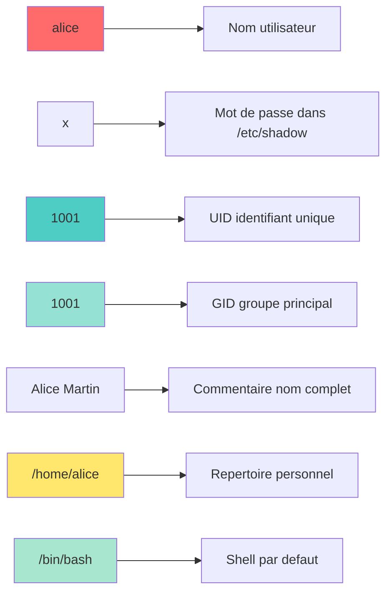
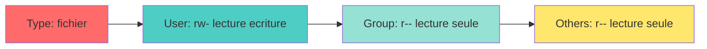

<a name="gestion-systeme-utilisateurs" id="gestion-systeme-utilisateurs"></a>

# 👥 Module 4
## Gestion du système et des utilisateurs

### Maîtriser les comptes, groupes et permissions

---

# Pourquoi gérer les utilisateurs ? 👥

**Unix/Linux est multi-utilisateurs par conception**

Imaginez un immeuble :
- Chaque locataire (utilisateur) a sa clé (mot de passe)
- Chacun a son appartement (home directory)
- Certaines zones sont communes (dossiers partagés)
- Le gardien (root) a accès à tout

**Objectifs :**
- Sécurité : qui peut faire quoi ?
- Isolation : chacun ses données
- Organisation : groupes de travail

---

# L'utilisateur root : le super-admin 👑

**root** : l'utilisateur tout-puissant (UID 0)

**Pouvoirs :**
- Accès à tous les fichiers
- Modification de toute configuration
- Installation de logiciels
- Gestion des utilisateurs
- Redémarrage, arrêt du système

**⚠️ Avec de grands pouvoirs viennent de grandes responsabilités**

```bash
# Danger ! Peut détruire le système
rm -rf /
```

---

# Ne jamais travailler en root ! 🚨

**Pourquoi ?**

1. **Erreur humaine** : une faute de frappe peut être fatale
2. **Sécurité** : un malware aurait tous les droits
3. **Audit** : difficile de tracer qui a fait quoi
4. **Bonnes pratiques** : utiliser `sudo` pour les tâches admin

**Analogie :**
Utiliser root en permanence, c'est comme conduire une voiture de sport à 200 km/h en ville : possible, mais dangereux !

---

# Les fichiers d'authentification 📄

**Fichiers clés du système :**

`/etc/passwd` : informations des utilisateurs

```
alice:x:1001:1001:Alice Martin:/home/alice:/bin/bash
bob:x:1002:1002:Bob Dupont:/home/bob:/bin/bash
```

Format : `username:x:UID:GID:comment:home:shell`

---

# Décryptage de /etc/passwd 🔍

**Format :** `alice:x:1001:1001:Alice Martin:/home/alice:/bin/bash`



**UID remarquables :**
- 0 : root
- 1-999 : comptes système
- 1000+ : utilisateurs normaux

---

# Le fichier /etc/shadow 🔒

Contient les mots de passe chiffrés (accessible uniquement par root)

```
alice:$6$rounds=5000$salt$hashedpassword:19000:0:99999:7:::
```

**Format :**

```
username:password_hash:last_change:min:max:warn:inactive:expire
```

**Paramètres :**
- `last_change` : jours depuis 1970 du dernier changement
- `min` : jours minimum entre changements
- `max` : jours maximum avant expiration
- `warn` : jours d'avertissement avant expiration

---

# Le fichier /etc/group 👥

Définit les groupes et leurs membres

```
users:x:100:
developers:x:1010:alice,bob,charlie
admins:x:1020:alice
docker:x:999:alice,bob
```

**Format :** `group_name:x:GID:member_list`

**Pourquoi des groupes ?**
- Simplifier la gestion des permissions
- Organiser les utilisateurs par projet/département
- Partager l'accès à des ressources

---

# Créer un utilisateur : useradd 🆕

```bash
# Méthode simple
sudo useradd alice

# Méthode complète
sudo useradd -m -s /bin/bash -c "Alice Martin" -G sudo,developers alice

# Options importantes :
# -m : créer le home directory
# -s : définir le shell
# -c : commentaire (nom complet)
# -G : groupes supplémentaires
# -d : spécifier le home directory
# -u : spécifier l'UID
```

---

# Créer un utilisateur : adduser 🆕

**Alternative interactive (Debian/Ubuntu) :**

```bash
sudo adduser alice
```

Cette commande :
- Crée l'utilisateur
- Crée le home directory
- Demande le mot de passe
- Demande les informations (nom, téléphone, etc.)
- Configure les permissions

**Plus simple pour les débutants !**

---

# Définir un mot de passe 🔑

```bash
# Définir le mot de passe d'un utilisateur
sudo passwd alice

# Changer son propre mot de passe
passwd

# Forcer le changement au prochain login
sudo passwd -e alice

# Verrouiller un compte
sudo passwd -l alice

# Déverrouiller un compte
sudo passwd -u alice
```

---

# Politique de mot de passe fort 💪

**Bonnes pratiques :**

✅ Au moins 12 caractères

✅ Mélange majuscules/minuscules

✅ Chiffres et caractères spéciaux

✅ Pas de mots du dictionnaire

✅ Pas d'informations personnelles

**Outils :**

```bash
# Générer un mot de passe aléatoire
pwgen 16 1

# Ou avec openssl
openssl rand -base64 16
```

---

# Modifier un utilisateur : usermod 🔧

```bash
# Changer le shell
sudo usermod -s /bin/zsh alice

# Changer le home directory
sudo usermod -d /home/newdir alice

# Ajouter à des groupes supplémentaires
sudo usermod -aG docker,sudo alice

# Changer l'UID
sudo usermod -u 2000 alice

# Changer le nom d'utilisateur
sudo usermod -l newalice alice

# Verrouiller le compte
sudo usermod -L alice

# Déverrouiller
sudo usermod -U alice
```

---

# ⚠️ Option -aG vs -G

**Différence CRITIQUE :**

```bash
# MAUVAIS : remplace TOUS les groupes
sudo usermod -G docker alice
# → alice n'est plus que dans 'docker'

# BON : ajoute aux groupes existants
sudo usermod -aG docker alice
# → alice garde ses groupes ET gagne 'docker'
```

**Pensez-y comme :**
- `-G` : réinitialiser la liste
- `-aG` : ajouter (append)

---

# Supprimer un utilisateur : userdel 🗑️

```bash
# Supprimer seulement le compte
sudo userdel alice

# Supprimer le compte ET le home directory
sudo userdel -r alice

# Vérifier avant de supprimer
ls -la /home/alice
ps -u alice  # Vérifier si des processus tournent
```

**⚠️ Attention :**
- Les fichiers appartenant à l'utilisateur ailleurs restent
- Les processus en cours doivent être arrêtés

---

# Gérer les groupes 👥

**Créer un groupe :**

```bash
sudo groupadd developers
sudo groupadd -g 2000 project_team  # Avec GID spécifique
```

**Modifier un groupe :**

```bash
sudo groupmod -n newname oldname     # Renommer
sudo groupmod -g 3000 developers     # Changer GID
```

**Supprimer un groupe :**

```bash
sudo groupdel developers
```

---

# Gérer l'appartenance aux groupes 🎫

```bash
# Ajouter un utilisateur à un groupe
sudo usermod -aG developers alice
sudo gpasswd -a alice developers     # Alternative

# Retirer un utilisateur d'un groupe
sudo gpasswd -d alice developers

# Lister les groupes d'un utilisateur
groups alice
id alice

# Changer temporairement de groupe principal
newgrp developers
```

---

# Groupes primaires vs secondaires 🔀

**Groupe primaire (primary group) :**
- Un seul par utilisateur
- Défini dans `/etc/passwd`
- Les nouveaux fichiers créés lui appartiennent

**Groupes secondaires (supplementary groups) :**
- Multiples possibles
- Listés dans `/etc/group`
- Donnent des accès supplémentaires

```bash
id alice
# uid=1001(alice) gid=1001(alice) groups=1001(alice),27(sudo),999(docker)
#                     ↑ primaire          ↑ secondaires
```

---

# Permissions Unix : les bases 🔐

**3 types d'actions :**
- **r** (read) : lire
- **w** (write) : écrire
- **x** (execute) : exécuter

**3 catégories d'utilisateurs :**
- **u** (user) : propriétaire
- **g** (group) : groupe
- **o** (others) : autres

**Exemple :** `-rw-r--r--  1 alice  developers  1024 Jan 10 10:30 fichier.txt`



---

# Permissions en notation octale 🔢

**Chaque trio = un chiffre :**

```
r (4) + w (2) + x (1) = 7
r (4) + w (2)         = 6
r (4)         + x (1) = 5
r (4)                 = 4
        w (2) + x (1) = 3
        w (2)         = 2
                x (1) = 1
                      = 0
```

**Exemples courants :**
- `644` : rw-r--r-- (fichier texte)
- `755` : rwxr-xr-x (script exécutable)
- `700` : rwx------ (fichier privé)
- `777` : rwxrwxrwx (tout le monde peut tout faire - DANGEREUX)

---

# Changer les permissions : chmod 🔧

**Notation symbolique :**

```bash
chmod u+x script.sh          # Ajouter exécution pour user
chmod g-w fichier.txt        # Retirer écriture pour group
chmod o-r secret.txt         # Retirer lecture pour others
chmod a+r public.txt         # Ajouter lecture pour all
chmod u=rwx,g=rx,o=r file    # Définir explicitement
```

---

# Changer les permissions : chmod (suite) 🔧

**Notation octale :**

```bash
chmod 644 fichier.txt        # rw-r--r--
chmod 755 script.sh          # rwxr-xr-x
chmod 700 private.txt        # rwx------
chmod 600 ~/.ssh/id_rsa      # rw------- (clé SSH privée)
```

**Récursif :**

```bash
chmod -R 755 /var/www/html   # Applique à tous les fichiers
```

---

# Permissions sur les répertoires 📁

**Particularités des répertoires :**

- **r** : lister le contenu (ls)
- **w** : créer/supprimer des fichiers dedans
- **x** : traverser (cd) le répertoire

**Exemple pratique :**

```bash
# Répertoire accessible mais non listable
chmod 711 /home/alice/secret
# → On peut aller dedans si on connaît le nom,
#   mais on ne peut pas lister son contenu
```

---

# Changer propriétaire et groupe : chown/chgrp 👤

```bash
# Changer le propriétaire
sudo chown alice fichier.txt

# Changer propriétaire et groupe
sudo chown alice:developers fichier.txt

# Seulement le groupe
sudo chgrp developers fichier.txt

# Récursif
sudo chown -R alice:developers /projet

# Préserver le groupe actuel avec :
sudo chown alice: fichier.txt
```

---

# umask : permissions par défaut 🎭

**umask** : masque qui définit les permissions des nouveaux fichiers

**Analogie : le tampon par défaut d'une imprimante** 🖨️

Imaginez que umask est comme les paramètres par défaut de votre imprimante :
- Sans umask : tout le monde peut tout faire (666 pour fichiers)
- Avec umask 0022 : on retire certains droits par défaut (autres ne peuvent pas écrire)

```bash
# Voir le umask actuel
umask
# Résultat : 0022

# Calcul :
# Fichiers : 666 - umask = permissions
# 666 - 022 = 644 (rw-r--r--)

# Répertoires : 777 - umask = permissions
# 777 - 022 = 755 (rwxr-xr-x)
```

**Exemple pratique :**

```bash
# Tester le umask
touch test1.txt
ls -l test1.txt
# -rw-r--r--  (644)

# Changer le umask
umask 0077
touch test2.txt
ls -l test2.txt
# -rw-------  (600)  → Fichier privé !
```

---

# Modifier le umask 🎨

```bash
# Temporaire (session actuelle)
umask 0027
# Nouveaux fichiers : 640 (rw-r-----)
# Nouveaux répertoires : 750 (rwxr-x---)

# Permanent (dans ~/.bashrc)
echo "umask 0027" >> ~/.bashrc
source ~/.bashrc

# umask typiques :
# 0022 : par défaut (permissif)
# 0027 : plus restrictif
# 0077 : très restrictif (fichiers privés)
```

---

# sudo : exécuter en tant que root 🔑

**sudo** : "**S**uper**U**ser **DO**"

```bash
# Exécuter une commande en root
sudo apt update

# Ouvrir un shell root (déconseillé)
sudo -i
sudo -s

# Exécuter en tant qu'un autre utilisateur
sudo -u alice commande

# Éditer un fichier système (safe)
sudo visudo              # Édite /etc/sudoers
sudoedit /etc/hosts      # Édite de façon sécurisée
```

---

# Configurer sudo : /etc/sudoers ⚙️

**⚠️ TOUJOURS utiliser `visudo` pour éditer `/etc/sudoers`**

```bash
sudo visudo
```

**Exemples de configuration :**

```
# Donner tous les droits
alice ALL=(ALL:ALL) ALL

# Sans demander le mot de passe (DANGEREUX)
alice ALL=(ALL) NOPASSWD: ALL

# Seulement certaines commandes
bob ALL=(ALL) /usr/bin/apt, /bin/mkdir

# Groupe sudo peut tout faire
%sudo ALL=(ALL:ALL) ALL
```

---

# Format de la configuration sudo 📝

```
utilisateur HOSTS=(RUN_AS) COMMANDES
```

**Exemples détaillés :**

```
# Alice peut gérer les fichiers système
alice ALL=(ALL) /bin/mkdir, /bin/cp, /bin/mv

# Bob peut installer des paquets
bob ALL=(ALL) /usr/bin/apt install *

# Groupe ops peut tout, sans password
%ops ALL=(ALL) NOPASSWD: ALL

# Charlie peut exécuter des commandes en tant qu'alice
charlie ALL=(alice) ALL
```

---

# Groupes système importants 🎖️

**sudo/wheel** : administration système
- Peut utiliser sudo

**docker** : utiliser Docker sans sudo
- Accès au socket Docker

**www-data** : serveur web
- Propriétaire des fichiers web

**systemd-journal** : lire les logs systemd

**adm** : lire les logs dans /var/log

---

# Quotas disque : pourquoi ? 💾

**Problème :**
Un utilisateur remplit le disque → tout le système crashe

**Solution : les quotas**
- Limiter l'espace disque par utilisateur/groupe
- Limiter le nombre de fichiers (inodes)

**Analogie : le forfait mobile** 📱

- **Sans quota** : utilisation illimitée → un utilisateur peut tout consommer
- **Avec quota** : chacun a son forfait (10 Go par exemple)
- **Soft limit** : avertissement à 8 Go (tu vas bientôt dépasser)
- **Hard limit** : blocage à 10 Go (c'est fini, tu ne peux plus rien télécharger)

**Exemple concret :**

Imaginez une entreprise avec 100 employés et un serveur de 1 To :
- Sans quotas : un employé peut stocker 500 Go de vidéos personnelles
- Avec quotas : chacun a droit à 8 Go → espace équitablement réparti

---

# Activer les quotas 📊

**1. Installer les outils :**

```bash
sudo apt install quota quotatool    # Debian/Ubuntu
sudo dnf install quota              # RHEL/Fedora
```

---

# Activer les quotas (suite) 📊

**2. Modifier /etc/fstab :**

```bash
sudo nano /etc/fstab
```

Ajouter `usrquota,grpquota` :

```
/dev/sda1 / ext4 defaults,usrquota,grpquota 0 1
```

---

# Activer les quotas (suite) 📊

**3. Remonter et initialiser :**

```bash
sudo mount -o remount /
sudo quotacheck -cugm /
sudo quotaon /
```

---

# Définir des quotas 📏

```bash
# Éditer les quotas d'un utilisateur
sudo edquota alice

# Interface interactive :
# Disk quotas for user alice (uid 1001):
#   Filesystem  blocks   soft   hard  inodes  soft  hard
#   /dev/sda1      100   5000  10000      50   500  1000

# blocks : kilo-octets utilisés
# soft : avertissement
# hard : limite absolue
```

---

# Quotas : soft vs hard 🎚️

**Soft limit (souple) :**
- Peut être dépassé temporairement
- Période de grâce (grace period) : 7 jours par défaut
- Avertissement à l'utilisateur

**Hard limit (dure) :**
- Ne peut JAMAIS être dépassé
- Écriture refusée immédiatement

**Analogie :**
- Soft = "Tu as presque fini tes 50 Go, supprime des trucs"
- Hard = "C'est fini, tu ne peux plus rien ajouter"

---

# Gérer les quotas en ligne de commande 💻

```bash
# Définir un quota directement
sudo setquota -u alice 1000000 2000000 0 0 /

# Vérifier les quotas d'un utilisateur
sudo quota -u alice

# Voir un rapport de tous les utilisateurs
sudo repquota -a

# Désactiver les quotas
sudo quotaoff /

# Réactiver
sudo quotaon /
```

---

# Structure détaillée du système de fichiers 📂

**Rappel des principaux répertoires :**

`/bin` : binaires essentiels (ls, cat, cp, bash)
`/sbin` : binaires système (fsck, reboot)
`/usr/bin` : programmes utilisateur
`/usr/sbin` : programmes admin

**Note moderne :** sur beaucoup de distributions, `/bin`, `/sbin`, `/lib` sont des liens symboliques vers `/usr/bin`, `/usr/sbin`, `/usr/lib`

---

# /etc : configuration 📋

**Fichiers de configuration système**

```
/etc/
├── passwd              # Utilisateurs
├── shadow              # Mots de passe
├── group               # Groupes
├── sudoers             # Configuration sudo
├── fstab               # Montages automatiques
├── hostname            # Nom de la machine
├── hosts               # Résolution de noms locale
├── resolv.conf         # Serveurs DNS
├── network/            # Configuration réseau
├── ssh/                # Configuration SSH
├── systemd/            # Configuration systemd
└── apt/                # Configuration apt (Debian/Ubuntu)
```

---

# /var : données variables 📈

**Fichiers qui changent fréquemment**

```
/var/
├── log/                # Logs système et applications
│   ├── syslog
│   ├── auth.log
│   └── kern.log
├── cache/              # Caches d'applications
├── tmp/                # Fichiers temporaires (persistants)
├── spool/              # Files d'attente (impression, mail)
├── lib/                # Données d'état (bases de données)
└── www/                # Données du serveur web
```

---

# /home : répertoires utilisateurs 🏠

**Chaque utilisateur a son espace :**

```
/home/
├── alice/
│   ├── Documents/
│   ├── Downloads/
│   ├── .bashrc         # Configuration bash
│   ├── .ssh/           # Clés SSH
│   └── .config/        # Configs d'applications
└── bob/
    └── ...
```

**Fichiers cachés (commençant par `.`) :**
- Configuration personnelle
- Non affichés par `ls` (mais visibles avec `ls -a`)

---

# /tmp et /var/tmp : temporaires ⏱️

**/tmp :**
- Effacé à chaque redémarrage
- Accessible à tous (sticky bit)
- Utiliser pour fichiers très temporaires

**/var/tmp :**
- Persistant entre redémarrages
- Nettoyé périodiquement (selon config)

```bash
# Créer un fichier temporaire
mktemp
# → /tmp/tmp.xYz123abc

# Créer un répertoire temporaire
mktemp -d
```

---

# /proc : système de fichiers virtuel 🌐

**Interface virtuelle avec le noyau**

```bash
cat /proc/cpuinfo       # Informations CPU
cat /proc/meminfo       # Informations mémoire
cat /proc/version       # Version du noyau
cat /proc/uptime        # Temps depuis démarrage
cat /proc/loadavg       # Charge système

# Informations d'un processus
cat /proc/1234/cmdline  # Commande du PID 1234
cat /proc/1234/status   # État du processus
```

**Aucun fichier réel sur le disque !** Tout est généré à la volée.

---

# /sys : autre système virtuel ⚡

**Interface avec les périphériques et pilotes**

```bash
# Luminosité de l'écran
cat /sys/class/backlight/*/brightness

# Température CPU
cat /sys/class/thermal/thermal_zone*/temp

# État de la batterie
cat /sys/class/power_supply/BAT0/capacity
```

**Utile pour scripts d'automatisation et monitoring**

---

# Bonnes pratiques de gestion des utilisateurs ✅

1. **Ne jamais travailler en root directement**
   - Toujours utiliser sudo

2. **Principes du moindre privilège**
   - Donner uniquement les droits nécessaires

3. **Groupes plutôt qu'utilisateurs individuels**
   - Plus facile à gérer

4. **Désactiver les comptes inutilisés**
   - `sudo usermod -L ancien_user`

---

# Bonnes pratiques de gestion des utilisateurs (suite) ✅

5. **Auditer régulièrement**

```bash
# Qui s'est connecté récemment ?
last

# Qui est connecté maintenant ?
who
w

# Historique des commandes sudo
sudo cat /var/log/auth.log | grep sudo
```

6. **Politique de mots de passe forte**
   - Expiration, complexité, longueur

---

# Outils de monitoring des utilisateurs 📊

```bash
# Connexions récentes
last -10

# Échecs de connexion
lastb

# Utilisateurs connectés
who
w

# Depuis combien de temps un user est inactif
w

# Historique des connexions d'un user
last alice

# Lister tous les utilisateurs réels
awk -F: '$3>=1000 {print $1}' /etc/passwd
```

---

# Sécuriser l'accès root 🔒

**Désactiver la connexion root directe :**

```bash
# Dans /etc/ssh/sshd_config
sudo nano /etc/ssh/sshd_config

# Modifier cette ligne :
PermitRootLogin no

# Redémarrer SSH
sudo systemctl restart sshd
```

**Forcer l'usage de sudo :**
- Traçabilité (qui a fait quoi)
- Double authentification (password user + sudo)
- Limitations par commande possibles

---

# Récapitulatif du Module 4 ✅

**Ce que vous avez appris :**

✅ Gestion des utilisateurs (useradd, usermod, userdel)

✅ Gestion des groupes (groupadd, groupmod, gpasswd)

✅ Fichiers /etc/passwd, /etc/shadow, /etc/group

✅ Permissions Unix (chmod, chown, umask)

✅ Sudo et élévation de privilèges

✅ Quotas disque

✅ Structure détaillée du système de fichiers

✅ Bonnes pratiques de sécurité

---

# Prochaine étape 🎯

**Module 5 : Stockage et système de fichiers**

- Disques et partitions (fdisk, parted)
- Systèmes de fichiers (ext4, xfs, btrfs)
- Signaux Unix
- systemd et gestion des services
- Démarrage et arrêt du système
- Logs et journalctl

---
layout: default
---

# Questions ? 🤔

N'hésitez pas à poser vos questions maintenant !

Le prochain module explorera en profondeur la gestion des processus et des services système.

