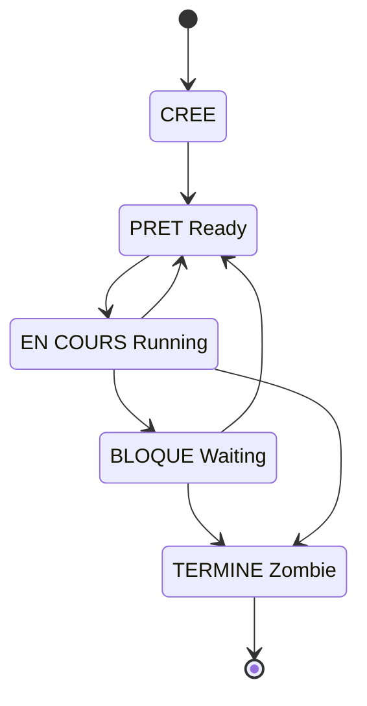
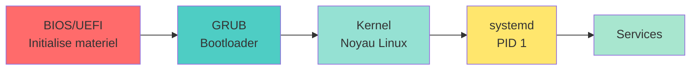

<a name="processus-services" id="processus-services"></a>

# 💾 Module 3
## Gestion des processus et des services

### Maîtriser l'exécution et les services système

---

# Qu'est-ce qu'un processus ? 🏃

**Un processus** = un programme en cours d'exécution

**Analogie : les tâches dans une entreprise** 🏢

- **Programme** = manuel de procédure (sur l'étagère)
- **Processus** = employé qui suit le manuel (en action)
- **PID** = badge de l'employé (numéro unique)
- **Mémoire** = bureau de l'employé
- **CPU** = temps de parole en réunion

Un même programme peut avoir plusieurs processus (plusieurs employés suivent le même manuel)

---

# Le PID : Process ID 🆔

**PID** : identifiant unique d'un processus

```bash
# Voir les processus en cours
ps

# Afficher avec les PID
ps aux

# PID 1 : le processus init (systemd)
ps -p 1
```

**Caractéristiques :**
- Numéro unique attribué à la création
- Commence à 1 (init/systemd)
- Réutilisé après la terminaison du processus
- Maximum : 32768 par défaut (configurable)

---

# PPID : Parent Process ID 👨‍👦

**Chaque processus a un parent**

```bash
# Voir PID et PPID
ps -ef

# Arbre des processus
pstree

# Détails d'un processus
ps -fp 1234
```

**Hiérarchie :**
- Tous les processus descendent de PID 1 (systemd/init)
- Si un parent meurt, les enfants sont adoptés par init
- Les processus zombies : enfants non récupérés par le parent

---

# Anatomie d'un processus 🧬

**Composants d'un processus :**

1. **Code** : instructions du programme
2. **Données** : variables globales
3. **Pile (stack)** : variables locales, appels de fonctions
4. **Tas (heap)** : allocation dynamique
5. **Descripteurs de fichiers** : fichiers ouverts, sockets
6. **Registres CPU** : état du processeur
7. **PID, PPID, UID, GID** : identifiants

---

# États d'un processus 🔄



---

# Les états en détail 📊

**Running (R)** : en cours d'exécution sur un CPU

**Sleeping :**
- **Interruptible (S)** : en attente, peut être réveillé par un signal
- **Uninterruptible (D)** : en attente d'I/O, ne peut pas être interrompu

**Stopped (T)** : arrêté temporairement (Ctrl+Z)

**Zombie (Z)** : terminé, mais le parent n'a pas récupéré le code de sortie

**Idle (I)** : inactif (threads kernel)

---

# Voir les processus : ps 🔍

```bash
# Processus de votre session
ps

# Tous les processus (format BSD)
ps aux

# Tous les processus (format System V)
ps -ef

# Processus d'un utilisateur
ps -u alice

# Processus avec un nom spécifique
ps aux | grep nginx
```

---

# Format de sortie de ps aux 📋

```bash
ps aux
```

```
USER       PID  %CPU %MEM    VSZ   RSS TTY   STAT START   TIME COMMAND
root         1   0.0  0.1 169316 11704 ?     Ss   10:00   0:02 /sbin/init
alice     1234   0.5  2.3 423680 94532 ?     Sl   10:15   1:23 firefox
bob       5678   0.0  0.1  12456  4532 pts/0 R+   14:23   0:00 ps aux
```

**Colonnes importantes :**
- `USER` : utilisateur propriétaire
- `PID` : Process ID
- `%CPU` : utilisation CPU
- `%MEM` : utilisation mémoire
- `STAT` : état du processus
- `COMMAND` : commande exécutée

---

# Les codes STAT déchiffrés 🔐

**Codes principaux :**
- `R` : Running (en cours)
- `S` : Sleeping (sommeil interruptible)
- `D` : Disk sleep (sommeil non interruptible)
- `T` : Stopped (arrêté)
- `Z` : Zombie

**Modificateurs :**
- `<` : haute priorité
- `N` : basse priorité
- `+` : au premier plan (foreground)
- `s` : leader de session
- `l` : multi-threadé

---

# Voir les processus en temps réel : top ⏱️

```bash
top
```

**Interface interactive :**
- `q` : quitter
- `h` : aide
- `k` : tuer un processus
- `r` : changer la priorité (renice)
- `M` : trier par mémoire
- `P` : trier par CPU
- `u` : filtrer par utilisateur
- `1` : afficher tous les CPU

---

# Alternative moderne : htop 🎨

```bash
# Installer htop
sudo apt install htop         # Debian/Ubuntu
sudo dnf install htop         # RHEL/Fedora

# Lancer
htop
```

**Avantages :**
- Interface colorée
- Navigation intuitive (flèches, F-keys)
- Arbre des processus
- Recherche facile
- Kill/renice intuitif

---

# Trouver un processus : pgrep 🔎

```bash
# Trouver le PID d'un processus par nom
pgrep nginx
# → 1234

# Avec détails
pgrep -l nginx
# → 1234 nginx

# Processus d'un utilisateur
pgrep -u alice

# Premier match uniquement
pgrep -n firefox

# Dernier match uniquement
pgrep -o firefox
```

---

# Signaux Unix : communiquer avec les processus 📡

**Un signal** = message envoyé à un processus

**Analogie :** comme donner des ordres à un employé
- "Fais une pause" (SIGSTOP)
- "Reprends le travail" (SIGCONT)
- "Quitte proprement" (SIGTERM)
- "Quitte immédiatement !" (SIGKILL)

```bash
# Envoyer un signal
kill -SIGNAL PID
```

---

# Signaux courants 🚦

**SIGTERM (15)** : terminaison propre (par défaut)
- Le processus peut nettoyer avant de quitter
- Enregistrer des données, fermer des fichiers

**SIGKILL (9)** : terminaison immédiate
- Le processus est tué de force
- Pas de nettoyage possible
- Utilisez en dernier recours !

**SIGHUP (1)** : rechargement de configuration
- "Hang up" - historiquement : déconnexion du terminal
- Souvent utilisé pour recharger la config

**SIGINT (2)** : interruption (Ctrl+C)

**SIGSTOP (19)** : pause (Ctrl+Z)

**SIGCONT (18)** : reprise après pause

---

# Utiliser kill 🔫

```bash
# Terminaison propre (SIGTERM)
kill 1234
kill -15 1234
kill -TERM 1234

# Terminaison forcée (SIGKILL)
kill -9 1234
kill -KILL 1234

# Rechargement de config
kill -HUP 1234

# Lister tous les signaux disponibles
kill -l
```

---

# killall et pkill 🎯

```bash
# Tuer tous les processus avec un nom
killall firefox

# Tuer par motif
pkill -f "python.*script.py"

# Tuer les processus d'un utilisateur
pkill -u alice

# Avec un signal spécifique
killall -9 nginx
pkill -TERM firefox
```

**⚠️ Attention :** `killall` sur certains Unix (Solaris) tue TOUS les processus !

---

# Priorité des processus : nice 🎚️

**Nice value** : priorité d'un processus (-20 à +19)

- **-20** : priorité maximale (réservé root)
- **0** : priorité par défaut
- **+19** : priorité minimale

**Analogie :** la file d'attente au restaurant
- VIP (-20) : servi en premier
- Client normal (0) : dans l'ordre
- Pas pressé (+19) : attendra longtemps

**Plus le nice est élevé, plus le processus est "gentil" en laissant les autres passer**

---

# Lancer un processus avec nice 🚀

```bash
# Lancer avec nice +10 (basse priorité)
nice -n 10 ./mon_script.sh

# Lancer avec nice -10 (haute priorité, root requis)
sudo nice -n -10 ./processus_important.sh

# Lancer en arrière-plan avec nice
nice -n 15 ./backup.sh &
```

---

# Changer la priorité : renice 🔧

```bash
# Changer le nice d'un processus existant
renice 10 -p 1234

# Pour tous les processus d'un utilisateur
renice 15 -u alice

# Diminuer le nice (augmenter priorité) - root requis
sudo renice -5 -p 1234

# Dans htop : appuyez sur F7/F8 pour changer
```

---

# Premier plan / Arrière-plan 🎭

```bash
# Lancer en arrière-plan
./long_script.sh &

# Voir les jobs en cours
jobs
# [1]  Running    ./long_script.sh &
# [2]- Running    ./autre.sh &
# [3]+ Stopped    nano fichier.txt

# Mettre en avant-plan
fg %1               # Job numéro 1
fg                  # Dernier job (+)

# Mettre en arrière-plan
bg %2
```

---

# Suspendre et reprendre ⏸️▶️

```bash
# Lancer un programme
nano fichier.txt

# Suspendre (Ctrl+Z)
^Z
[1]+  Stopped    nano fichier.txt

# Reprendre en arrière-plan
bg

# Reprendre en avant-plan
fg

# Tuer un job
kill %1
```

---

# nohup : processus persistant 🛡️

**nohup** : "no hang up" - continue après déconnexion

```bash
# Lancer un processus qui survit à la déconnexion
nohup ./long_script.sh &

# Sortie redirigée vers nohup.out
nohup ./script.sh > output.log 2>&1 &

# Vérifier
cat nohup.out
```

**Cas d'usage :**
- Scripts qui tournent longtemps
- Connexion SSH instable
- Lancement de services manuellement

---

# screen et tmux : multiplexeurs de terminal 📺

**Outils pour gérer plusieurs sessions terminales**

**screen** : classique et simple

```bash
# Installer
sudo apt install screen

# Nouvelle session
screen

# Détacher (Ctrl+A puis D)
# Lister les sessions
screen -ls

# Rattacher
screen -r

# Nouvelle fenêtre : Ctrl+A puis C
# Naviguer : Ctrl+A puis N (next) ou P (previous)
```

---

# tmux : alternative moderne 🚀

```bash
# Installer
sudo apt install tmux

# Nouvelle session
tmux

# Détacher (Ctrl+B puis D)
# Lister les sessions
tmux ls

# Rattacher
tmux attach

# Nouvelle fenêtre : Ctrl+B puis C
# Split vertical : Ctrl+B puis %
# Split horizontal : Ctrl+B puis "
# Naviguer : Ctrl+B puis flèches
```

---

# Qu'est-ce qu'un service ? 🎪

**Service (ou daemon)** : programme qui tourne en arrière-plan

**Analogie : le personnel invisible d'un hôtel** 🏨
- **Service web (nginx)** : réceptionniste (accueille les visiteurs)
- **Service SSH** : portier (gère l'accès sécurisé)
- **Service cron** : femme de ménage (tâches planifiées)
- **Service de log** : comptable (note tout ce qui se passe)

**Caractéristiques :**
- Démarrent au boot
- Pas d'interface utilisateur directe
- Fournissent des fonctionnalités système

---

# systemd : le gestionnaire de services moderne 🎛️

**systemd** : système d'init et gestionnaire de services (depuis ~2010)

**Responsabilités :**
1. **Premier processus** (PID 1)
2. Démarrer les services au boot
3. Gérer les dépendances entre services
4. Superviser les services (redémarrage automatique)
5. Gérer les logs (journald)
6. Gérer les timers (remplace cron)

**Remplace** : SysVinit, Upstart

---

# systemctl : contrôler les services 🎮

```bash
# Démarrer un service
sudo systemctl start nginx

# Arrêter un service
sudo systemctl stop nginx

# Redémarrer un service
sudo systemctl restart nginx

# Recharger la config (sans redémarrer)
sudo systemctl reload nginx

# Redémarrer ou recharger (intelligent)
sudo systemctl reload-or-restart nginx
```

---

# systemctl : état des services 📊

```bash
# Voir l'état d'un service
systemctl status nginx

# Vérifier si actif
systemctl is-active nginx

# Vérifier si activé au démarrage
systemctl is-enabled nginx

# Lister tous les services
systemctl list-units --type=service

# Lister les services qui ont échoué
systemctl --failed
```

---

# Exemple de sortie systemctl status 📋

```bash
systemctl status nginx
```

```
● nginx.service - A high performance web server
     Loaded: loaded (/lib/systemd/system/nginx.service; enabled; vendor preset: enabled)
     Active: active (running) since Mon 2025-11-06 10:00:00 CET; 2h 30min ago
       Docs: man:nginx(8)
   Main PID: 1234 (nginx)
      Tasks: 5 (limit: 4915)
     Memory: 12.5M
        CPU: 1.234s
     CGroup: /system.slice/nginx.service
             ├─1234 nginx: master process /usr/sbin/nginx
             └─1235 nginx: worker process

Nov 06 10:00:00 hostname systemd[1]: Starting A high performance web server...
Nov 06 10:00:00 hostname systemd[1]: Started A high performance web server.
```

---

# Activer/désactiver au démarrage 🔌

```bash
# Activer un service au démarrage
sudo systemctl enable nginx

# Désactiver
sudo systemctl disable nginx

# Activer et démarrer en une commande
sudo systemctl enable --now nginx

# Désactiver et arrêter
sudo systemctl disable --now nginx

# Masquer un service (empêcher tout démarrage)
sudo systemctl mask nginx

# Démasquer
sudo systemctl unmask nginx
```

---

# Dépendances de services 🔗

**Les services dépendent les uns des autres**

```bash
# Voir les dépendances d'un service
systemctl list-dependencies nginx

# Voir qui dépend de ce service
systemctl list-dependencies nginx --reverse

# Voir uniquement les services (pas targets, etc.)
systemctl list-dependencies nginx --plain
```

**Exemple :** nginx dépend de network.target

---

# Units systemd 📦

**systemd gère plusieurs types d'unités :**

- **`.service`** : services
- **`.target`** : groupes de services (comme les runlevels)
- **`.socket`** : sockets réseau/IPC
- **`.timer`** : tâches planifiées (comme cron)
- **`.mount`** : points de montage
- **`.device`** : périphériques
- **`.path`** : surveillance de fichiers/répertoires

```bash
# Lister tous les types d'unités
systemctl list-units --all
```

---

# Créer un service systemd custom 🛠️

**Fichier : `/etc/systemd/system/mon-service.service`**

```ini
[Unit]
Description=Mon service personnalisé
After=network.target

[Service]
Type=simple
User=alice
WorkingDirectory=/opt/mon-app
ExecStart=/usr/bin/python3 /opt/mon-app/server.py
Restart=on-failure
RestartSec=5s

[Install]
WantedBy=multi-user.target
```

---

# Créer un service systemd (suite) 🛠️

```bash
# Recharger systemd après création/modification
sudo systemctl daemon-reload

# Activer le service
sudo systemctl enable mon-service

# Démarrer le service
sudo systemctl start mon-service

# Vérifier l'état
systemctl status mon-service
```

---

# Types de services systemd 🎭

**Type=simple** : processus principal (par défaut)

**Type=forking** : processus qui fork (comme les daemons traditionnels)

**Type=oneshot** : s'exécute une fois et se termine

**Type=notify** : le service notifie systemd quand il est prêt

**Type=idle** : attend que tous les autres services soient démarrés

---

# Redémarrage automatique 🔄

```ini
[Service]
Restart=always           # Toujours redémarrer
Restart=on-failure       # Seulement en cas d'échec
Restart=on-abnormal      # Seulement si terminaison anormale
Restart=on-abort         # Seulement si signal d'arrêt
Restart=on-watchdog      # Seulement si watchdog timeout

RestartSec=5s            # Attendre 5s avant de redémarrer
StartLimitBurst=3        # Max 3 redémarrages
StartLimitIntervalSec=60 # Dans une fenêtre de 60s
```

---

# Targets systemd : les "runlevels" 🎯

**Targets** : groupes de services (équivalent des runlevels)

**Targets principaux :**

- `poweroff.target` : arrêt
- `rescue.target` : mode rescue (single-user)
- `multi-user.target` : multi-utilisateurs, pas de GUI
- `graphical.target` : multi-utilisateurs avec GUI
- `reboot.target` : redémarrage

```bash
# Target actuel
systemctl get-default

# Changer le target par défaut
sudo systemctl set-default multi-user.target
```

---

# Changer de target (runlevel) 🔀

```bash
# Passer en mode rescue
sudo systemctl isolate rescue.target

# Passer en mode multi-user
sudo systemctl isolate multi-user.target

# Passer en mode graphique
sudo systemctl isolate graphical.target

# Équivalents traditionnels :
# init 1 → systemctl isolate rescue.target
# init 3 → systemctl isolate multi-user.target
# init 5 → systemctl isolate graphical.target
```

---

# Le démarrage du système 🚀

**Séquence de boot :**

1. **BIOS/UEFI** : initialise le matériel
2. **Bootloader (GRUB)** : charge le noyau
3. **Noyau Linux** : initialise les périphériques
4. **systemd (PID 1)** : lance les services



---

# Analyser le temps de démarrage ⏱️

```bash
# Temps total de démarrage
systemd-analyze

# Temps par service
systemd-analyze blame

# Chaîne critique
systemd-analyze critical-chain

# Graphique (génère un SVG)
systemd-analyze plot > boot.svg
```

---

# Logs système : journald 📜

**journalctl** : voir les logs systemd

```bash
# Tous les logs
journalctl

# Logs depuis le dernier boot
journalctl -b

# Logs d'un service
journalctl -u nginx

# Suivre en temps réel
journalctl -f

# Suivre un service
journalctl -u nginx -f
```

---

# journalctl : filtres avancés 🔍

```bash
# Depuis une heure
journalctl --since "1 hour ago"

# Depuis une date
journalctl --since "2025-11-01"

# Période
journalctl --since "2025-11-01" --until "2025-11-02"

# Par utilisateur
journalctl _UID=1000

# Par priorité (erreur et plus grave)
journalctl -p err

# Inverser l'ordre (plus récent en premier)
journalctl -r
```

---

# journalctl : format et export 📤

```bash
# Format JSON
journalctl -u nginx -o json

# Format court
journalctl -o short

# Format verbeux
journalctl -o verbose

# Export vers fichier
journalctl -u nginx > nginx.log

# Taille du journal
journalctl --disk-usage

# Nettoyer les vieux logs
sudo journalctl --vacuum-time=7d    # Garder 7 jours
sudo journalctl --vacuum-size=500M  # Garder 500 Mo
```

---

# Arrêt et redémarrage du système 🔌

```bash
# Arrêt immédiat
sudo shutdown now
sudo poweroff
sudo systemctl poweroff

# Arrêt dans 10 minutes
sudo shutdown +10

# Arrêt à une heure précise
sudo shutdown 22:30

# Redémarrage
sudo reboot
sudo systemctl reboot
sudo shutdown -r now

# Annuler un shutdown planifié
sudo shutdown -c
```

---

# Niveaux d'arrêt 🛑

**halt** : arrête le CPU (système reste sous tension)

```bash
sudo halt
```

**poweroff** : coupe l'alimentation

```bash
sudo poweroff
```

**reboot** : redémarre

```bash
sudo reboot
```

**Différence** : subtile et dépend du matériel
- Modern practice : utiliser `systemctl`

---

# Processus zombie 🧟

**Zombie** : processus terminé mais pas "récupéré" par le parent

```bash
# Identifier les zombies
ps aux | grep Z

# Ou
ps aux | awk '$8 == "Z"'
```

**Comment les éliminer ?**
- Impossible de tuer un zombie (déjà mort !)
- Il faut tuer le parent ou attendre qu'il récupère le code de sortie
- Les zombies ne consomment pas de ressources (juste une entrée dans la table)

---

# Les processus orphelins 👻

**Orphelin** : processus dont le parent est mort

**Ce qui se passe :**
- Le processus est adopté par init (PID 1)
- systemd nettoie automatiquement

**Pas un problème** généralement, contrairement aux zombies

---

# Surveiller l'utilisation des ressources 📊

```bash
# Utilisation globale
top
htop

# Utilisation par processus
ps aux --sort=-%mem | head -10    # Top 10 mémoire
ps aux --sort=-%cpu | head -10    # Top 10 CPU

# Statistiques I/O
sudo iotop

# Statistiques réseau par processus
sudo nethogs
```

---

# uptime et load average ⚖️

```bash
uptime
# 14:23:45 up 5 days, 3:15, 2 users, load average: 0.52, 0.38, 0.31
```

**Load average** : nombre moyen de processus en attente du CPU
- Trois valeurs : 1 min, 5 min, 15 min
- `< nombre de CPUs` : OK
- `= nombre de CPUs` : pleine charge
- `> nombre de CPUs` : surchargé

**Exemple :** 4 CPUs
- Load 2.0 : OK (50% d'utilisation)
- Load 4.0 : pleine charge
- Load 8.0 : 2x trop de travail

---

# Limites de ressources : ulimit 🚧

**ulimit** : limiter les ressources d'un processus

```bash
# Voir les limites actuelles
ulimit -a

# Limite de fichiers ouverts
ulimit -n 4096

# Limite de taille de fichier
ulimit -f 10000   # En blocs de 512 octets

# Limite de processus
ulimit -u 200

# Limite de mémoire
ulimit -m 1000000  # En Ko
```

---

# Limites permanentes : /etc/security/limits.conf 📝

```bash
sudo nano /etc/security/limits.conf
```

**Format :** `domain type item value`

```
alice    soft    nproc    100
alice    hard    nproc    150
@devs    soft    nofile   4096
@devs    hard    nofile   8192
*        soft    core     0
```

- **soft** : limite par défaut (peut être augmentée par l'utilisateur)
- **hard** : limite maximale (root uniquement)

---

# cgroups : contrôle des ressources 🎛️

**cgroups** (control groups) : limiter et isoler les ressources

**Utilisés par :**
- systemd
- Docker
- LXC
- Kubernetes

**Ressources contrôlées :**
- CPU
- Mémoire
- I/O disque
- Réseau

---

# Limiter les ressources d'un service 🔒

**Dans un fichier service systemd :**

```ini
[Service]
# Limite CPU (50%)
CPUQuota=50%

# Limite mémoire (500 Mo)
MemoryLimit=500M
MemoryMax=500M

# Limite I/O
IOReadBandwidthMax=/dev/sda 10M
IOWriteBandwidthMax=/dev/sda 5M

# Limite tâches (processus/threads)
TasksMax=100
```

---

# Outils de diagnostic 🔧

```bash
# Informations système
uname -a                  # Noyau
hostname                  # Nom de la machine
uptime                    # Durée de fonctionnement

# Processus
ps aux
top
htop

# Services
systemctl status
systemctl --failed

# Logs
journalctl -xe
dmesg                     # Logs du noyau
```

---

# Scénarios pratiques 💼

**Service qui ne démarre pas :**

```bash
# 1. Vérifier l'état
systemctl status nom-service

# 2. Voir les logs
journalctl -u nom-service -n 50

# 3. Vérifier la config
systemctl cat nom-service

# 4. Tester manuellement
/usr/bin/mon-programme --config /etc/config
```

---

# Scénarios pratiques (suite) 💼

**Système lent :**

```bash
# 1. Vérifier la charge
uptime
top

# 2. Identifier les processus gourmands
ps aux --sort=-%cpu | head
ps aux --sort=-%mem | head

# 3. Vérifier l'I/O
sudo iotop

# 4. Vérifier les logs
journalctl -p err -n 50
```

---

# Bonnes pratiques ✅

1. **Utiliser systemd pour les services**
   - Ne pas lancer les services manuellement en production
   - Configurer le restart automatique

2. **Surveiller les logs régulièrement**
   - `journalctl -f` pendant les déploiements

3. **Nommer explicitement les processus en arrière-plan**
   - Facilite le debugging

4. **Limiter les ressources des services**
   - Éviter qu'un service monopolise le système

---

# Bonnes pratiques (suite) ✅

5. **Ne jamais faire `kill -9` en premier**
   - Toujours essayer `kill` (SIGTERM) d'abord
   - Laisser le processus nettoyer

6. **Utiliser les cgroups en production**
   - Isoler les applications critiques

7. **Monitorer les zombies**
   - Pas critique, mais symptôme d'un bug

8. **Automatiser avec systemd timers**
   - Plutôt que cron pour les tâches système

---

# Récapitulatif du Module 3 ✅

**Ce que vous avez appris :**

✅ Anatomie et états des processus (PID, PPID, états)
✅ Gestion des processus (ps, top, htop, kill)
✅ Signaux Unix (SIGTERM, SIGKILL, SIGHUP, etc.)
✅ Priorités (nice, renice)
✅ Jobs et arrière-plan (fg, bg, nohup)
✅ systemd et gestion des services
✅ Création de services personnalisés
✅ Logs avec journalctl
✅ Démarrage et arrêt du système
✅ Limites de ressources (ulimit, cgroups)

---

# Prochaine étape 🎯

**Module 4 : Gestion du stockage et du système de fichiers**

- Disques et partitions
- Systèmes de fichiers (ext4, xfs, btrfs, NFS)
- Montage et /etc/fstab
- Permissions étendues (ACL)
- Liens symboliques et durs
- Gestion de l'espace disque

---
layout: default
---

# Questions ? 🤔

N'hésitez pas à poser vos questions maintenant !

Le prochain module explorera la gestion du stockage et des systèmes de fichiers.

