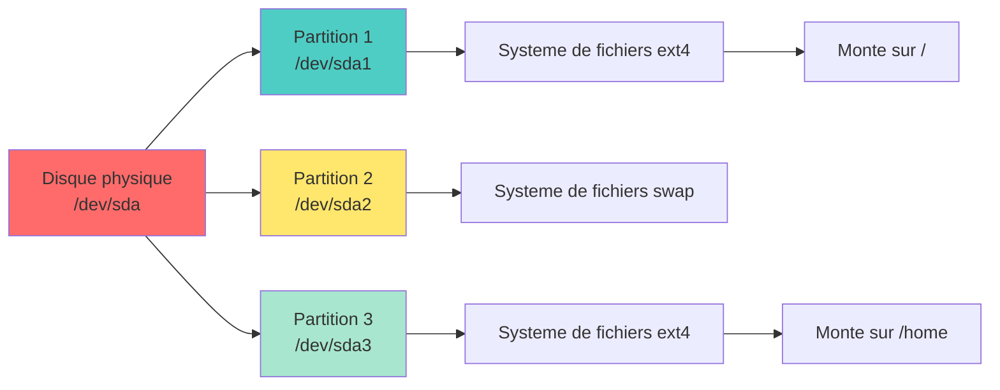

<a name="stockage-systeme-fichiers" id="stockage-systeme-fichiers"></a>

# 💾 Module 5
## Gestion du stockage et du système de fichiers

### Maîtriser disques, partitions et systèmes de fichiers

---

# Comprendre le stockage 💾

**Analogie : une bibliothèque** 📚

- **Disque dur** = le bâtiment entier
- **Partition** = un étage de la bibliothèque
- **Système de fichiers** = méthode de rangement des livres
- **Montage** = ouvrir l'accès à un étage
- **Fichier** = un livre
- **Répertoire** = une étagère

**Sans partition ni système de fichiers, un disque est inutilisable !**

---

# Hiérarchie du stockage 🏗️



---

### Processus classique de création d'une partition :

1. Identifier le disque
2. Créer des partitions
3. Créer un système de fichiers
4. Monter pour utiliser

---

#### Nomenclature des disques 💿

<div class="text-xs">

**Disques SATA/SAS/USB :**
- `/dev/sda` : premier disque
- `/dev/sdb` : deuxième disque
- `/dev/sdc` : troisième disque

**Partitions :**
- `/dev/sda1` : première partition du disque sda
- `/dev/sda2` : deuxième partition du disque sda

**Disques NVMe (SSD modernes) :**
- `/dev/nvme0n1` : premier disque NVMe
- `/dev/nvme0n1p1` : première partition

</div>

---

#### Analogie : les placards numérotés** 🗄️

Imaginez un garde-meuble :
- **sda, sdb, sdc** : les différents placards (disques)
- **sda1, sda2** : les étagères dans le placard A (partitions)
- **Système de fichiers** : comment vous organisez chaque étagère


---

### Exemple concret :

```bash
# Lister vos disques
lsblk

# Résultat typique sur un PC :
# sda         (disque dur principal 500 Go)
# ├─sda1      (partition EFI 512 Mo)
# ├─sda2      (partition / 100 Go)
# └─sda3      (partition /home 399 Go)
# sdb         (clé USB 32 Go)
# └─sdb1      (partition unique 32 Go)
```

---

# Lister les disques et partitions 📋

```bash
# Lister les disques et partitions
lsblk

# Format arborescent avec tailles
lsblk -f

# Afficher les UUID
sudo blkid

# Informations détaillées
sudo fdisk -l

# Taille des disques
df -h

# Utilisation de l'espace par répertoire
du -sh /home/*
```

---

# Exemple de sortie lsblk 📊

```bash
lsblk
```

```
NAME   MAJ:MIN RM   SIZE RO TYPE MOUNTPOINT
sda      8:0    0   500G  0 disk 
├─sda1   8:1    0   512M  0 part /boot/efi
├─sda2   8:2    0   450G  0 part /
└─sda3   8:3    0    50G  0 part /home
sdb      8:16   0     1T  0 disk 
└─sdb1   8:17   0     1T  0 part /mnt/data
nvme0n1  259:0  0   256G  0 disk 
└─nvme0n1p1 259:1 0  256G  0 part /opt
```

**Colonnes :**
- `NAME` : nom du périphérique
- `SIZE` : taille
- `TYPE` : disk ou part(ition)
- `MOUNTPOINT` : où c'est monté

---

# df : espace disque disponible 📏

```bash
# Format lisible
df -h

# Seulement les systèmes de fichiers locaux
df -h -x tmpfs -x devtmpfs

# Inodes disponibles
df -i

# Type de système de fichiers
df -T
```

**Exemple de sortie :**

```
Filesystem      Size  Used Avail Use% Mounted on
/dev/sda2       450G  120G  308G  28% /
/dev/sda3        50G   15G   33G  31% /home
/dev/sdb1       1.0T  500G  500G  50% /mnt/data
```

---

# du : utilisation du disque 📊

```bash
# Taille d'un répertoire
du -sh /home/alice

# Détail des sous-répertoires
du -h --max-depth=1 /var

# Les 10 plus gros répertoires
du -h /home | sort -hr | head -10

# Exclure certains répertoires
du -sh --exclude="*.cache" /home/alice

# Total uniquement
du -sh /var/log
```

---

# ncdu : analyseur interactif d'espace disque 🎨

```bash
# Installer ncdu
sudo apt install ncdu         # Debian/Ubuntu
sudo dnf install ncdu         # RHEL/Fedora

# Analyser un répertoire
ncdu /home

# Analyser et sauvegarder
ncdu -o /tmp/scan.ncdu /var
# Charger plus tard
ncdu -f /tmp/scan.ncdu
```

**Navigation :**
- Flèches : naviguer
- Entrée : entrer dans un répertoire
- `d` : supprimer
- `q` : quitter

---

# Partitionnement : MBR vs GPT 🔀

**MBR (Master Boot Record)** : ancien standard (1983)
- Max 4 partitions primaires
- Max 2 To par disque
- Compatible BIOS

**GPT (GUID Partition Table)** : moderne (2000s)
- 128 partitions
- Disques > 2 To
- UEFI requis
- Plus robuste (backup de la table)

**Recommandation 2025 :** toujours utiliser GPT !

---

# ⚠️ RÈGLE FONDAMENTALE : Un disque = Un seul format !

<div class="text-sm">

**Un disque ne peut avoir QU'UN SEUL type de table de partitions : MBR OU GPT, jamais les deux !**

```
❌ IMPOSSIBLE :
┌──────────────────────────────────────────────┐
│  /dev/sda                                    │
│  ┌─────────────┐  ┌─────────────────────────┐│
│  │ sda1 (MBR)  │  │      sda2 (GPT)         ││
│  └─────────────┘  └─────────────────────────┘│
└──────────────────────────────────────────────┘

✅ CORRECT :
┌──────────────────────────────────────────────┐
│  /dev/sda (GPT)                              │
│  ┌─────────────┐  ┌─────────────────────────┐│
│  │    sda1     │  │         sda2            ││
│  └─────────────┘  └─────────────────────────┘│
└──────────────────────────────────────────────┘
```

**Conséquence :** Si vous changez de MBR vers GPT (ou inversement), **toutes les données sont perdues !**

</div>

---

# Vérifier le type de table : MBR ou GPT ? 🔍

**Méthode 1 : `fdisk -l` (la plus simple)**

```bash
sudo fdisk -l /dev/sda
```

```
Disque /dev/sda : 100 GiB
Type de table de partition : gpt    # <-- ICI !
```

---

**Méthode 2 : `parted` (plus détaillé)**

```bash
sudo parted /dev/sda print
```

```
Modèle: ATA VBOX HARDDISK
Disque /dev/sda : 107GB
Table de partitions : gpt           # <-- ICI !
```

---

**Méthode 3 : `lsblk` avec l'option PTTYPE**

```bash
lsblk -o NAME,SIZE,PTTYPE /dev/sda
```

```
NAME   SIZE PTTYPE
sda    100G gpt     # <-- ICI !
├─sda1  50G
└─sda2  50G
```

---

**Méthode 4 : `blkid` (rapide)**

```bash
sudo blkid -o value -s PTTYPE /dev/sda
```

```
gpt
```

💡 **Astuce mémo :** `fdisk -l` est la méthode la plus universelle !

---

# Créer des partitions : fdisk 🔧

<div class="text-sm">

**fdisk** : outil classique pour partitionner

```bash
# Lancer fdisk sur un disque
sudo fdisk /dev/sdb

# Commandes interactives :
# m : aide (menu)
# p : afficher les partitions actuelles
# g : créer une nouvelle table GPT (efface tout !)
# o : créer une nouvelle table MBR (efface tout !)
# n : nouvelle partition
# d : supprimer une partition
# t : changer le type de partition
# w : écrire et quitter (APPLIQUE les changements)
# q : quitter sans sauvegarder
```

**⚠️ ATTENTION :** Les changements sont écrits seulement avec `w`

</div>

---

# fdisk : Créer une partition GPT de A à Z 📝

<div class="text-xs">

**Scénario :** Nouveau disque `/dev/sdb` vide, on veut une partition GPT

**Étape 1 : Lancer fdisk**

```bash
sudo fdisk /dev/sdb
```

**Étape 2 : Créer la table GPT** (si disque neuf ou changement de format)

```
Command (m for help): g    # <-- Crée une table GPT vide
Created a new GPT disklabel (GUID: xxxx-xxxx-xxxx)
```

⚠️ **Cette commande efface TOUTE la table de partitions existante !**

</div>

---

# fdisk : Créer une partition GPT (suite) 📝

<div class="text-xs">

**Étape 3 : Créer la partition**

```
Command (m for help): n     # <-- Nouvelle partition
Partition number (1-128, default 1): 1    # <-- Entrée (accepter 1)
First sector: [Entrée]      # <-- Début par défaut
Last sector: [Entrée]       # <-- Tout le disque
                            # Ou +50G pour 50 Go, +500M pour 500 Mo

Created a new partition 1 of type 'Linux filesystem'
```

**Étape 4 : Vérifier avant d'écrire**

```
Command (m for help): p     # <-- Affiche les partitions
Device     Start      End  Sectors Size Type
/dev/sdb1   2048 209715166 209713119 100G Linux filesystem
```

</div>

---

# fdisk : Créer une partition GPT (fin) 📝

<div class="text-xs">

**Étape 5 : Écrire les changements**

```
Command (m for help): w     # <-- ÉCRIT sur le disque !
The partition table has been altered.
Calling ioctl() to re-read partition table.
Syncing disks.
```

**Étape 6 : Vérifier que la partition existe**

```bash
lsblk /dev/sdb
```

```
NAME   MAJ:MIN RM  SIZE RO TYPE MOUNTPOINT
sdb      8:16   0  100G  0 disk 
└─sdb1   8:17   0  100G  0 part    # <-- Partition créée !
```

**Prochaine étape :** Formater avec `mkfs.ext4 /dev/sdb1` puis monter !

</div>

---

# fdisk : Créer une partition MBR 📝

<div class="text-xs">

**Si vous avez besoin de MBR** (compatibilité ancien BIOS) :

```bash
sudo fdisk /dev/sdb
```

```
Command (m for help): o      # <-- Crée une table MBR (au lieu de 'g')
Created a new DOS disklabel

Command (m for help): n      # <-- Nouvelle partition
Partition type:
   p   primary (0 primary, 0 extended, 4 free)
   e   extended
Select (default p): p        # <-- Partition primaire
Partition number (1-4): 1    # <-- Numéro 1
First sector: [Entrée]
Last sector: [Entrée]        # <-- Tout le disque

Command (m for help): w      # <-- Écrire
```

💡 **Rappel MBR :** Maximum 4 partitions primaires (ou 3 primaires + 1 étendue avec des logiques)

</div>

---

# 🧪 Tester sans risque : Créer un faux disque (loop device)

<div class="text-sm">

**Problème :** Vous êtes en VM et voulez tester `fdisk`, `mkfs`, `mount`... sans ajouter de disque ?

**Solution :** Créer un **fichier** qui se comporte comme un disque !

**C'est quoi un loop device ?**
- Un fichier ordinaire que Linux traite comme un périphérique bloc
- Apparaît comme `/dev/loop0`, `/dev/loop1`, etc.
- Parfait pour apprendre et tester sans risque !

**Analogie 🎭 :** C'est comme un acteur qui joue le rôle d'un disque dur

</div>

---

# Créer un faux disque : Étape par étape 📝

**Étape 1 : Créer le fichier image (500 Mo)**

```bash
# Crée un fichier rempli de zéros de 500 Mo
dd if=/dev/zero of=/tmp/fake_disk.img bs=1M count=500
```

```
500+0 records in
500+0 records out
524288000 bytes (524 MB, 500 MiB) copied, 0.5 s, 1.0 GB/s
```

---

# Créer un faux disque : Étape par étape (suite) 📝

**Étape 2 : Associer le fichier à un loop device**

```bash
# -f : trouve automatiquement le prochain loop libre
# -P : crée aussi les partitions (loop0p1, loop0p2...)
sudo losetup -fP /tmp/fake_disk.img
```

---

**Étape 3 : Vérifier le périphérique créé**

```bash
# Voir tous les loop devices actifs
losetup -l
```

```
NAME       SIZELIMIT OFFSET AUTOCLEAR RO BACK-FILE
/dev/loop0         0      0         0  0 /tmp/fake_disk.img
```

```bash
# Ou plus simplement
losetup -a
```

```
/dev/loop0: []: (/tmp/fake_disk.img)
```

---

# Utiliser le faux disque comme un vrai ! 🎯

**Maintenant `/dev/loop0` se comporte exactement comme `/dev/sdb` !**

```bash
# Partitionner (GPT)
sudo fdisk /dev/loop0
# g → n → Entrée → Entrée → Entrée → w

# Vérifier la partition
lsblk /dev/loop0
```

```
NAME      MAJ:MIN RM  SIZE RO TYPE MOUNTPOINT
loop0       7:0    0  500M  0 loop
└─loop0p1   7:1    0  499M  0 part
```

---

# Utiliser le faux disque : Formater et monter 🎯

```bash
# Formater en ext4
sudo mkfs.ext4 /dev/loop0p1
```

```bash
# Créer un point de montage
sudo mkdir -p /mnt/test
```

```bash
# Monter
sudo mount /dev/loop0p1 /mnt/test
```

```bash
# Tester !
echo "Ça marche !" | sudo tee /mnt/test/test.txt
cat /mnt/test/test.txt
df -h /mnt/test
```

---

# Nettoyer le faux disque 🧹

**Quand vous avez fini vos tests :**

```bash
# 1. Démonter la partition
sudo umount /mnt/test

# 2. Détacher le loop device
sudo losetup -d /dev/loop0

# 3. Vérifier qu'il est bien détaché
losetup -l
# (devrait être vide ou sans loop0)

# 4. Supprimer le fichier image (optionnel)
rm /tmp/fake_disk.img
```

💡 **Astuce :** Vous pouvez créer plusieurs faux disques simultanément !

---

# Récapitulatif : Commandes loop device 📋

<div class="text-sm">

| Action | Commande |
|--------|----------|
| **Créer fichier image** | `dd if=/dev/zero of=/tmp/disk.img bs=1M count=500` |
| **Attacher au loop** | `sudo losetup -fP /tmp/disk.img` |
| **Lister les loops** | `losetup -l` ou `losetup -a` |
| **Détacher** | `sudo losetup -d /dev/loop0` |
| **Détacher tous** | `sudo losetup -D` |

**Pourquoi utiliser les loop devices ?**
- ✅ Aucun risque pour vos vrais disques
- ✅ Pas besoin d'éteindre la VM
- ✅ Créez autant de "disques" que vous voulez
- ✅ Parfait pour apprendre `fdisk`, `mkfs`, `mount`, LVM...

</div>

---

# Créer des partitions : gdisk/parted 🔧

**gdisk** : pour GPT (comme fdisk)

```bash
sudo gdisk /dev/sdb
```

**parted** : supporte MBR et GPT, scriptable

```bash
# Mode interactif
sudo parted /dev/sdb

# Mode commande
sudo parted /dev/sdb mklabel gpt
sudo parted /dev/sdb mkpart primary ext4 0% 100%
```

---

# Exemple pratique : ajouter un disque 💿

**Étape 1 : Identifier le nouveau disque**

```bash
lsblk
# → Nouveau disque : /dev/sdb
```

---

# Exemple pratique : ajouter un disque (suite) 💿

**Étape 2 : Créer une partition**

```bash
sudo fdisk /dev/sdb

# Dans fdisk :
# n → nouvelle partition
# p → primaire
# 1 → numéro de partition
# Entrée → début par défaut
# Entrée → fin par défaut (tout le disque)
# w → écrire et quitter
```

---

# Exemple pratique : ajouter un disque (suite) 💿

**Étape 3 : Créer un système de fichiers**

```bash
sudo mkfs.ext4 /dev/sdb1
```

---

# Exemple pratique : ajouter un disque (suite) 💿

**Étape 4 : Créer un point de montage et monter**

```bash
sudo mkdir /mnt/data
sudo mount /dev/sdb1 /mnt/data
```

---

# Exemple pratique : ajouter un disque (suite) 💿

**Étape 5 : Rendre permanent (dans /etc/fstab)**

```bash
sudo nano /etc/fstab

# Ajouter :
/dev/sdb1  /mnt/data  ext4  defaults  0  2
```

---

# Systèmes de fichiers 📂

**ext4** : standard Linux
- Stable, performant, mature
- Journaling
- Max 16 To par fichier, 1 Eo par volume
- Par défaut sur la plupart des distributions

**xfs** : haute performance
- Excellent pour gros fichiers
- Utilisé par Red Hat par défaut
- Pas de shrink (réduire taille) possible

---

# Systèmes de fichiers (suite) 📂

**btrfs** : moderne, fonctionnalités avancées
- Snapshots, compression
- Checksums (intégrité)
- Redimensionnement en ligne
- En développement actif

**tmpfs** : en RAM
- Très rapide
- Volatile (effacé au redémarrage)
- Utilisé pour /tmp, /run

---

# Systèmes de fichiers réseau 🌐

**NFS** : Network File System
- Standard Unix/Linux
- Partage entre serveurs Linux

**CIFS/SMB** : partage Windows
- Samba sur Linux
- Compatible avec Windows

**sshfs** : via SSH
- Monter un répertoire distant comme local
- Sécurisé

---

# Créer un système de fichiers 🛠️

```bash
# ext4
sudo mkfs.ext4 /dev/sdb1

# xfs
sudo mkfs.xfs /dev/sdb1

# btrfs
sudo mkfs.btrfs /dev/sdb1

# FAT32 (pour clés USB)
sudo mkfs.vfat /dev/sdb1

# NTFS (pour compatibilité Windows)
sudo mkfs.ntfs /dev/sdb1

# Avec label
sudo mkfs.ext4 -L "MesDocuments" /dev/sdb1
```

---

# Monter un système de fichiers 🔗

```bash
# Monter temporairement
sudo mount /dev/sdb1 /mnt/data

# Monter en lecture seule
sudo mount -o ro /dev/sdb1 /mnt/data

# Monter avec options
sudo mount -o rw,noexec,nosuid /dev/sdb1 /mnt/data

# Monter tous les systèmes de /etc/fstab
sudo mount -a

# Démonter
sudo umount /mnt/data

# Démonter avec force (si occupé)
sudo umount -f /mnt/data
sudo umount -l /mnt/data  # lazy unmount
```

---

# Options de montage courantes ⚙️

**rw** / **ro** : lecture-écriture / lecture seule

**noexec** : interdire l'exécution de binaires

**nosuid** : ignorer les bits SUID/SGID

**nodev** : ignorer les périphériques

**noatime** : ne pas mettre à jour l'access time (performance)

**nodiratime** : ne pas mettre à jour l'access time des répertoires

**defaults** : rw, suid, dev, exec, auto, nouser, async

---

# /etc/fstab : montages automatiques 📝

**Format :** `device mountpoint fstype options dump pass`

```bash
# UUID recommandé (stable)
UUID=abc-123  /home  ext4  defaults  0  2

# Ancien style (peut changer au reboot)
/dev/sda3  /home  ext4  defaults  0  2

# NFS
server:/export  /mnt/nfs  nfs  defaults  0  0

# tmpfs
tmpfs  /tmp  tmpfs  defaults,noatime,mode=1777  0  0

# Swap
/dev/sda2  none  swap  sw  0  0
```

---

# Colonnes de /etc/fstab 📊

**1. Device** : UUID ou /dev/sdX

**2. Mount point** : où monter

**3. Filesystem type** : ext4, xfs, nfs, etc.

**4. Options** : defaults, ro, noexec, etc.

**5. Dump** : sauvegarde avec dump (0 = non, 1 = oui)

**6. Pass** : ordre de vérification fsck (0 = jamais, 1 = racine, 2 = autres)

---

# Trouver l'UUID d'un disque 🔍

```bash
# Méthode 1 : blkid
sudo blkid /dev/sdb1
# → UUID="abc-123-def-456"

# Méthode 2 : lsblk
lsblk -f

# Méthode 3 : depuis /dev/disk
ls -l /dev/disk/by-uuid/

# Utiliser l'UUID dans fstab
UUID=abc-123-def-456  /mnt/data  ext4  defaults  0  2
```

**Pourquoi UUID ?** Car `/dev/sdX` peut changer au redémarrage !

---

# Tester /etc/fstab sans rebooter 🧪

```bash
# Éditer fstab
sudo nano /etc/fstab

# Tester le montage
sudo mount -a

# Si erreur, corriger immédiatement !
# Sinon le système ne démarrera pas

# Vérifier
df -h
mount | grep /mnt/data
```

**⚠️ Un fstab incorrect peut empêcher le boot !**

---

# Swap : mémoire d'échange 💫

**Swap** : extension de la RAM sur disque

**Analogie :** 
- **RAM** = bureau de travail (rapide)
- **Swap** = armoire (lent mais plus d'espace)

**Utilisations :**
- Quand la RAM est pleine
- Hibernation (suspend to disk)
- Recommandé même avec beaucoup de RAM

---

# Créer et activer un swap 🔄

```bash
# Méthode 1 : partition swap
sudo mkswap /dev/sda2
sudo swapon /dev/sda2

# Méthode 2 : fichier swap
sudo fallocate -l 4G /swapfile
sudo chmod 600 /swapfile
sudo mkswap /swapfile
sudo swapon /swapfile

# Rendre permanent dans /etc/fstab
/swapfile  none  swap  sw  0  0

# Vérifier le swap
swapon --show
free -h
```

---

# Gérer le swap 🎛️

```bash
# Voir l'utilisation du swap
free -h
swapon --show

# Désactiver le swap
sudo swapoff /swapfile

# Réactiver
sudo swapon /swapfile

# Désactiver tout le swap
sudo swapoff -a

# Priorité du swap (multiple swaps)
sudo swapon -p 10 /swapfile
```

---

# Swappiness : agressivité du swap ⚖️

**swappiness** : tendance à utiliser le swap (0-100)

```bash
# Voir la valeur actuelle
cat /proc/sys/vm/swappiness
# → 60 (par défaut)

# Changer temporairement
sudo sysctl vm.swappiness=10

# Rendre permanent
echo "vm.swappiness=10" | sudo tee -a /etc/sysctl.conf
sudo sysctl -p
```

**Valeurs :**
- `0` : swap uniquement si nécessaire
- `60` : défaut (équilibre)
- `100` : swap agressif

**Recommandation :** 10 pour desktop, 60 pour serveur

---

# Liens symboliques et durs 🔗

**Lien dur (hard link)** : même inode, plusieurs noms

```bash
ln fichier.txt lien_dur.txt
```

- Partagent le même contenu
- Supprimer un n'affecte pas l'autre
- Impossible pour les répertoires
- Doivent être sur la même partition

---

# Liens symboliques et durs (suite) 🔗

**Lien symbolique (soft/symbolic link)** : pointeur vers un fichier

```bash
ln -s /chemin/vers/fichier.txt lien_sym.txt
ln -s /opt/app /usr/local/bin/app
```

- Peut pointer vers des répertoires
- Peut traverser les partitions
- Si la cible est supprimée, le lien est cassé

---

# Analogie des liens 🎭

**Lien dur :** comme deux clés différentes pour la même porte
- Les deux clés ouvrent la même pièce
- Perdre une clé ne change rien

**Lien symbolique :** comme une pancarte indiquant "La maison est là →"
- Si la maison est détruite, la pancarte pointe dans le vide

---

# Comparer les liens 🔬

```bash
# Créer un fichier
echo "Contenu" > original.txt

# Lien dur
ln original.txt dur.txt

# Lien symbolique
ln -s original.txt sym.txt

# Comparer les inodes
ls -li
# 12345 original.txt
# 12345 dur.txt         ← même inode
# 12346 sym.txt → original.txt
```

---

# Permissions étendues : ACL 🔐

**ACL** (Access Control Lists) : permissions plus fines que rwx

**Pourquoi ?**
- Permissions pour plusieurs utilisateurs spécifiques
- Permissions par défaut pour les nouveaux fichiers
- Plus flexible que owner/group/others

```bash
# Vérifier si le système de fichiers supporte ACL
mount | grep acl
```

---

# Installer et utiliser ACL 🛠️

```bash
# Installer les outils ACL
sudo apt install acl          # Debian/Ubuntu
sudo dnf install acl          # RHEL/Fedora

# Voir les ACL
getfacl fichier.txt

# Donner accès en lecture à alice
setfacl -m u:alice:r fichier.txt

# Donner accès en écriture à bob
setfacl -m u:bob:rw fichier.txt

# Donner accès au groupe devs
setfacl -m g:devs:rwx dossier/
```

---

# ACL avancées 🎯

```bash
# Supprimer une ACL spécifique
setfacl -x u:alice fichier.txt

# Supprimer toutes les ACL
setfacl -b fichier.txt

# ACL récursive
setfacl -R -m u:alice:rx /projet/

# ACL par défaut (pour les nouveaux fichiers)
setfacl -d -m u:alice:rw /projet/

# Copier les ACL d'un fichier
getfacl fichier1.txt | setfacl --set-file=- fichier2.txt
```

---

# Exemple d'ACL 📝

```bash
# Créer un répertoire partagé
sudo mkdir /shared
sudo setfacl -m u:alice:rwx /shared
sudo setfacl -m u:bob:rx /shared
sudo setfacl -m g:devs:rwx /shared

# ACL par défaut pour les sous-fichiers
sudo setfacl -d -m u:alice:rwx /shared
sudo setfacl -d -m g:devs:rw /shared

# Vérifier
getfacl /shared
```

---

# Sortie de getfacl 📋

```bash
getfacl /shared
```

```
# file: /shared
# owner: root
# group: root
user::rwx
user:alice:rwx
user:bob:r-x
group::r-x
group:devs:rwx
mask::rwx
other::r-x
default:user::rwx
default:user:alice:rwx
default:group::r-x
default:group:devs:rw-
default:mask::rwx
default:other::r-x
```

---

# Attributs de fichiers étendus 🏷️

**Attributs immuables avec chattr**

```bash
# Rendre un fichier immuable (même root ne peut pas le modifier)
sudo chattr +i fichier.txt

# Append only (on peut ajouter, pas supprimer)
sudo chattr +a fichier.log

# Voir les attributs
lsattr fichier.txt

# Retirer l'attribut
sudo chattr -i fichier.txt
```

**Cas d'usage :**
- Protéger des fichiers critiques
- Logs append-only
- Empêcher la suppression accidentelle

---

# Vérifier l'intégrité : fsck 🔍

**fsck** : File System Check (vérifier et réparer)

```bash
# Vérifier une partition (doit être démontée !)
sudo umount /dev/sdb1
sudo fsck /dev/sdb1

# Forcer la vérification
sudo fsck -f /dev/sdb1

# Réparer automatiquement
sudo fsck -y /dev/sdb1

# Vérifier au prochain reboot
sudo touch /forcefsck
sudo reboot
```

**⚠️ Ne jamais fsck une partition montée !**

---

# Redimensionner un système de fichiers 📏

**ext4 : agrandir**

```bash
# 1. Agrandir la partition (avec fdisk/parted)
# 2. Informer le noyau
sudo partprobe

# 3. Agrandir le système de fichiers
sudo resize2fs /dev/sdb1
```

**ext4 : réduire**

```bash
# 1. Démonter
sudo umount /dev/sdb1

# 2. Vérifier
sudo e2fsck -f /dev/sdb1

# 3. Réduire le système de fichiers
sudo resize2fs /dev/sdb1 50G

# 4. Réduire la partition
```

---

# LVM : Logical Volume Manager 🎛️

**LVM** : couche d'abstraction pour la gestion flexible du stockage

```
Disques physiques (PV)
    ↓
Volume Group (VG)
    ↓
Logical Volumes (LV)
    ↓
Systèmes de fichiers
```

**Avantages :**
- Redimensionnement facile
- Snapshots
- Migration de données
- Agrégation de disques

---

# Créer un LVM 🛠️

```bash
# 1. Créer Physical Volumes
sudo pvcreate /dev/sdb1 /dev/sdc1

# 2. Créer un Volume Group
sudo vgcreate mon_vg /dev/sdb1 /dev/sdc1

# 3. Créer des Logical Volumes
sudo lvcreate -L 50G -n vol_data mon_vg
sudo lvcreate -L 20G -n vol_backup mon_vg

# 4. Créer des systèmes de fichiers
sudo mkfs.ext4 /dev/mon_vg/vol_data
sudo mkfs.ext4 /dev/mon_vg/vol_backup
```

---

# Gérer LVM 🎮

```bash
# Voir les PV
sudo pvdisplay
sudo pvs

# Voir les VG
sudo vgdisplay
sudo vgs

# Voir les LV
sudo lvdisplay
sudo lvs

# Agrandir un LV
sudo lvextend -L +10G /dev/mon_vg/vol_data
sudo resize2fs /dev/mon_vg/vol_data

# Réduire (attention, risque de perte de données)
sudo umount /dev/mon_vg/vol_data
sudo e2fsck -f /dev/mon_vg/vol_data
sudo resize2fs /dev/mon_vg/vol_data 40G
sudo lvreduce -L 40G /dev/mon_vg/vol_data
```

---

# Snapshots LVM 📸

**Snapshot** : copie instantanée d'un volume

```bash
# Créer un snapshot
sudo lvcreate -L 5G -s -n snapshot_data /dev/mon_vg/vol_data

# Monter le snapshot
sudo mkdir /mnt/snapshot
sudo mount /dev/mon_vg/snapshot_data /mnt/snapshot

# Restaurer depuis le snapshot
sudo umount /dev/mon_vg/vol_data
sudo lvconvert --merge /dev/mon_vg/snapshot_data
# Au prochain reboot, le volume sera restauré

# Supprimer le snapshot
sudo lvremove /dev/mon_vg/snapshot_data
```

---

#### RAID : Redundant Array of Independent Disks 💾💾

<div class="text-xs">

**RAID** : combiner plusieurs disques

**RAID 0** : performance (striping)
- Données réparties sur tous les disques
- Si un disque meurt, tout est perdu

**RAID 1** : miroir
- Données dupliquées sur tous les disques
- Tolérance de panne : N-1 disques

**RAID 5** : parité distribuée
- Min 3 disques
- Tolérance : 1 disque

**RAID 6** : double parité
- Min 4 disques
- Tolérance : 2 disques

**RAID 10** : miroir + striping
- Min 4 disques
- Performance + redondance

</div>

---

# Créer un RAID logiciel 🔧

```bash
# Installer mdadm
sudo apt install mdadm

# Créer un RAID 1
sudo mdadm --create /dev/md0 --level=1 --raid-devices=2 /dev/sdb1 /dev/sdc1

# Vérifier
cat /proc/mdstat
sudo mdadm --detail /dev/md0

# Créer le système de fichiers
sudo mkfs.ext4 /dev/md0

# Sauvegarder la config
sudo mdadm --detail --scan | sudo tee -a /etc/mdadm/mdadm.conf
```

---

# Gérer un RAID 🛠️

```bash
# Marquer un disque défaillant
sudo mdadm --manage /dev/md0 --fail /dev/sdb1

# Retirer le disque
sudo mdadm --manage /dev/md0 --remove /dev/sdb1

# Ajouter un nouveau disque
sudo mdadm --manage /dev/md0 --add /dev/sdd1

# Surveiller l'état
watch cat /proc/mdstat
```

---

# NFS : partage réseau 🌐

**Server side (export) :**

```bash
# Installer NFS server
sudo apt install nfs-kernel-server

# Configurer /etc/exports
sudo nano /etc/exports

# Ajouter :
/data  192.168.1.0/24(rw,sync,no_subtree_check)

# Appliquer
sudo exportfs -a
# Note: Le redémarrage du service sera vu dans le Module 6
```

---

# NFS : client side 🖥️

```bash
# Installer NFS client
sudo apt install nfs-common

# Monter temporairement
sudo mount server:/data /mnt/nfs

# Monter automatiquement dans /etc/fstab
server:/data  /mnt/nfs  nfs  defaults  0  0

# Vérifier
df -h | grep nfs
```

---

# Quota disque : rappel 💾

**Configurer et surveiller les quotas**

```bash
# Vérifier les quotas d'un utilisateur
quota -u alice

# Rapport détaillé
sudo repquota -a

# Quota d'un groupe
sudo quota -g developers

# Grace period restante
sudo repquota -a | grep alice
```

---

# Nettoyer l'espace disque 🧹

**Trouver les gros fichiers :**

```bash
# Les 20 plus gros fichiers
find / -type f -printf '%s %p\n' 2>/dev/null | sort -nr | head -20

# Fichiers > 100M modifiés récemment
find /home -type f -size +100M -mtime -30

# Fichiers log volumineux
du -sh /var/log/*
```

---

# Nettoyer l'espace disque (suite) 🧹

**Nettoyer le cache apt :**

```bash
sudo apt clean
sudo apt autoclean
sudo apt autoremove
```

**Nettoyer les logs :**

```bash
sudo journalctl --vacuum-time=7d
sudo find /var/log -name "*.gz" -mtime +30 -delete
```

---

# Nettoyer l'espace disque (suite) 🧹

**Trouver les doublons :**

```bash
# Installer fdupes
sudo apt install fdupes

# Trouver les doublons
fdupes -r /home/alice

# Supprimer interactivement
fdupes -rd /home/alice
```

---

# Analyser l'utilisation I/O 📊

```bash
# Installer iotop
sudo apt install iotop

# Surveiller l'I/O par processus
sudo iotop

# iostat : statistiques I/O
sudo apt install sysstat
iostat -x 2    # Rafraîchir toutes les 2s

# I/O wait (attente disque)
top
# Regarder la colonne %wa
```

---

# Performance : options noatime 🚀

**atime** : dernière fois qu'un fichier a été lu

**Problème :** chaque lecture génère une écriture (mise à jour atime)

**Solution :**

```bash
# Dans /etc/fstab
UUID=xxx  /home  ext4  defaults,noatime  0  2

# Ou relatime (compromis)
UUID=xxx  /home  ext4  defaults,relatime  0  2
```

**Gain de performance** : significatif sur serveurs avec beaucoup de lectures

---

# Bonnes pratiques 📋

1. **Toujours utiliser UUID dans /etc/fstab**
   - Les /dev/sdX peuvent changer

2. **Tester fstab avant de rebooter**
   - `sudo mount -a`

3. **Sauvegarder avant des opérations dangereuses**
   - Partitionnement, resize, etc.

4. **Monitorer l'espace disque régulièrement**
   - Alertes à 80% d'utilisation

---

# Bonnes pratiques (suite) 📋

5. **Utiliser LVM pour la flexibilité**
   - Agrandissement facile
   - Snapshots avant mise à jour

6. **ACL pour permissions complexes**
   - Plus maintenable que chmod

7. **noatime pour la performance**
   - Surtout sur les serveurs

8. **RAID ou backup pour les données critiques**
   - Jamais les deux en même temps !

---

# Récapitulatif du Module 5 ✅

**Ce que vous avez appris :**

✅ Nomenclature des disques et partitions

✅ Partitionnement (fdisk, gdisk, parted)

✅ Systèmes de fichiers (ext4, xfs, btrfs, NFS)

✅ Montage et /etc/fstab

✅ Swap et swappiness

✅ Liens symboliques et durs

✅ ACL (permissions étendues)

✅ LVM pour la gestion flexible

✅ RAID pour la redondance

✅ Gestion de l'espace disque (df, du, ncdu)

---

# Prochaine étape 🎯

**Module 6 : Gestion des processus et services**

- Comprendre les processus et leurs états
- Gestion avec systemd et systemctl
- Gestion du pare-feu (sera vu dans Module 7)
- SSH et transfert de fichiers sécurisé
- Résolution DNS
- Configuration d'interfaces

---
layout: default
---

# Questions ? 🤔

N'hésitez pas à poser vos questions maintenant !

Le prochain module explorera la configuration et le diagnostic réseau.

