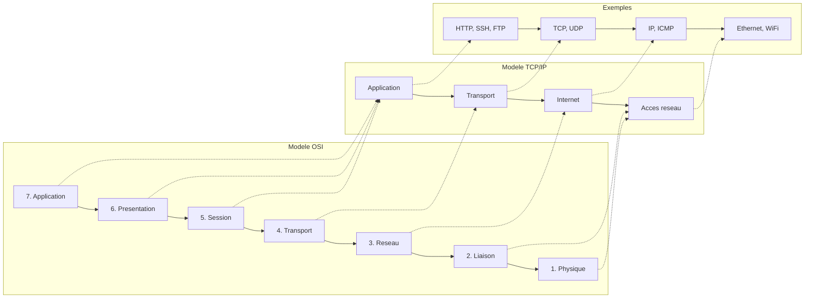
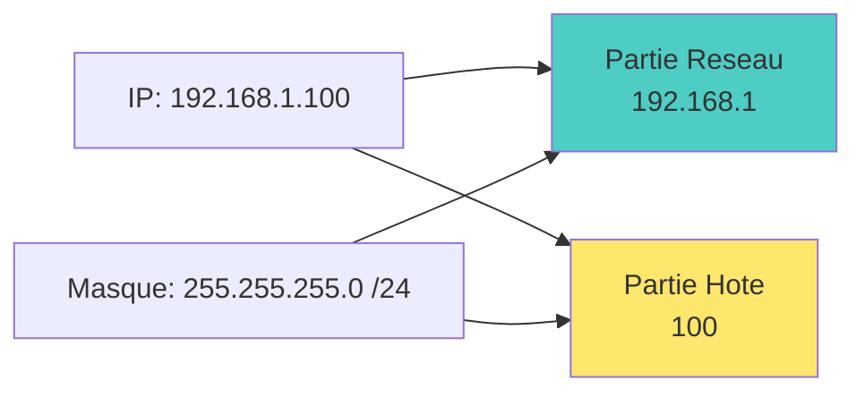
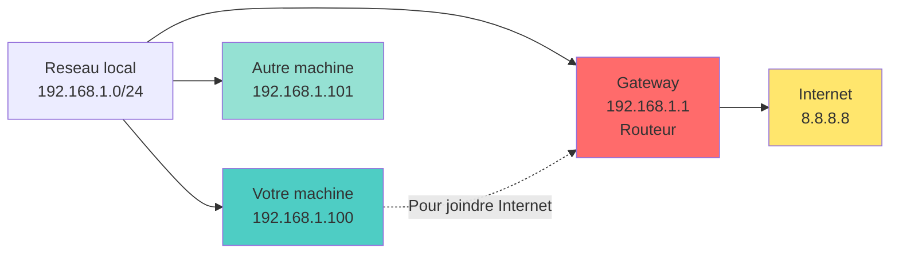

<a name="reseau" id="reseau"></a>

# 📡 Module 5
## Réseau

### Configuration, diagnostic et sécurité réseau

---

# Le réseau : une analogie postale 📮

**Imaginez le réseau comme le système postal :**

- **Adresse IP** = adresse postale de votre maison
- **Masque de sous-réseau** = code postal (définit le quartier)
- **Passerelle (Gateway)** = bureau de poste local
- **DNS** = annuaire téléphonique (nom → adresse)
- **Port** = numéro d'appartement
- **Routeur** = centre de tri postal
- **Pare-feu** = gardien qui filtre le courrier

---

# Modèle OSI vs TCP/IP 🏗️



**En pratique, on utilise le modèle TCP/IP**

---

# Adresses IP : IPv4 vs IPv6 🌐

**IPv4** : 32 bits (4 octets)
- Format : `192.168.1.100`
- ~4.3 milliards d'adresses
- Épuisement → besoin d'IPv6

**IPv6** : 128 bits (16 octets)
- Format : `2001:0db8:85a3:0000:0000:8a2e:0370:7334`
- Simplifié : `2001:db8:85a3::8a2e:370:7334`
- ~340 sextillions d'adresses
- Adoption progressive

**Analogie : les numéros de téléphone** 📞

**IPv4** : comme un numéro à 10 chiffres
- Limité : on manque de numéros
- Solution temporaire : indicatifs (NAT)

**IPv6** : comme un numéro à 40 chiffres
- Suffisant pour donner un numéro unique à chaque grain de sable sur Terre !

**Exemple concret :**

```bash
# Voir vos adresses IP
ip addr show

# Résultat typique :
# inet 192.168.1.100/24    (IPv4 privée)
# inet6 fe80::a00:27ff:fe4e:66a1/64  (IPv6 locale)
```

---

# Classes d'adresses IPv4 privées 🏠

**Plages privées (non routables sur Internet) :**

- **Classe A** : `10.0.0.0` à `10.255.255.255` (/8)
  - 16 millions d'adresses

- **Classe B** : `172.16.0.0` à `172.31.255.255` (/12)
  - 1 million d'adresses

- **Classe C** : `192.168.0.0` à `192.168.255.255` (/16)
  - 65 536 adresses

**Loopback** : `127.0.0.1` (localhost)

---

# Masque de sous-réseau 🎭

**Masque** : définit quelle partie est réseau vs hôte



**Notation CIDR** : `/24` = 255.255.255.0

**Calcul :**
- `/24` = 256 adresses (254 utilisables)
- `/16` = 65 536 adresses
- `/8` = 16 millions d'adresses

---

# Passerelle (Gateway) 🚪

**Gateway** : le routeur qui permet de sortir du réseau local



**Analogie :** la porte d'entrée de votre quartier

---

# DNS : Domain Name System 🌐

**DNS** : traduit les noms en adresses IP

```
google.com → 142.250.185.46
```

**Serveurs DNS populaires :**
- Google : `8.8.8.8`, `8.8.4.4`
- Cloudflare : `1.1.1.1`, `1.0.0.1`
- Quad9 : `9.9.9.9`

**Analogie :** l'annuaire téléphonique d'Internet

---

# Voir la configuration réseau 🔍

```bash
# Méthode moderne (depuis 2010)
ip addr
ip a

# Méthode traditionnelle (obsolète mais encore utilisée)
ifconfig

# Voir seulement les adresses IPv4
ip -4 addr

# Voir seulement les adresses IPv6
ip -6 addr

# Afficher une interface spécifique
ip addr show eth0
```

---

# Exemple de sortie ip addr 📋

```bash
ip addr
```

```
1: lo: <LOOPBACK,UP,LOWER_UP> mtu 65536
    inet 127.0.0.1/8 scope host lo
    inet6 ::1/128 scope host

2: eth0: <BROADCAST,MULTICAST,UP,LOWER_UP> mtu 1500
    inet 192.168.1.100/24 brd 192.168.1.255 scope global eth0
    inet6 fe80::a00:27ff:fe4e:66a1/64 scope link
```

**Informations importantes :**
- `lo` : interface loopback (localhost)
- `eth0` : interface Ethernet
- `UP` : interface active
- `inet` : adresse IPv4
- `inet6` : adresse IPv6

---

# Interfaces réseau 🔌

**Nomenclature classique :**
- `eth0`, `eth1` : Ethernet
- `wlan0`, `wlan1` : WiFi
- `lo` : loopback (localhost)

**Nomenclature moderne (systemd) :**
- `enp0s3` : Ethernet PCI slot 0, port 3
- `eno1` : Ethernet on-board 1
- `wlp3s0` : Wireless LAN PCI slot 3, port 0

---

# Activer/désactiver une interface 🔌

```bash
# Désactiver
sudo ip link set eth0 down

# Activer
sudo ip link set eth0 up

# Voir l'état
ip link show eth0

# Méthode alternative (ifconfig)
sudo ifconfig eth0 down
sudo ifconfig eth0 up
```

---

# Configuration IP manuelle 🔧

```bash
# Attribuer une IP
sudo ip addr add 192.168.1.100/24 dev eth0

# Supprimer une IP
sudo ip addr del 192.168.1.100/24 dev eth0

# Ajouter une passerelle par défaut
sudo ip route add default via 192.168.1.1

# Supprimer la passerelle
sudo ip route del default

# Méthode ifconfig (obsolète)
sudo ifconfig eth0 192.168.1.100 netmask 255.255.255.0
```

**⚠️ Ces changements sont temporaires !**

---

# Configuration permanente : méthode traditionnelle 📝

**Debian/Ubuntu (/etc/network/interfaces) :**

```bash
sudo nano /etc/network/interfaces
```

```
auto eth0
iface eth0 inet static
    address 192.168.1.100
    netmask 255.255.255.0
    gateway 192.168.1.1
    dns-nameservers 8.8.8.8 8.8.4.4
```

```bash
# Redémarrer le réseau
sudo systemctl restart networking
```

---

# Configuration permanente : Netplan (Ubuntu moderne) 🆕

**Fichier : `/etc/netplan/01-netcfg.yaml`**

```yaml
network:
  version: 2
  renderer: networkd
  ethernets:
    eth0:
      dhcp4: no
      addresses:
        - 192.168.1.100/24
      gateway4: 192.168.1.1
      nameservers:
        addresses:
          - 8.8.8.8
          - 8.8.4.4
```

```bash
# Appliquer la config
sudo netplan apply

# Tester avant d'appliquer
sudo netplan try
```

---

# Configuration permanente : Red Hat/CentOS/AlmaLinux 🎩

**Fichier : `/etc/sysconfig/network-scripts/ifcfg-eth0`**

```bash
TYPE=Ethernet
BOOTPROTO=static
NAME=eth0
DEVICE=eth0
ONBOOT=yes
IPADDR=192.168.1.100
NETMASK=255.255.255.0
GATEWAY=192.168.1.1
DNS1=8.8.8.8
DNS2=8.8.4.4
```

```bash
# Redémarrer l'interface
sudo ifdown eth0 && sudo ifup eth0

# Ou redémarrer le service
sudo systemctl restart NetworkManager
```

---

# DHCP : configuration automatique 🤖

**DHCP** : Dynamic Host Configuration Protocol

```yaml
# Netplan
network:
  version: 2
  ethernets:
    eth0:
      dhcp4: yes
```

**Le serveur DHCP fournit automatiquement :**
- Adresse IP
- Masque de sous-réseau
- Passerelle
- Serveurs DNS

---

# NetworkManager : gestion graphique et CLI 🎛️

**nmcli** : outil en ligne de commande pour NetworkManager

```bash
# Voir les connexions
nmcli connection show

# Voir les périphériques
nmcli device status

# Activer/désactiver une connexion
nmcli connection up eth0
nmcli connection down eth0

# Voir les détails d'une connexion
nmcli connection show eth0
```

---

# Créer une connexion avec nmcli 🔧

```bash
# DHCP
sudo nmcli connection add type ethernet con-name "Mon Ethernet" \
  ifname eth0

# IP statique
sudo nmcli connection add type ethernet con-name "Mon Ethernet" \
  ifname eth0 \
  ipv4.addresses 192.168.1.100/24 \
  ipv4.gateway 192.168.1.1 \
  ipv4.dns "8.8.8.8 8.8.4.4" \
  ipv4.method manual
```

---

# Modifier une connexion avec nmcli 🔧

```bash
# Changer l'IP
sudo nmcli connection modify eth0 ipv4.addresses 192.168.1.200/24

# Changer la passerelle
sudo nmcli connection modify eth0 ipv4.gateway 192.168.1.1

# Changer les DNS
sudo nmcli connection modify eth0 ipv4.dns "1.1.1.1 8.8.8.8"

# Passer en DHCP
sudo nmcli connection modify eth0 ipv4.method auto

# Appliquer les changements
sudo nmcli connection up eth0
```

---

# Configuration DNS 🌐

**Fichier : `/etc/resolv.conf`**

```bash
cat /etc/resolv.conf
```

```
nameserver 8.8.8.8
nameserver 8.8.4.4
search example.com
```

**⚠️ Souvent géré automatiquement par systemd-resolved ou NetworkManager**

---

# systemd-resolved 🆕

**Service moderne de résolution DNS**

```bash
# Voir l'état
systemctl status systemd-resolved

# Voir la configuration
resolvectl status

# Vider le cache DNS
sudo resolvectl flush-caches

# Statistiques
resolvectl statistics
```

---

# Tester la connectivité : ping 🏓

```bash
# Ping vers une IP
ping 8.8.8.8

# Ping vers un nom de domaine
ping google.com

# Limiter le nombre de paquets
ping -c 4 google.com

# Intervalle entre les pings (secondes)
ping -i 0.5 google.com

# Flood ping (root requis, ATTENTION !)
sudo ping -f 192.168.1.1
```

**Ce que ping teste :**
- Connectivité réseau
- Temps de réponse (latence)
- Perte de paquets

---

# Interpréter les résultats de ping 📊

```bash
ping -c 4 google.com
```

```
PING google.com (142.250.185.46) 56(84) bytes of data.
64 bytes from par21s04-in-f14.1e100.net (142.250.185.46): icmp_seq=1 ttl=115 time=15.2 ms
64 bytes from par21s04-in-f14.1e100.net (142.250.185.46): icmp_seq=2 ttl=115 time=14.8 ms
64 bytes from par21s04-in-f14.1e100.net (142.250.185.46): icmp_seq=3 ttl=115 time=15.1 ms
64 bytes from par21s04-in-f14.1e100.net (142.250.185.46): icmp_seq=4 ttl=115 time=15.0 ms

--- google.com ping statistics ---
4 packets transmitted, 4 received, 0% packet loss, time 3005ms
rtt min/avg/max/mdev = 14.825/15.025/15.194/0.141 ms
```

**Informations clés :**
- `time` : latence (plus bas = mieux)
- `0% packet loss` : aucune perte (parfait)
- `ttl` : Time To Live (nombre de sauts max)

---

# Tracer le chemin : traceroute 🗺️

```bash
# Installer
sudo apt install traceroute

# Tracer la route vers un hôte
traceroute google.com

# Utiliser ICMP au lieu d'UDP
sudo traceroute -I google.com

# Limiter le nombre de sauts
traceroute -m 15 google.com
```

**Montre tous les routeurs intermédiaires**

---

# Exemple de traceroute 🗺️

```bash
traceroute google.com
```

```
traceroute to google.com (142.250.185.46), 30 hops max, 60 byte packets
 1  192.168.1.1 (192.168.1.1)  1.234 ms  1.123 ms  1.056 ms
 2  10.0.0.1 (10.0.0.1)  5.432 ms  5.123 ms  5.234 ms
 3  * * *
 4  142.250.185.46 (142.250.185.46)  15.123 ms  14.987 ms  15.234 ms
```

**Signification :**
- Chaque ligne = un routeur
- `* * *` = routeur qui ne répond pas (normal, firewall)
- Temps en ms = latence

---

# Résolution DNS : dig et nslookup 🔍

**dig** : outil moderne et complet

```bash
# Installer
sudo apt install dnsutils

# Résolution simple
dig google.com

# Seulement la réponse courte
dig +short google.com

# Serveur DNS spécifique
dig @8.8.8.8 google.com

# Type d'enregistrement spécifique
dig google.com MX     # Mail servers
dig google.com NS     # Name servers
dig google.com AAAA   # IPv6
```

---

# Résolution DNS : nslookup 🔍

**nslookup** : outil traditionnel

```bash
# Résolution simple
nslookup google.com

# Serveur DNS spécifique
nslookup google.com 8.8.8.8

# Mode interactif
nslookup
> server 8.8.8.8
> google.com
> exit
```

---

# Résolution inverse : IP → nom 🔄

```bash
# dig
dig -x 8.8.8.8

# nslookup
nslookup 8.8.8.8

# host
host 8.8.8.8
```

---

# /etc/hosts : résolution locale 📝

**Fichier `/etc/hosts` :** résolution avant DNS

```bash
sudo nano /etc/hosts
```

```
127.0.0.1       localhost
127.0.1.1       ma-machine
192.168.1.10    serveur-web.local serveur-web
192.168.1.20    base-donnees.local db
```

**Cas d'usage :**
- Tests en développement
- Bloquer des domaines (ad blocker)
- Noms personnalisés pour le réseau local

---

# Table de routage 🛣️

```bash
# Voir la table de routage
ip route
ip route show

# Route par défaut
ip route show default

# Méthode ancienne
route -n
netstat -rn
```

---

# Exemple de table de routage 📊

```bash
ip route
```

```
default via 192.168.1.1 dev eth0 proto dhcp metric 100
192.168.1.0/24 dev eth0 proto kernel scope link src 192.168.1.100 metric 100
```

**Signification :**
- `default via 192.168.1.1` : passerelle par défaut
- `192.168.1.0/24 dev eth0` : réseau local directement accessible

---

# Ajouter/supprimer des routes 🛤️

```bash
# Ajouter une route vers un réseau spécifique
sudo ip route add 10.0.0.0/24 via 192.168.1.254

# Supprimer une route
sudo ip route del 10.0.0.0/24

# Changer la route par défaut
sudo ip route change default via 192.168.1.2

# Route permanente (dans /etc/network/interfaces)
up ip route add 10.0.0.0/24 via 192.168.1.254
```

---

# Ports et protocoles 🚪

**Port** : numéro qui identifie un service

**Ports bien connus (0-1023) :**
- `22` : SSH
- `80` : HTTP
- `443` : HTTPS
- `25` : SMTP (mail)
- `53` : DNS
- `21` : FTP
- `3306` : MySQL
- `5432` : PostgreSQL

**Ports enregistrés (1024-49151)** : applications

**Ports dynamiques (49152-65535)** : temporaires

---

# Voir les ports ouverts : ss 🔍

**ss** : Socket Statistics (remplace netstat)

```bash
# Tous les ports en écoute
sudo ss -tuln

# Avec les noms de processus
sudo ss -tulnp

# Seulement TCP
sudo ss -tln

# Seulement UDP
sudo ss -uln

# Connexions établies
sudo ss -tn
```

**Options :**
- `-t` : TCP
- `-u` : UDP
- `-l` : en écoute (listening)
- `-n` : numérique (pas de résolution DNS)
- `-p` : processus

---

# Exemple de sortie ss 📋

```bash
sudo ss -tulnp
```

```
Netid  State   Recv-Q  Send-Q  Local Address:Port  Peer Address:Port  Process
tcp    LISTEN  0       128     0.0.0.0:22           0.0.0.0:*          users:(("sshd",pid=1234,fd=3))
tcp    LISTEN  0       128     0.0.0.0:80           0.0.0.0:*          users:(("nginx",pid=5678,fd=6))
tcp    LISTEN  0       128     [::]:22              [::]:*             users:(("sshd",pid=1234,fd=4))
udp    UNCONN  0       0       0.0.0.0:68           0.0.0.0:*          users:(("dhclient",pid=9012,fd=6))
```

---

# Alternative : netstat 🔍

**netstat** : outil traditionnel (toujours utile)

```bash
# Tous les ports en écoute
sudo netstat -tuln

# Avec les processus
sudo netstat -tulnp

# Connexions actives
netstat -tan

# Statistiques réseau
netstat -s

# Table de routage
netstat -rn
```

---

# Tester un port : telnet et nc 🔌

**telnet** : tester la connectivité TCP

```bash
telnet google.com 80
# Tapez : GET / HTTP/1.1
# Puis : Host: google.com
# Puis : Entrée deux fois

# Ctrl+] puis quit pour sortir
```

**nc (netcat)** : couteau suisse réseau

```bash
# Tester un port
nc -zv google.com 80

# Scanner des ports
nc -zv 192.168.1.1 20-80

# Écouter sur un port
nc -l 12345

# Envoyer vers un port
echo "Message" | nc 192.168.1.100 12345
```

---

# Capturer le trafic réseau : tcpdump 📦

```bash
# Installer
sudo apt install tcpdump

# Capturer sur eth0
sudo tcpdump -i eth0

# Limiter le nombre de paquets
sudo tcpdump -i eth0 -c 10

# Sauvegarder dans un fichier
sudo tcpdump -i eth0 -w capture.pcap

# Filtrer par port
sudo tcpdump -i eth0 port 80

# Filtrer par hôte
sudo tcpdump -i eth0 host 192.168.1.100
```

---

# Wireshark : analyseur graphique 📊

```bash
# Installer Wireshark
sudo apt install wireshark

# Lancer (graphique)
sudo wireshark

# Ou en CLI
sudo tshark -i eth0
```

**Wireshark** : analyse détaillée du trafic
- Interface graphique
- Filtres puissants
- Décodage de protocoles
- Statistiques

---

# Pare-feu : introduction 🔥

**Pare-feu (firewall)** : filtre le trafic réseau

**Analogie :** le videur d'une boîte de nuit
- Contrôle qui entre et qui sort
- Bloque les indésirables
- Autorise les invités

**3 outils principaux sur Linux :**
1. **iptables** : bas niveau, complexe
2. **ufw** : simple, Debian/Ubuntu
3. **firewalld** : moderne, RHEL/Fedora

---

# iptables : le pare-feu traditionnel 🛡️

**iptables** : très puissant mais complexe

**Chaînes principales :**
- **INPUT** : trafic entrant
- **OUTPUT** : trafic sortant
- **FORWARD** : trafic transité

**Actions :**
- **ACCEPT** : autoriser
- **DROP** : bloquer (silencieux)
- **REJECT** : bloquer (avec message)

---

# Exemples iptables 🔧

```bash
# Voir les règles
sudo iptables -L -n -v

# Autoriser SSH (port 22)
sudo iptables -A INPUT -p tcp --dport 22 -j ACCEPT

# Autoriser HTTP et HTTPS
sudo iptables -A INPUT -p tcp --dport 80 -j ACCEPT
sudo iptables -A INPUT -p tcp --dport 443 -j ACCEPT

# Autoriser les connexions établies
sudo iptables -A INPUT -m state --state ESTABLISHED,RELATED -j ACCEPT

# Bloquer tout le reste
sudo iptables -P INPUT DROP
```

---

# Sauvegarder les règles iptables 💾

```bash
# Debian/Ubuntu
sudo iptables-save > /etc/iptables/rules.v4

# Restaurer
sudo iptables-restore < /etc/iptables/rules.v4

# RHEL/Fedora
sudo iptables-save > /etc/sysconfig/iptables

# Ou utiliser iptables-persistent
sudo apt install iptables-persistent
```

---

# ufw : Uncomplicated Firewall 🛡️

**ufw** : interface simple pour iptables (Ubuntu/Debian)

```bash
# Installer
sudo apt install ufw

# Activer
sudo ufw enable

# Désactiver
sudo ufw disable

# Voir l'état
sudo ufw status
sudo ufw status verbose
```

---

# Règles ufw 🔧

```bash
# Autoriser un port
sudo ufw allow 22
sudo ufw allow ssh
sudo ufw allow 80/tcp
sudo ufw allow 443/tcp

# Refuser un port
sudo ufw deny 23

# Autoriser depuis une IP spécifique
sudo ufw allow from 192.168.1.100

# Autoriser une plage de ports
sudo ufw allow 6000:6010/tcp

# Supprimer une règle
sudo ufw delete allow 80
```

---

# ufw : règles avancées 🎯

```bash
# Autoriser seulement depuis un sous-réseau
sudo ufw allow from 192.168.1.0/24 to any port 22

# Limiter les tentatives (protection brute-force)
sudo ufw limit ssh

# Bloquer une IP
sudo ufw deny from 203.0.113.51

# Réinitialiser toutes les règles
sudo ufw reset

# Numéroter les règles
sudo ufw status numbered

# Supprimer par numéro
sudo ufw delete 3
```

---

# ufw : profils d'application 📱

```bash
# Lister les applications disponibles
sudo ufw app list

# Voir les détails d'une application
sudo ufw app info OpenSSH

# Autoriser une application
sudo ufw allow 'Nginx Full'
sudo ufw allow 'OpenSSH'
sudo ufw allow 'Apache'
```

---

# firewalld : pare-feu moderne 🔥

**firewalld** : par défaut sur RHEL/Fedora/CentOS

**Concepts :**
- **Zones** : niveaux de confiance
- **Services** : ensembles de ports prédéfinis
- **Permanent** : règles qui survivent au redémarrage

```bash
# Installer
sudo dnf install firewalld

# Démarrer
sudo systemctl start firewalld
sudo systemctl enable firewalld
```

---

# Zones firewalld 🎯

**Zones prédéfinies (du plus sécurisé au moins) :**

- **drop** : tout est bloqué
- **block** : bloqué avec rejet
- **public** : par défaut, accès limité
- **external** : masquerading activé (NAT)
- **dmz** : accès limité aux services publics
- **work** : réseau de travail
- **home** : réseau domestique
- **internal** : réseau interne de confiance
- **trusted** : tout est autorisé

---

# Utiliser firewalld 🔧

```bash
# Voir la zone par défaut
sudo firewall-cmd --get-default-zone

# Changer la zone par défaut
sudo firewall-cmd --set-default-zone=home

# Lister les zones actives
sudo firewall-cmd --get-active-zones

# Voir les règles de la zone
sudo firewall-cmd --list-all

# Services autorisés
sudo firewall-cmd --list-services
```

---

# Ajouter des règles firewalld 🔧

```bash
# Autoriser un service
sudo firewall-cmd --add-service=http
sudo firewall-cmd --add-service=https

# Autoriser un port
sudo firewall-cmd --add-port=8080/tcp

# Rendre permanent
sudo firewall-cmd --permanent --add-service=http
sudo firewall-cmd --permanent --add-port=8080/tcp

# Recharger la config
sudo firewall-cmd --reload

# Supprimer une règle
sudo firewall-cmd --remove-service=http
sudo firewall-cmd --permanent --remove-service=http
```

---

# Règles riches firewalld 🎨

```bash
# Autoriser SSH seulement depuis un sous-réseau
sudo firewall-cmd --add-rich-rule='rule family="ipv4" source address="192.168.1.0/24" service name="ssh" accept'

# Bloquer une IP
sudo firewall-cmd --add-rich-rule='rule family="ipv4" source address="203.0.113.51" reject'

# Limitation de débit (protection DDoS)
sudo firewall-cmd --add-rich-rule='rule service name="http" accept limit value="100/m"'
```

---

# SSH : Secure Shell 🔒

**SSH** : connexion à distance sécurisée

**Client SSH (se connecter) :**

```bash
# Connexion simple
ssh utilisateur@serveur

# Port spécifique
ssh -p 2222 utilisateur@serveur

# Avec clé privée
ssh -i ~/.ssh/ma_cle utilisateur@serveur

# Exécuter une commande à distance
ssh utilisateur@serveur 'ls -la'

# Tunnel X11 (interface graphique)
ssh -X utilisateur@serveur
```

---

# Générer des clés SSH 🔑

```bash
# Générer une paire de clés (RSA 4096 bits)
ssh-keygen -t rsa -b 4096 -C "mon-email@example.com"

# Générer avec Ed25519 (plus moderne, recommandé)
ssh-keygen -t ed25519 -C "mon-email@example.com"

# Fichiers générés :
# ~/.ssh/id_rsa (ou id_ed25519) : clé PRIVÉE (à protéger !)
# ~/.ssh/id_rsa.pub (ou id_ed25519.pub) : clé PUBLIQUE (à partager)
```

---

# Copier la clé publique sur un serveur 📤

```bash
# Méthode automatique
ssh-copy-id utilisateur@serveur

# Avec port spécifique
ssh-copy-id -p 2222 utilisateur@serveur

# Méthode manuelle
cat ~/.ssh/id_rsa.pub | ssh utilisateur@serveur 'mkdir -p ~/.ssh && cat >> ~/.ssh/authorized_keys'

# Ou copier-coller dans ~/.ssh/authorized_keys sur le serveur
```

---

# Configuration SSH client 📝

**Fichier : `~/.ssh/config`**

```bash
# Serveur de production
Host prod
    HostName 203.0.113.10
    User admin
    Port 2222
    IdentityFile ~/.ssh/cle_prod

# Serveur de dev
Host dev
    HostName 192.168.1.100
    User developer
    ForwardAgent yes

# Utilisation :
ssh prod       # au lieu de ssh -p 2222 -i ~/.ssh/cle_prod admin@203.0.113.10
ssh dev
```

---

# Sécuriser le serveur SSH 🔐

**Fichier : `/etc/ssh/sshd_config`**

```bash
# Désactiver root login
PermitRootLogin no

# Désactiver mot de passe (clés uniquement)
PasswordAuthentication no

# Changer le port (obscurité, pas de sécurité réelle)
Port 2222

# Autoriser seulement certains utilisateurs
AllowUsers alice bob

# Timeout
ClientAliveInterval 300
ClientAliveCountMax 2
```

```bash
# Redémarrer SSH
sudo systemctl restart sshd
```

---

# Transfert de fichiers : scp 📂

**scp** : Secure Copy (basé sur SSH)

```bash
# Copier vers un serveur
scp fichier.txt utilisateur@serveur:/chemin/distant/

# Copier depuis un serveur
scp utilisateur@serveur:/chemin/fichier.txt ./

# Copier un répertoire
scp -r dossier/ utilisateur@serveur:/chemin/distant/

# Avec port spécifique
scp -P 2222 fichier.txt utilisateur@serveur:/chemin/

# Conserver permissions et dates
scp -p fichier.txt utilisateur@serveur:/chemin/
```

---

# Transfert de fichiers : rsync 🔄

**rsync** : synchronisation efficace

```bash
# Synchroniser un répertoire
rsync -avz /source/ utilisateur@serveur:/destination/

# Options :
# -a : mode archive (préserve tout)
# -v : verbose
# -z : compression
# -P : progression et reprise
# --delete : supprimer les fichiers supprimés de la source

# Synchronisation avec suppression
rsync -avz --delete /source/ utilisateur@serveur:/destination/

# Dry-run (simulation)
rsync -avz --dry-run /source/ utilisateur@serveur:/destination/
```

---

# Transfert de fichiers : sftp 📦

**sftp** : FTP sécurisé via SSH

```bash
# Se connecter
sftp utilisateur@serveur

# Commandes dans sftp :
# ls : lister distant
# lls : lister local
# cd : changer répertoire distant
# lcd : changer répertoire local
# put : envoyer fichier
# get : télécharger fichier
# exit : quitter
```

```bash
sftp> put fichier.txt
sftp> get document.pdf
sftp> exit
```

---

# Tunnels SSH : port forwarding 🚇

**Local forwarding** : accéder à un service distant localement

```bash
# Accéder à un serveur web distant sur localhost:8080
ssh -L 8080:localhost:80 utilisateur@serveur

# Puis ouvrir : http://localhost:8080
```

**Remote forwarding** : exposer un service local à distance

```bash
# Exposer votre port 3000 sur le port 8080 du serveur
ssh -R 8080:localhost:3000 utilisateur@serveur
```

**Dynamic forwarding** : proxy SOCKS

```bash
# Créer un proxy SOCKS sur le port 1080
ssh -D 1080 utilisateur@serveur

# Configurer votre navigateur pour utiliser localhost:1080 comme proxy SOCKS
```

---

# Diagnostiquer les problèmes réseau 🔧

**Checklist de diagnostic :**

1. **Interface activée ?**
   ```bash
   ip link show eth0
   ```

2. **IP correcte ?**
   ```bash
   ip addr show eth0
   ```

---

# Diagnostiquer les problèmes réseau (suite) 🔧

3. **Passerelle joignable ?**
   ```bash
   ping 192.168.1.1
   ```

4. **DNS fonctionne ?**
   ```bash
   dig google.com
   ```

---

# Diagnostiquer les problèmes réseau (suite) 🔧

5. **Connectivité Internet ?**
   ```bash
   ping 8.8.8.8
   ```

6. **Pare-feu ?**
   ```bash
   sudo ufw status
   sudo firewall-cmd --list-all
   ```

---

# Récapitulatif du Module 5 ✅

**Ce que vous avez appris :**

✅ Concepts réseau (IP, masque, gateway, DNS)
✅ Configuration réseau (ip, nmcli, Netplan)
✅ Diagnostic (ping, traceroute, dig, ss)
✅ Pare-feu (iptables, ufw, firewalld)
✅ SSH et clés SSH
✅ Transfert de fichiers (scp, rsync, sftp)
✅ Tunnels SSH
✅ Dépannage réseau

---

# Prochaine étape 🎯

**Module 6 : Gestion des paquets et maintenance**

- Gestionnaires de paquets (apt, dnf)
- Installation et mise à jour de logiciels
- Gestion des dépôts
- Dépendances
- Sécurité et mises à jour

---
layout: default
---

# Questions ? 🤔

N'hésitez pas à poser vos questions maintenant !

Le prochain module explorera la gestion des paquets logiciels et la maintenance du système.

