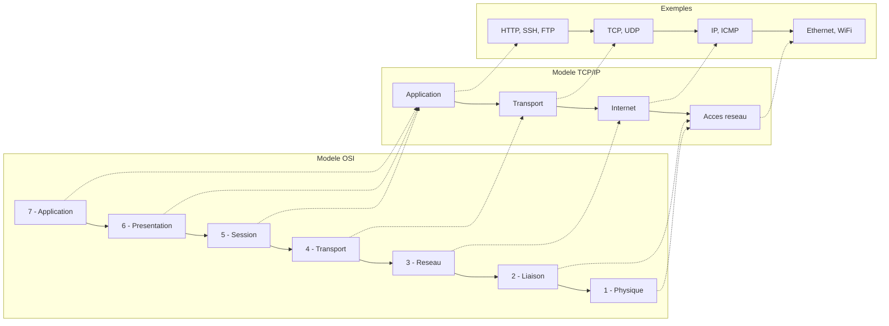
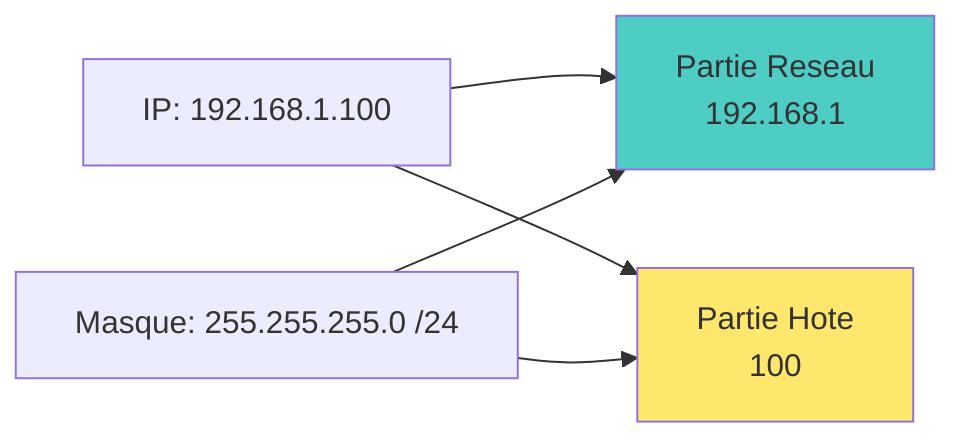
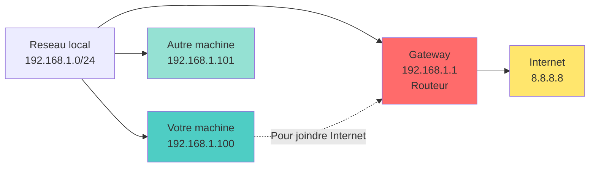
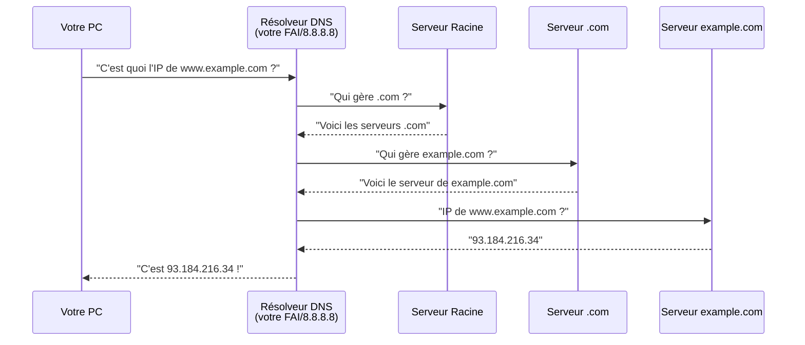
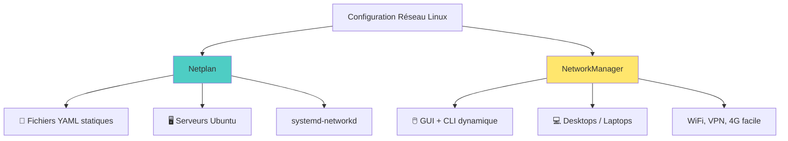
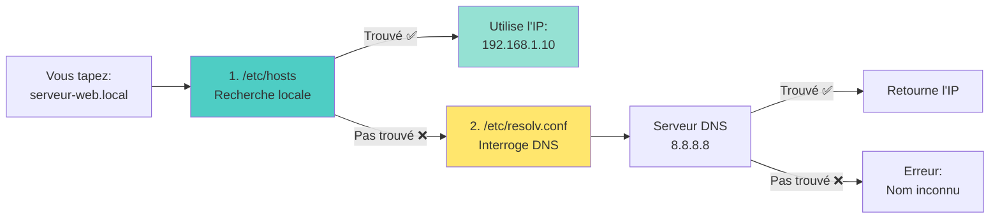
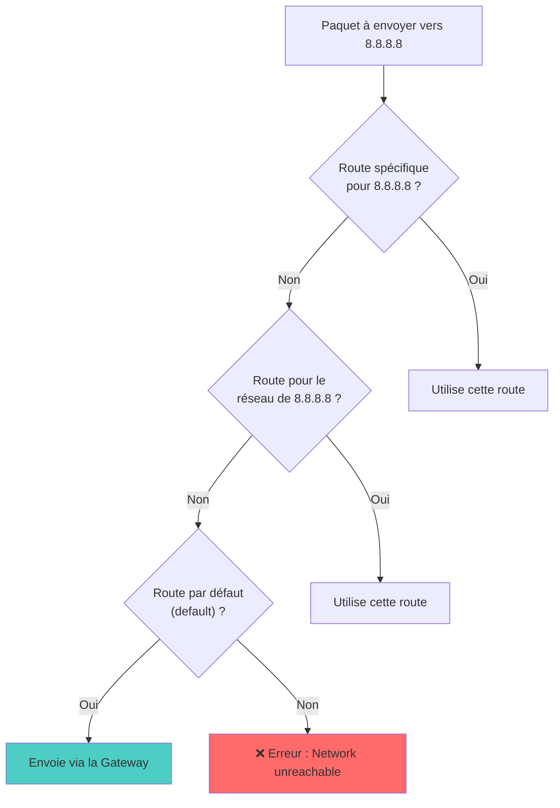

<a name="reseau" id="reseau"></a>

# 📡 Module 7
## Réseau

### Configuration, diagnostic et sécurité réseau

---

# Le réseau : une analogie postale 📮

**Imaginez le réseau comme le système postal :**

- **Adresse IP** = adresse postale de votre maison
- **Masque de sous-réseau** = code postal (définit le quartier)
- **Passerelle (Gateway)** = bureau de poste local
- **DNS** = annuaire téléphonique (nom → adresse)
- **Port** = numéro d'appartement
- **Routeur** = centre de tri postal
- **Pare-feu** = gardien qui filtre le courrier

---

# Modèle OSI vs TCP/IP 🏗️



**En pratique, on utilise le modèle TCP/IP**

---

### Comprendre les modèles réseau : L'analogie de la lettre 📬

<small>

| Étape | Modèle OSI | Ce que ça fait | Analogie postale |
|-------|------------|----------------|------------------|
| 7 | **Application** | Vous écrivez le message | ✍️ Rédiger la lettre |
| 6 | **Présentation** | Mise en forme, chiffrement | 🔐 Mettre dans une enveloppe scellée |
| 5 | **Session** | Établir la conversation | 📞 Décider à qui écrire |
| 4 | **Transport** | Découper en morceaux numérotés | 📦 Numéroter les pages si lettre longue |
| 3 | **Réseau** | Ajouter les adresses | 🏠 Écrire l'adresse expéditeur/destinataire |
| 2 | **Liaison** | Préparer pour le transport local | 📮 Mettre dans la boîte aux lettres |
| 1 | **Physique** | Transmettre physiquement | 🚚 Le camion qui transporte |

</small>

---

### Modèle OSI : Détail des 7 couches 📚

<div class="text-sm">

**Couche 7 - Application** : Ce que VOUS voyez
- HTTP (web), FTP (fichiers), SMTP (mail), SSH (terminal distant)
- 💡 *C'est votre navigateur, votre client mail...*

**Couche 6 - Présentation** : Traduction et formatage
- Chiffrement SSL/TLS, compression, encodage (UTF-8, ASCII)
- 💡 *Convertit les données pour qu'elles soient compréhensibles*

**Couche 5 - Session** : Gestion de la conversation
- Ouverture, maintien, fermeture de session
- 💡 *"Bonjour, je voudrais parler à..."*

**Couche 4 - Transport** : Fiabilité de bout en bout
- TCP (fiable, ordonné) ou UDP (rapide, sans garantie)
- 💡 *"Je vérifie que tout est bien arrivé"*

</div>

---

### Modèle OSI : Couches basses (1-3) 🔌

<div class="text-sm">

**Couche 3 - Réseau** : Routage et adressage IP
- Détermine le CHEMIN que prennent les données
- Protocole IP : adressage logique
- 💡 *"Comment aller de Paris à Tokyo ?"*

**Couche 2 - Liaison de données** : Communication locale
- Adresse MAC (physique, gravée dans la carte réseau)
- Détection d'erreurs, contrôle de flux local
- 💡 *"Communication avec le voisin immédiat"*

**Couche 1 - Physique** : Les bits sur le fil
- Câbles Ethernet, fibres optiques, ondes WiFi
- Tensions électriques, fréquences radio
- 💡 *"Le support physique qui transporte les 0 et 1"*

**Astuce mémo** : "**A**ll **P**eople **S**eem **T**o **N**eed **D**ata **P**rocessing"
(Application → Physique)

</div>

---

### TCP/IP : Le modèle pratique simplifié 🌐

<div class="text-sm">

**Pourquoi TCP/IP plutôt qu'OSI ?**

Le modèle OSI est **théorique** (créé pour enseigner).
Le modèle TCP/IP est **pratique** (créé pour Internet).

| TCP/IP | Équivalent OSI | Protocoles | Analogie |
|--------|---------------|------------|----------|
| **Application** | 5, 6, 7 | HTTP, SSH, DNS, FTP | L'application que vous utilisez |
| **Transport** | 4 | TCP, UDP | Le facteur qui garantit la livraison |
| **Internet** | 3 | IP, ICMP | Le système d'adressage mondial |
| **Accès réseau** | 1, 2 | Ethernet, WiFi | Le camion et la route physique |

</div>

---

<div class="text-sm">

**En pratique, vous manipulez :**
- 🖥️ **Application** : `curl`, navigateur, `ssh`
- 🔢 **Transport** : Ports (22, 80, 443)
- 🌍 **Internet** : Adresses IP (192.168.1.100)
- 🔌 **Accès réseau** : `eth0`, `wlan0`, câble RJ45

</div>

---

# Flux de communication réseau 🔄

<div class="text-sm">

**Exemple : Envoi d'un email**

1. **Application** → L'utilisateur écrit et envoie l'email (SMTP)
2. **Transport** → Les données sont découpées en segments (TCP)
3. **Internet** → Chaque segment reçoit une adresse IP source/destination
4. **Accès réseau** → Les paquets sont transmis physiquement sur le réseau

**Le processus inverse se produit à la réception** ⬅️

- Chaque couche retire son en-tête
- Les données remontent jusqu'à l'application destinataire
- L'email est reconstitué et affiché

**💡 Astuce** : Chaque couche communique uniquement avec la couche adjacente, comme des étages dans un immeuble !

</div>

---

# Adresses IP : Qu'est-ce que c'est ? 🏠

**Une adresse IP, c'est l'adresse postale de votre machine sur le réseau.**

Sans adresse IP, impossible de :
- ❌ Recevoir des données
- ❌ Envoyer des données
- ❌ Être identifié sur le réseau

---

**Deux versions coexistent :**

| | IPv4 | IPv6 |
|---|------|------|
| **Créé en** | 1983 | 1998 |
| **Bits** | 32 bits | 128 bits |
| **Format** | `192.168.1.100` | `2001:db8::1` |
| **Adresses** | ~4,3 milliards | ~340 sextillions |
| **Situation** | Épuisé ! | Adoption progressive |

---

# IPv4 en détail : Anatomie d'une adresse 🔍

**Format : 4 nombres de 0 à 255, séparés par des points**

```
    192    .    168    .     1     .    100
   └─┬─┘       └─┬─┘       └─┬─┘       └─┬─┘
  Octet 1    Octet 2    Octet 3    Octet 4
```

---

**Chaque octet = 8 bits = valeur de 0 à 255**

```bash
# En binaire, 192.168.1.100 s'écrit :
11000000.10101000.00000001.01100100
```

---

**Analogie téléphonique 📞**

```
   +33      1     23    45    67    89
   └┬┘     └┬┘   └───────┬──────────┘
  Pays   Région    Numéro local

  192.168   .1     .100
  └──┬──┘   └┬┘    └─┬─┘
  Réseau  Sous-   Machine
         réseau
```

---

# IPv6 : L'avenir du réseau 🚀

**Pourquoi IPv6 ?**

Avec ~4,3 milliards d'adresses IPv4 et **20+ milliards** d'appareils connectés → pénurie !

**Format IPv6 : 8 groupes de 4 caractères hexadécimaux**

```
2001:0db8:85a3:0000:0000:8a2e:0370:7334
└──┘ └──┘ └──┘ └──┘ └──┘ └──┘ └──┘ └──┘
  1    2    3    4    5    6    7    8
```

**Simplification autorisée :**

```
Complet :   2001:0db8:0000:0000:0000:0000:0000:0001
Simplifié : 2001:db8::1
```

- **Zéros initiaux** : peuvent être supprimés (`0db8` → `db8`)
- **Groupes de zéros** : remplacés par `::` (une seule fois)

---

# IPv4 vs IPv6 : Comparaison pratique 📊

<div class="text-sm">

**Combien d'adresses ?**

| Version | Nombre | Analogie |
|---------|--------|----------|
| **IPv4** | 4 294 967 296 | 1 adresse pour 2 humains |
| **IPv6** | 340 282 366 920 938 463 463 374 607 431 768 211 456 | 50 000 milliards d'adresses par **millimètre carré** de la Terre ! |

**En pratique aujourd'hui :**

```bash
# Voir vos adresses IPv4 et IPv6
ip -4 addr    # Seulement IPv4
ip -6 addr    # Seulement IPv6
```

</div>

---

<div class="text-sm">

**Pourquoi on utilise encore IPv4 ?**
- 🏠 Réseaux locaux privés (192.168.x.x)
- 🔄 NAT (plusieurs machines partagent 1 IP publique)
- 📚 Habitude et compatibilité

**IPv6 est utilisé pour :**
- 🌍 Connexions Internet directes
- 📱 Opérateurs mobiles (Free, Orange...)
- ☁️ Services cloud modernes

</div>

---

#### Exemple concret :

<div>

```bash
# Voir vos adresses IP
ip addr show

# Résultat typique :
# inet 192.168.1.100/24    (IPv4 privée)
# inet6 fe80::a00:27ff:fe4e:66a1/64  (IPv6 locale)
```

</div>

---

#### Classes d'adresses IPv4 privées 🏠

<div class="text-xs">

**Plages privées (non routables sur Internet) :**

- **Classe A** : `10.0.0.0` à `10.255.255.255` (/8)
  - 16 millions d'adresses
  - 💼 **Exemple** : Grandes entreprises, data centers → `10.50.120.45`

- **Classe B** : `172.16.0.0` à `172.31.255.255` (/12)
  - 1 million d'adresses
  - 🏢 **Exemple** : Entreprises moyennes, campus universitaires → `172.20.15.100`

- **Classe C** : `192.168.0.0` à `192.168.255.255` (/16)
  - 65 536 adresses
  - 🏠 **Exemple** : Réseaux domestiques, petits bureaux → `192.168.1.25`

**Loopback** : `127.0.0.1` (localhost)
  - 🔄 **Exemple** : Tester un serveur web local → `http://127.0.0.1:8080`

</div>

---

# Masque de sous-réseau 🎭

**Masque** : définit quelle partie est réseau vs hôte



**Notation CIDR** : `/24` = 255.255.255.0

---

# Comprendre le masque de sous-réseau 🎓

<div class="text-sm">

**C'est quoi concrètement ?**

Le masque détermine **quelle partie de l'IP identifie le réseau** et **quelle partie identifie la machine**.

**Exemple avec `192.168.1.100` et masque `255.255.255.0` (/24)**

```bash
IP :      192  .  168  .   1   .  100
Masque :  255  .  255  .  255  .   0

         [    Réseau    ] [Hôte]
         192.168.1         .100
```

- **Partie réseau** (`192.168.1`) → Toutes les machines du même réseau local
- **Partie hôte** (`100`) → Identifie UNE machine spécifique sur ce réseau

**En pratique ça veut dire quoi ?** 🤔

Avec ce masque, votre machine `192.168.1.100` peut communiquer directement avec :
- ✅ `192.168.1.1` (même réseau)
- ✅ `192.168.1.50` (même réseau)
- ❌ `192.168.2.100` (autre réseau → besoin d'un routeur)

</div>

---

# Notation CIDR - Les masques courants 📊

<div class="text-sm">

**Format `/XX` = nombre de bits pour le réseau**

| CIDR | Masque | Adresses dispo | Cas d'usage | Exemple réseau |
|------|--------|----------------|-------------|----------------|
| `/8` | `255.0.0.0` | 16 777 216 | Très grands réseaux | `10.0.0.0/8` |
| `/16` | `255.255.0.0` | 65 536 | Grands réseaux | `172.16.0.0/16` |
| `/24` | `255.255.255.0` | 256 (254 utiles) | Réseau standard | `192.168.1.0/24` |
| `/30` | `255.255.255.252` | 4 (2 utiles) | Liaison point-à-point | `10.0.0.0/30` |

**Pourquoi 254 et pas 256 en /24 ?** 🤨

- **Adresse réseau** : `192.168.1.0` → réservée (identifie le réseau)
- **Adresse broadcast** : `192.168.1.255` → réservée (message à tous)
- **Adresses utilisables** : `192.168.1.1` à `192.168.1.254` (254 machines)

</div>

---

# Analogie du quartier : Comprendre les masques 🏘️

<div class="text-sm">

**Imaginez que les adresses IP sont des adresses postales dans des quartiers :**

| CIDR | Analogie | Nombre de "maisons" |
|------|----------|---------------------|
| `/24` | **Un petit quartier** 🏠 | 254 maisons numérotées de 1 à 254 |
| `/16` | **Une ville entière** 🏙️ | 65 534 maisons (254 quartiers × 254 maisons) |
| `/8` | **Une mégalopole** 🌆 | 16 millions de maisons ! |
| `/30` | **Un duplex** 🏡 | Seulement 2 maisons (liaison directe) |

**Exemple concret avec /24 (255.255.255.0) :**

```
Quartier : 192.168.1.x  (le "x" = numéro de maison)

🏠 Maison 0    → Réservée (panneau "Bienvenue dans le quartier")
🏠 Maisons 1-254 → Habitables (vos machines)
🏠 Maison 255  → Réservée (haut-parleur pour parler à tout le quartier)
```

</div>

---

**Plus le `/XX` est petit, plus le "quartier" est grand !**
- `/24` = petit quartier où tout le monde se connaît
- `/8` = immense ville où il faut des "routeurs" pour trouver son chemin

---

# Passerelle (Gateway) 🚪

**Gateway** : le routeur qui permet de sortir du réseau local



**Analogie :** la porte d'entrée de votre quartier

---

### Comprendre la Passerelle (Gateway) 🚪

<div class="text-[9px]">

**C'est quoi une Gateway ?**

C'est **le routeur** qui fait le pont entre votre réseau local et le monde extérieur (Internet).

**Fonctionnement concret :**

Imaginons que vous voulez accéder à `google.com` depuis votre ordinateur `192.168.1.100` :

1. **Votre machine** vérifie : "Est-ce que Google est dans mon réseau local (192.168.1.x) ?"
   - ❌ Non → Google est sur Internet

2. **Votre machine** envoie alors le paquet à la **Gateway** (`192.168.1.1`)
   - 💬 "Tiens, routeur ! Peux-tu transmettre ça à Google pour moi ?"

3. **La Gateway** (routeur) :
   - Reçoit le paquet
   - Change l'adresse IP source (de privée à publique via NAT)
   - Envoie le paquet vers Internet
   - Reçoit la réponse et la renvoie à votre machine

**En résumé :** Sans Gateway, vous êtes prisonnier de votre réseau local ! 🔒

</div>

---

# Cas concret : Configuration réseau complète 💻

<div class="text-xs">

**Scénario :** Vous travaillez depuis chez vous sur un réseau domestique

**Configuration de votre ordinateur :**

```bash
Adresse IP :     192.168.1.50
Masque :         255.255.255.0  (/24)
Gateway :        192.168.1.1
DNS :            8.8.8.8
```

**Décryptage :**

| Élément | Signification | Analogie |
|---------|--------------|----------|
| **192.168.1.50** | Votre adresse sur le réseau local | Votre numéro de maison dans le quartier |
| **255.255.255.0** | Vous pouvez parler directement aux IP de 192.168.1.1 à 192.168.1.254 | Votre quartier contient 254 maisons |
| **192.168.1.1** | L'adresse du routeur pour sortir du réseau | La porte d'entrée du quartier |
| **8.8.8.8** | Serveur Google pour traduire les noms de domaine | L'annuaire téléphonique |

</div>

---

<div class="text-xs">

**Exemples de communication :**

- 💬 Accéder à `192.168.1.10` (imprimante réseau) → ✅ Communication directe (même réseau)
- 💬 Accéder à `192.168.1.100` (NAS) → ✅ Communication directe (même réseau)
- 💬 Accéder à `google.com` → ❌ Pas dans le réseau local
  - → Demander au DNS : "C'est quoi l'IP de google.com ?" → `142.250.185.46`
  - → Envoyer le paquet à la Gateway (`192.168.1.1`)
  - → La Gateway transmet vers Internet

</div>

---

# DNS : Domain Name System 🌐

**Pourquoi le DNS existe ?**

Les ordinateurs communiquent avec des **adresses IP** (142.250.185.46)
Les humains préfèrent des **noms** (google.com)

**Le DNS fait la traduction !** 📖

```
Vous tapez :     google.com
DNS traduit :    142.250.185.46
Votre PC :       "Ah OK, je contacte 142.250.185.46"
```

**Analogie : L'annuaire téléphonique 📞**
- Vous cherchez "Pizza du coin" → L'annuaire vous donne 01 23 45 67 89
- Vous cherchez "google.com" → Le DNS vous donne 142.250.185.46

---

# Comment fonctionne le DNS ? 🔄

**Quand vous tapez `www.example.com` dans votre navigateur :**



---

# La hiérarchie DNS 🏛️

**Le DNS est organisé en arbre inversé :**

```
                    . (racine)
                    │
        ┌───────────┼───────────┐
        │           │           │
       com         org         fr
        │           │           │
    ┌───┴───┐      │       ┌───┴───┐
  google  amazon  wikipedia  gouv  example
    │       │       │         │       │
   www    aws     www       service  www
```

**Les niveaux :**
- **Racine (.)** : 13 serveurs mondiaux (a.root-servers.net → m.root-servers.net)
- **TLD** : .com, .org, .fr, .net... (géré par des registres)
- **Domaine** : google.com, example.fr (géré par le propriétaire)
- **Sous-domaine** : www.google.com, mail.google.com

---

# Types d'enregistrements DNS 📋

<div class="text-sm">

| Type | Signification | Exemple | Usage |
|------|---------------|---------|-------|
| **A** | Adresse IPv4 | `93.184.216.34` | IP du serveur |
| **AAAA** | Adresse IPv6 | `2606:2800:220:1::` | IP v6 du serveur |
| **CNAME** | Alias | `www` → `example.com` | Redirection de nom |
| **MX** | Mail eXchanger | `mail.example.com` | Serveur email |
| **NS** | Name Server | `ns1.example.com` | Serveur DNS autoritaire |
| **TXT** | Texte libre | `v=spf1 include:...` | Vérifications (SPF, DKIM) |
| **PTR** | Reverse | `34.216.184.93.in-addr.arpa` | IP → Nom (inverse) |

</div>

---

<div class="text-sm">

**Exemple concret :**

```bash
# Voir tous les enregistrements
dig example.com ANY

# Seulement les MX (serveurs mail)
dig example.com MX
```

</div>

---

# Serveurs DNS publics recommandés 🌍

| Fournisseur | DNS Primaire | DNS Secondaire | Avantages |
|-------------|--------------|----------------|-----------|
| **Google** | `8.8.8.8` | `8.8.4.4` | Rapide, fiable |
| **Cloudflare** | `1.1.1.1` | `1.0.0.1` | Très rapide, vie privée |
| **Quad9** | `9.9.9.9` | `149.112.112.112` | Sécurité (bloque malwares) |
| **OpenDNS** | `208.67.222.222` | `208.67.220.220` | Filtrage parental dispo |

---

**Lequel choisir ?**
- 🚀 **Performance** : Cloudflare (1.1.1.1)
- 🔒 **Sécurité** : Quad9 (bloque les sites malveillants)
- 🏢 **Entreprise** : Souvent DNS interne + Google/Cloudflare en backup

```bash
# Tester la vitesse d'un DNS
time dig @1.1.1.1 google.com
time dig @8.8.8.8 google.com
```

---

# Voir la configuration réseau 🔍

```bash
# Méthode moderne (depuis 2010)
ip addr
ip a

# Méthode traditionnelle (obsolète mais encore utilisée)
ifconfig

# Voir seulement les adresses IPv4
ip -4 addr

# Voir seulement les adresses IPv6
ip -6 addr

# Afficher une interface spécifique
ip addr show eth0
```

---

# Exemple de sortie ip addr 📋

```bash
ip addr
```

```
1: lo: <LOOPBACK,UP,LOWER_UP> mtu 65536
    inet 127.0.0.1/8 scope host lo
    inet6 ::1/128 scope host

2: eth0: <BROADCAST,MULTICAST,UP,LOWER_UP> mtu 1500
    inet 192.168.1.100/24 brd 192.168.1.255 scope global eth0
    inet6 fe80::a00:27ff:fe4e:66a1/64 scope link
```

---

# Décryptage de `ip addr` ligne par ligne (1/2) 🔍

**Ligne 1 : `1: lo: <LOOPBACK,UP,LOWER_UP> mtu 65536`**

| Élément | Signification |
|---------|---------------|
| `1:` | Numéro de l'interface (ordre d'apparition) |
| `lo` | Nom de l'interface (loopback = boucle locale) |
| `<LOOPBACK>` | Type d'interface (boucle interne) |
| `UP` | Interface **activée** au niveau système |
| `LOWER_UP` | Câble branché / signal présent |
| `mtu 65536` | Taille max d'un paquet (65 Ko pour loopback) |

---

**Les flags entre `< >` sont cruciaux :**
- `UP` = activée → Sans ça, l'interface ne fonctionne pas !
- `LOWER_UP` = connexion physique OK → Si absent = câble débranché
- `BROADCAST` = peut envoyer à tous les appareils du réseau
- `MULTICAST` = peut envoyer à un groupe d'appareils

---

# Décryptage de `ip addr` ligne par ligne (2/2) 🔍

**Ligne : `inet 192.168.1.100/24 brd 192.168.1.255 scope global eth0`**

| Élément | Signification |
|---------|---------------|
| `inet` | Adresse **IPv4** (inet6 = IPv6) |
| `192.168.1.100` | Votre adresse IP |
| `/24` | Masque de sous-réseau (255.255.255.0) |
| `brd 192.168.1.255` | Adresse de **broadcast** (message à tous) |
| `scope global` | Utilisable pour communiquer **partout** |
| `eth0` | Interface à laquelle cette IP est liée |

---

**Les différents "scopes" :**

| Scope | Signification | Exemple |
|-------|---------------|---------|
| `global` | Routable partout | 192.168.1.100 (réseau local) |
| `link` | Seulement sur le lien local | fe80::... (IPv6 link-local) |
| `host` | Seulement cette machine | 127.0.0.1 (localhost) |

💡 **Si vous n'avez pas d'adresse `inet` → pas de réseau IPv4 !**

---

# Interfaces réseau : Les noms 🔌

**Pourquoi les noms sont-ils bizarres ?**

Avant, c'était simple : `eth0`, `eth1`, `wlan0`...
Problème : l'ordre pouvait **changer au redémarrage** ! 😱

**Solution moderne : noms prévisibles (systemd)**

Les noms sont basés sur l'**emplacement physique** du matériel.

---

# Nomenclature des interfaces : Décodage 🔍

<div class="text-sm">

**Structure : `<type><emplacement>`**

| Préfixe | Signification | Exemple |
|---------|---------------|---------|
| `en` | **E**ther**n**et (filaire) | `enp0s3` |
| `wl` | **W**ire**l**ess (WiFi) | `wlp3s0` |
| `ww` | **W**ireless **W**AN (4G/5G) | `wwan0` |
| `lo` | **Lo**opback (boucle locale) | `lo` |

</div>

---

**Décodage de l'emplacement :**

| Suffixe | Signification | Exemple complet |
|---------|---------------|-----------------|
| `o<N>` | **O**n-board (intégré carte mère) | `eno1` = Ethernet intégré #1 |
| `p<bus>s<slot>` | **P**CI bus X, **S**lot Y | `enp0s3` = Ethernet PCI bus 0, slot 3 |
| `s<slot>` | Hot-plug **S**lot | `ens33` = Slot 33 (VMware) |

**Exemples concrets :**
- `enp0s3` → Ethernet, PCI bus 0, slot 3 (VirtualBox)
- `ens33` → Ethernet, slot 33 (VMware)
- `wlp3s0` → WiFi, PCI bus 3, slot 0
- `eno1` → Premier Ethernet intégré à la carte mère

---

# Trouver le nom de votre interface 🎯

```bash
# Lister toutes les interfaces
ip link show

# Résultat typique :
# 1: lo: <LOOPBACK,UP>
# 2: enp0s3: <BROADCAST,MULTICAST,UP>
# 3: wlp2s0: <BROADCAST,MULTICAST>
```

**Astuce : identifier rapidement**

```bash
# Interface avec une adresse IP (probablement la principale)
ip -br addr

# Résultat :
# lo        UNKNOWN  127.0.0.1/8
# enp0s3    UP       192.168.1.100/24   <-- C'est celle-ci !
```

💡 **En VM, les noms courants sont :**
- **VirtualBox** : `enp0s3`, `enp0s8`
- **VMware** : `ens33`, `ens34`
- **QEMU/KVM** : `enp1s0`, `ens3`

---

# Activer/désactiver une interface 🔌

```bash
# Désactiver
sudo ip link set eth0 down

# Activer
sudo ip link set eth0 up

# Voir l'état
ip link show eth0

# Méthode alternative (ifconfig)
sudo ifconfig eth0 down
sudo ifconfig eth0 up
```

---

# Configuration IP manuelle 🔧

```bash
# Attribuer une IP
sudo ip addr add 192.168.1.100/24 dev eth0

# Supprimer une IP
sudo ip addr del 192.168.1.100/24 dev eth0

# Ajouter une passerelle par défaut
sudo ip route add default via 192.168.1.1

# Supprimer la passerelle
sudo ip route del default

# Méthode ifconfig (obsolète)
sudo ifconfig eth0 192.168.1.100 netmask 255.255.255.0
```

**⚠️ Ces changements sont temporaires !**

---

# Configuration permanente : méthode traditionnelle 📝

**Debian/Ubuntu (/etc/network/interfaces) :**

```bash
sudo nano /etc/network/interfaces
```

```
auto eth0
iface eth0 inet static
    address 192.168.1.100
    netmask 255.255.255.0
    gateway 192.168.1.1
    dns-nameservers 8.8.8.8 8.8.4.4
```

```bash
# Redémarrer le réseau
sudo systemctl restart networking
```

---

# Configuration permanente : Netplan (Ubuntu moderne) 🆕

**Netplan** est le système de configuration réseau par défaut sur Ubuntu (depuis 17.10)

**Fichier : `/etc/netplan/01-netcfg.yaml`**

```yaml
network:
  version: 2
  renderer: networkd
  ethernets:
    eth0:
      dhcp4: no
      addresses:
        - 192.168.1.100/24
      gateway4: 192.168.1.1
      nameservers:
        addresses:
          - 8.8.8.8
          - 8.8.4.4
```

---

# Netplan : Explication ligne par ligne (1/3) 📖

**Structure de base :**

```yaml
network:
  version: 2
```

- `network:` → Racine du fichier de configuration réseau
- `version: 2` → Utilise le format Netplan v2 (standard actuel)

---

# Netplan : Explication ligne par ligne (2/3) 📖

**Choix du renderer et interface :**

```yaml
  renderer: networkd
  ethernets:
    eth0:
```

- `renderer: networkd` → Utilise **systemd-networkd** pour gérer le réseau
  - Alternative : `NetworkManager` (plus courant sur desktop)
- `ethernets:` → Section pour les interfaces Ethernet filaires
- `eth0:` → Nom de l'interface à configurer

⚠️ **Important** : Le nom peut varier (`ens33`, `enp0s3`...) → Vérifier avec `ip a`

---

# Netplan : Explication ligne par ligne (3/3) 📖

**Configuration IP statique :**

<div class="text-sm">

```yaml
      dhcp4: no
      addresses:
        - 192.168.1.100/24
      gateway4: 192.168.1.1
      nameservers:
        addresses:
          - 8.8.8.8
          - 8.8.4.4
```
</div>

---

| Ligne | Signification |
|-------|---------------|
| `dhcp4: no` | Désactive l'attribution automatique d'IP (DHCP) |
| `addresses: - 192.168.1.100/24` | IP fixe avec masque /24 (255.255.255.0) |
| `gateway4: 192.168.1.1` | Passerelle par défaut (routeur) |
| `nameservers:` | Serveurs DNS à utiliser |
| `8.8.8.8` / `8.8.4.4` | DNS publics de Google |

---

# Netplan : Commandes d'application 🚀

```bash
# Appliquer la configuration
sudo netplan apply
```

```bash
# Tester avant d'appliquer (rollback automatique après 120s)
sudo netplan try
```

```bash
# Générer la config et voir les erreurs
sudo netplan generate
```

```bash
# Afficher la configuration actuelle
sudo netplan get
```

⚠️ **Attention** : Une erreur de syntaxe YAML peut couper le réseau !

---

# Configuration permanente : Red Hat/CentOS/AlmaLinux 🎩

**Fichier : `/etc/sysconfig/network-scripts/ifcfg-eth0`**

```bash
TYPE=Ethernet
BOOTPROTO=static
NAME=eth0
DEVICE=eth0
ONBOOT=yes
IPADDR=192.168.1.100
NETMASK=255.255.255.0
GATEWAY=192.168.1.1
DNS1=8.8.8.8
DNS2=8.8.4.4
```

---

# Red Hat/CentOS : Appliquer les changements 🚀

```bash
# Redémarrer l'interface (méthode classique)
sudo ifdown eth0 && sudo ifup eth0
```

```bash
# Ou via NetworkManager (recommandé)
sudo nmcli connection reload
sudo nmcli connection up eth0
```

```bash
# Ou redémarrer le service complet
sudo systemctl restart NetworkManager
```

**Vérifier que ça fonctionne :**

```bash
# Voir la nouvelle configuration
ip addr show eth0

# Tester la connectivité
ping -c 3 8.8.8.8
```

---

# DHCP : configuration automatique 🤖

**DHCP** : Dynamic Host Configuration Protocol

```yaml
# Netplan
network:
  version: 2
  ethernets:
    eth0:
      dhcp4: yes
```

**Le serveur DHCP fournit automatiquement :**
- Adresse IP
- Masque de sous-réseau
- Passerelle
- Serveurs DNS

---

# Netplan vs NetworkManager : Lequel choisir ? 🤔

**Deux systèmes de configuration réseau coexistent sur Linux moderne**



---

# Netplan vs NetworkManager : Comparaison détaillée 📊

<div class="text-xs">

| Critère | **Netplan** | **NetworkManager** |
|---------|-------------|-------------------|
| **Type** | Fichiers de config YAML | Daemon + GUI/CLI |
| **Idéal pour** | Serveurs, config fixe | Desktop, laptops, mobilité |
| **WiFi** | ⚠️ Possible mais complexe | ✅ Très facile |
| **VPN** | ⚠️ Manuel | ✅ Intégré |
| **Changement à chaud** | ❌ Nécessite `netplan apply` | ✅ Instantané |
| **Interface graphique** | ❌ Non | ✅ Oui (nm-applet) |
| **Présent sur** | Ubuntu Server par défaut | Ubuntu Desktop, Fedora, RHEL |
| **Fichiers** | `/etc/netplan/*.yaml` | `/etc/NetworkManager/` |

</div>

---

# Quand utiliser quoi ? 🎯

<div class="text-sm">

**Utilisez Netplan quand :**

- 🖥️ Vous gérez un **serveur** avec une config réseau **fixe**
- 📝 Vous voulez une config **reproductible** (Infrastructure as Code)
- 🔄 Vous utilisez **Ansible/Puppet** pour déployer
- 🚫 Pas besoin de WiFi ou VPN dynamique

**Utilisez NetworkManager quand :**

- 💻 Vous êtes sur un **desktop/laptop**
- 📶 Vous changez souvent de **WiFi**
- 🔒 Vous utilisez des **VPN** (OpenVPN, WireGuard)
- 🔌 Vous branchez/débranchez des câbles Ethernet
- 📱 Vous utilisez des **connexions mobiles** (4G/5G)

</div>

---

# En pratique : Qui utilise quoi ? 🏢

<div class="text-sm">

**Ubuntu Server** (par défaut)

```
Netplan → systemd-networkd (backend)
         Config dans /etc/netplan/
```

**Ubuntu Desktop** (par défaut)

```
Netplan → NetworkManager (backend)
         Config via GUI ou nmcli
```

**Fedora / RHEL / AlmaLinux**

```
NetworkManager directement
Config dans /etc/NetworkManager/ ou via nmcli
```

**Debian** (selon installation)

```
/etc/network/interfaces (traditionnel)
ou NetworkManager (si installé)
```

**💡 Astuce :** Sur Ubuntu, Netplan peut utiliser NetworkManager comme "renderer" !

</div>

---

# Vérifier quel système est actif 🔍

```bash
# Voir si NetworkManager est actif
systemctl status NetworkManager

# Voir si systemd-networkd est actif
systemctl status systemd-networkd
```

---

# Vérifier quel système est actif (suite) 🔍

```bash
# Voir la config Netplan et son renderer
cat /etc/netplan/*.yaml | grep renderer
# renderer: networkd  → systemd-networkd
# renderer: NetworkManager  → NetworkManager

# Voir quelle interface est gérée par qui
nmcli device status  # Si NetworkManager
networkctl list      # Si systemd-networkd
```

---

# NetworkManager : gestion graphique et CLI 🎛️

**nmcli** : outil en ligne de commande pour NetworkManager

```bash
# Voir les connexions
nmcli connection show

# Voir les périphériques
nmcli device status

# Activer/désactiver une connexion
nmcli connection up eth0
nmcli connection down eth0

# Voir les détails d'une connexion
nmcli connection show eth0
```

---

# Créer une connexion avec nmcli 🔧

```bash
# DHCP
sudo nmcli connection add type ethernet con-name "Mon Ethernet" \
  ifname eth0

# IP statique
sudo nmcli connection add type ethernet con-name "Mon Ethernet" \
  ifname eth0 \
  ipv4.addresses 192.168.1.100/24 \
  ipv4.gateway 192.168.1.1 \
  ipv4.dns "8.8.8.8 8.8.4.4" \
  ipv4.method manual
```

---

# Modifier une connexion avec nmcli 🔧

```bash
# Changer l'IP
sudo nmcli connection modify eth0 ipv4.addresses 192.168.1.200/24

# Changer la passerelle
sudo nmcli connection modify eth0 ipv4.gateway 192.168.1.1

# Changer les DNS
sudo nmcli connection modify eth0 ipv4.dns "1.1.1.1 8.8.8.8"

# Passer en DHCP
sudo nmcli connection modify eth0 ipv4.method auto

# Appliquer les changements
sudo nmcli connection up eth0
```

---

# Configuration DNS 🌐

<div class="text-sm">

**Deux fichiers importants pour la résolution de noms :**

**1. `/etc/resolv.conf` - Configuration des serveurs DNS**

```bash
cat /etc/resolv.conf
```

```
nameserver 8.8.8.8
nameserver 8.8.4.4
search example.com
```

**2. `/etc/hosts` - Résolution locale (prioritaire)**

```bash
cat /etc/hosts
```

```
127.0.0.1       localhost
127.0.1.1       ma-machine
192.168.1.10    serveur-web.local serveur-web
192.168.1.20    base-donnees.local db
```

**⚠️ `/etc/resolv.conf` est souvent géré automatiquement par systemd-resolved ou NetworkManager**

</div>

---

# /etc/hosts vs /etc/resolv.conf - Quelle différence ? 🤔

<div class="text-sm">

**Ordre de résolution des noms :**



</div>

---

**En résumé :**

| Fichier | Rôle | Priorité | Cas d'usage |
|---------|------|----------|-------------|
| **`/etc/hosts`** | Association directe nom → IP | ✅ **1er** (prioritaire) | Résolution locale rapide, alias, tests |
| **`/etc/resolv.conf`** | Liste des serveurs DNS à interroger | 2ème (si hosts ne trouve pas) | Résolution des noms Internet |

---

# Cas d'usage pratiques 💡

<div class="text-xs">

**Exemple 1 : Forcer une résolution locale avec `/etc/hosts`**

```bash
# Bloquer un site (redirige vers localhost)
echo "127.0.0.1    facebook.com" | sudo tee -a /etc/hosts

# Créer des alias pour vos serveurs internes
echo "192.168.1.50    db" | sudo tee -a /etc/hosts
echo "192.168.1.51    web" | sudo tee -a /etc/hosts

# Ensuite vous pouvez faire :
ssh db        # Au lieu de ssh 192.168.1.50
ping web      # Au lieu de ping 192.168.1.51
```

**Exemple 2 : Changer de serveur DNS dans `/etc/resolv.conf`**

```bash
# Voir les DNS actuels
cat /etc/resolv.conf

# Utiliser les DNS de Cloudflare (plus rapides/privés)
echo "nameserver 1.1.1.1" | sudo tee /etc/resolv.conf
echo "nameserver 1.0.0.1" | sudo tee -a /etc/resolv.conf
```

**Analogie complète 📞**

- **`/etc/hosts`** = Votre carnet de contacts personnel (consulté en premier)
- **`/etc/resolv.conf`** = L'annuaire téléphonique public (consulté si pas dans vos contacts)

</div>

---

# systemd-resolved 🆕

**Service moderne de résolution DNS**

```bash
# Voir l'état
systemctl status systemd-resolved

# Voir la configuration
resolvectl status

# Vider le cache DNS
sudo resolvectl flush-caches

# Statistiques
resolvectl statistics
```

---

# Tester la connectivité : ping 🏓

```bash
# Ping vers une IP
ping 8.8.8.8

# Ping vers un nom de domaine
ping google.com

# Limiter le nombre de paquets
ping -c 4 google.com

# Intervalle entre les pings (secondes)
ping -i 0.5 google.com

# Flood ping (root requis, ATTENTION !)
sudo ping -f 192.168.1.1
```

**Ce que ping teste :**
- Connectivité réseau
- Temps de réponse (latence)
- Perte de paquets

---

# Interpréter les résultats de ping 📊

```bash
ping -c 4 google.com
```

```
PING google.com (142.250.185.46) 56(84) bytes of data.
64 bytes from par21s04-in-f14.1e100.net (142.250.185.46): icmp_seq=1 ttl=115 time=15.2 ms
64 bytes from par21s04-in-f14.1e100.net (142.250.185.46): icmp_seq=2 ttl=115 time=14.8 ms
64 bytes from par21s04-in-f14.1e100.net (142.250.185.46): icmp_seq=3 ttl=115 time=15.1 ms
64 bytes from par21s04-in-f14.1e100.net (142.250.185.46): icmp_seq=4 ttl=115 time=15.0 ms

--- google.com ping statistics ---
4 packets transmitted, 4 received, 0% packet loss, time 3005ms
rtt min/avg/max/mdev = 14.825/15.025/15.194/0.141 ms
```

**Informations clés :**
- `time` : latence (plus bas = mieux)
- `0% packet loss` : aucune perte (parfait)
- `ttl` : Time To Live (nombre de sauts max)

---

# Tracer le chemin : traceroute 🗺️

```bash
# Installer
sudo apt install traceroute

# Tracer la route vers un hôte
traceroute google.com

# Utiliser ICMP au lieu d'UDP
sudo traceroute -I google.com

# Limiter le nombre de sauts
traceroute -m 15 google.com
```

**Montre tous les routeurs intermédiaires**

---

# Exemple de traceroute 🗺️

```bash
traceroute google.com
```

```
traceroute to google.com (142.250.185.46), 30 hops max, 60 byte packets
 1  192.168.1.1 (192.168.1.1)  1.234 ms  1.123 ms  1.056 ms
 2  10.0.0.1 (10.0.0.1)  5.432 ms  5.123 ms  5.234 ms
 3  * * *
 4  142.250.185.46 (142.250.185.46)  15.123 ms  14.987 ms  15.234 ms
```

**Signification :**
- Chaque ligne = un routeur
- `* * *` = routeur qui ne répond pas (normal, firewall)
- Temps en ms = latence

---

# Résolution DNS : dig et nslookup 🔍

**dig** : outil moderne et complet

```bash
# Installer
sudo apt install dnsutils

# Résolution simple
dig google.com

# Seulement la réponse courte
dig +short google.com

# Serveur DNS spécifique
dig @8.8.8.8 google.com

# Type d'enregistrement spécifique
dig google.com MX     # Mail servers
dig google.com NS     # Name servers
dig google.com AAAA   # IPv6
```

---

# Résolution DNS : nslookup 🔍

**nslookup** : outil traditionnel

```bash
# Résolution simple
nslookup google.com

# Serveur DNS spécifique
nslookup google.com 8.8.8.8

# Mode interactif
nslookup
> server 8.8.8.8
> google.com
> exit
```

---

# Résolution inverse : IP → nom 🔄

```bash
# dig
dig -x 8.8.8.8

# nslookup
nslookup 8.8.8.8

# host
host 8.8.8.8
```

---

# /etc/hosts : résolution locale 📝

**Fichier `/etc/hosts` :** résolution avant DNS

```bash
sudo nano /etc/hosts
```

```
127.0.0.1       localhost
127.0.1.1       ma-machine
192.168.1.10    serveur-web.local serveur-web
192.168.1.20    base-donnees.local db
```

**Cas d'usage :**
- Tests en développement
- Bloquer des domaines (ad blocker)
- Noms personnalisés pour le réseau local

---

# La table de routage : C'est quoi ? 🛣️

**Problème :** Quand votre machine veut envoyer un paquet, comment sait-elle par où l'envoyer ?

**Réponse :** Elle consulte sa **table de routage** !

**Analogie : Le GPS de votre machine 🚗**

```
Vous voulez aller à Lyon depuis Paris :

1. GPS vérifie : "Lyon est-il dans Paris ?" → Non
2. GPS dit : "Prends l'autoroute A6 vers le Sud"
3. Vous suivez le chemin indiqué

Votre machine fait pareil :
1. "Est-ce que 8.8.8.8 est dans mon réseau local ?" → Non
2. "Table de routage dit : Envoie à la gateway 192.168.1.1"
3. Le paquet part vers la gateway
```

---

# Pourquoi manipuler la table de routage ? 🤔

**Cas d'usage concrets où vous devrez ajouter des routes :**

<div class="text-sm">

**1. VPN d'entreprise 🏢**

```
Problème : Accéder au réseau interne 10.20.0.0/16 via le VPN
Solution : ip route add 10.20.0.0/16 via 192.168.1.50 (IP du VPN)
```

**2. Plusieurs passerelles 🚪**

```
Problème : Réseau de dev sur 172.16.0.0/16 accessible via un autre routeur
Solution : ip route add 172.16.0.0/16 via 192.168.1.254
```

</div>

---

# Pourquoi manipuler la table de routage ? (suite) 🤔

<div class="text-sm">

**3. Load balancing / Failover ⚖️**

```
Problème : Deux connexions Internet, router certains flux
Solution : Routes spécifiques vers chaque gateway
```

**4. Conteneurs / VMs 🐳**

```
Problème : Les conteneurs Docker utilisent le réseau 172.17.0.0/16
Solution : Docker ajoute automatiquement une route !
```

</div>

---

# Comment fonctionne le routage ? 🧠

**La machine consulte la table de routage dans cet ORDRE :**



**Règle : La route la plus SPÉCIFIQUE gagne !**

- `/32` (une seule IP) > `/24` (256 IPs) > `/16` > `/8` > `default`

---

# Anatomie d'une entrée de routage 🔬

```bash
ip route
```

```
default via 192.168.1.1 dev enp0s3 proto dhcp metric 100
192.168.1.0/24 dev enp0s3 proto kernel scope link src 192.168.1.100 metric 100
169.254.0.0/16 dev enp0s3 scope link metric 1000
```

---

# Anatomie d'une entrée de routage (suite) 🔬

<div class="text-xs">

| Élément | Signification |
|---------|---------------|
| `default` | Route par défaut (0.0.0.0/0) - "si rien d'autre ne matche" |
| `via 192.168.1.1` | Envoyer les paquets à cette adresse (gateway) |
| `dev enp0s3` | Utiliser cette interface réseau |
| `proto dhcp` | Route apprise par DHCP (pas configurée manuellement) |
| `proto kernel` | Route créée automatiquement par le noyau |
| `scope link` | Destination directement joignable (même réseau) |
| `src 192.168.1.100` | Adresse source à utiliser pour les paquets |
| `metric 100` | Priorité (plus bas = préféré si plusieurs routes) |

</div>

---

# Exemple concret : Multi-réseau en entreprise 🏢

<div class="text-sm">

**Scénario :** Votre machine doit accéder à :
- Internet → via la box (192.168.1.1)
- Réseau de prod (10.10.0.0/16) → via routeur spécifique (192.168.1.254)
- Réseau de dev (172.16.0.0/16) → via VPN (192.168.1.50)

**Configuration :**

```bash
# Table de routage résultante
ip route

default via 192.168.1.1 dev eth0           # Internet
10.10.0.0/16 via 192.168.1.254 dev eth0    # Prod
172.16.0.0/16 via 192.168.1.50 dev eth0    # Dev via VPN
192.168.1.0/24 dev eth0 scope link         # Réseau local
```

</div>

---

# Exemple concret : Multi-réseau (suite) 🏢

<div class="text-sm">

**Test : où va chaque paquet ?**

- `ping 8.8.8.8` → Gateway 192.168.1.1 (route default)
- `ping 10.10.5.20` → Gateway 192.168.1.254 (route spécifique)
- `ping 172.16.100.5` → Gateway 192.168.1.50 (route VPN)
- `ping 192.168.1.50` → Directement (même réseau, scope link)

**Vérifier quelle route sera utilisée :**

```bash
ip route get 8.8.8.8
# 8.8.8.8 via 192.168.1.1 dev eth0 src 192.168.1.100

ip route get 10.10.5.20
# 10.10.5.20 via 192.168.1.254 dev eth0 src 192.168.1.100
```

</div>

---

# Commandes de routage 🛣️

```bash
# Voir la table de routage
ip route
ip route show

# Route par défaut
ip route show default

# Méthode ancienne
route -n
netstat -rn
```

---

# Exemple de table de routage 📊

```bash
ip route
```

```
default via 192.168.1.1 dev eth0 proto dhcp metric 100
192.168.1.0/24 dev eth0 proto kernel scope link src 192.168.1.100 metric 100
```

**Signification :**
- `default via 192.168.1.1` : passerelle par défaut
- `192.168.1.0/24 dev eth0` : réseau local directement accessible

---

# Ajouter/supprimer des routes 🛤️

```bash
# Ajouter une route vers un réseau spécifique
sudo ip route add 10.0.0.0/24 via 192.168.1.254

# Supprimer une route
sudo ip route del 10.0.0.0/24

# Changer la route par défaut
sudo ip route change default via 192.168.1.2

# Route permanente (dans /etc/network/interfaces)
up ip route add 10.0.0.0/24 via 192.168.1.254
```

---

# Ports : C'est quoi exactement ? 🚪

**Problème :** Une machine a UNE adresse IP, mais fait tourner PLUSIEURS services (web, mail, SSH...)

**Comment distinguer les services ?** → Les **ports** !

**Analogie : L'immeuble 🏢**

```
Adresse IP = Adresse de l'immeuble (10 rue de Paris)
Port       = Numéro d'appartement

192.168.1.100:22   → Immeuble 192.168.1.100, appartement 22 (SSH)
192.168.1.100:80   → Immeuble 192.168.1.100, appartement 80 (Web)
192.168.1.100:443  → Immeuble 192.168.1.100, appartement 443 (Web sécurisé)
```

**Format complet d'une connexion :**
```
IP_source:port_source  →  IP_destination:port_destination
192.168.1.50:54321    →  142.250.185.46:443
  (Votre PC)                (Google HTTPS)
```

---

# Les 3 catégories de ports 📊

| Catégorie | Plage | Qui les utilise | Exemples |
|-----------|-------|-----------------|----------|
| **Bien connus** | 0 - 1023 | Services système (root) | SSH (22), HTTP (80), DNS (53) |
| **Enregistrés** | 1024 - 49151 | Applications | MySQL (3306), Minecraft (25565) |
| **Dynamiques** | 49152 - 65535 | Connexions temporaires | Votre navigateur utilise un port ici |

**Pourquoi cette séparation ?**
- Ports 0-1023 : Réservés aux services critiques (besoin d'être root pour les ouvrir)
- Ports éphémères : Votre PC en prend un au hasard pour chaque connexion sortante

---

### Ports essentiels à connaître par cœur 🧠

<div class="text-xs">

| Port | Service | Protocole | À quoi ça sert |
|------|---------|-----------|----------------|
| **22** | SSH | TCP | Connexion à distance sécurisée |
| **80** | HTTP | TCP | Sites web non sécurisés |
| **443** | HTTPS | TCP | Sites web sécurisés (TLS) |
| **21** | FTP | TCP | Transfert de fichiers (ancien) |
| **25** | SMTP | TCP | Envoi d'emails |
| **53** | DNS | UDP/TCP | Résolution de noms |
| **67/68** | DHCP | UDP | Attribution d'IP automatique |
| **3306** | MySQL | TCP | Base de données MySQL |
| **5432** | PostgreSQL | TCP | Base de données PostgreSQL |

</div>

---

<div class="text-xs">

**Astuce mémo :**
- 🔐 **22** = "2 personnes discutent en **S**ecret" (SSH)
- 🌐 **80** = "**H**TTP" (le H ressemble à 8+0)
- 🔒 **443** = 80 × 5.5 ≈ "HTTP × Sécurité"

</div>

---

# Voir les ports ouverts : ss 🔍

**ss** : Socket Statistics (remplace netstat)

```bash
# Tous les ports en écoute
sudo ss -tuln

# Avec les noms de processus
sudo ss -tulnp

# Seulement TCP
sudo ss -tln

# Seulement UDP
sudo ss -uln

# Connexions établies
sudo ss -tn
```

**Options :**
- `-t` : TCP
- `-u` : UDP
- `-l` : en écoute (listening)
- `-n` : numérique (pas de résolution DNS)
- `-p` : processus

---

# Exemple de sortie ss 📋

```bash
sudo ss -tulnp
```

```
Netid  State   Recv-Q  Send-Q  Local Address:Port  Peer Address:Port  Process
tcp    LISTEN  0       128     0.0.0.0:22           0.0.0.0:*          users:(("sshd",pid=1234,fd=3))
tcp    LISTEN  0       128     0.0.0.0:80           0.0.0.0:*          users:(("nginx",pid=5678,fd=6))
tcp    LISTEN  0       128     [::]:22              [::]:*             users:(("sshd",pid=1234,fd=4))
udp    UNCONN  0       0       0.0.0.0:68           0.0.0.0:*          users:(("dhclient",pid=9012,fd=6))
```

---

### Décryptage de `ss -tulnp` colonne par colonne 🔍

<div class="text-sm">

**Prenons cette ligne :**
```
tcp    LISTEN  0       128     0.0.0.0:22           0.0.0.0:*          users:(("sshd",pid=1234,fd=3))
```

| Colonne | Valeur | Signification |
|---------|--------|---------------|
| **Netid** | `tcp` | Protocole (tcp ou udp) |
| **State** | `LISTEN` | État : en attente de connexions |
| **Recv-Q** | `0` | File d'attente réception (0 = OK) |
| **Send-Q** | `128` | Taille max de la file d'attente |
| **Local Address:Port** | `0.0.0.0:22` | Écoute sur **toutes les interfaces**, port 22 |
| **Peer Address:Port** | `0.0.0.0:*` | Accepte des connexions de **n'importe où** |
| **Process** | `sshd,pid=1234` | Programme qui écoute (SSH daemon, PID 1234) |

</div>

---

# Comprendre les adresses dans ss 🎯

<div class="text-sm">

**Local Address : Sur quelle(s) interface(s) le service écoute ?**

| Adresse | Signification | Sécurité |
|---------|---------------|----------|
| `0.0.0.0:80` | Écoute sur **TOUTES** les interfaces IPv4 | ⚠️ Accessible de partout |
| `127.0.0.1:3306` | Écoute **SEULEMENT** sur localhost | ✅ Seulement local |
| `192.168.1.100:22` | Écoute sur cette IP spécifique | ⚠️ Accessible du réseau local |
| `[::]:80` | Écoute sur **TOUTES** les interfaces IPv6 | ⚠️ Accessible de partout |
| `[::1]:5432` | IPv6 localhost uniquement | ✅ Seulement local |

</div>

---

<div class="text-sm">

**Peer Address : Qui peut se connecter ?**

| Adresse | Signification |
|---------|---------------|
| `0.0.0.0:*` | N'importe quelle IP, n'importe quel port |
| `192.168.1.50:54321` | Connexion établie avec cette IP:port |

**État (State) pour TCP :**
- `LISTEN` : En attente de connexions (serveur)
- `ESTABLISHED` : Connexion active
- `TIME_WAIT` : Connexion en cours de fermeture
- `CLOSE_WAIT` : L'autre côté a fermé, on attend la fermeture locale

</div>

---

# Alternative : netstat 🔍

**netstat** : outil traditionnel (toujours utile)

```bash
# Tous les ports en écoute
sudo netstat -tuln

# Avec les processus
sudo netstat -tulnp

# Connexions actives
netstat -tan

# Statistiques réseau
netstat -s

# Table de routage
netstat -rn
```

---

# Tester un port : telnet et nc 🔌

**telnet** : tester la connectivité TCP

```bash
telnet google.com 80
# Tapez : GET / HTTP/1.1
# Puis : Host: google.com
# Puis : Entrée deux fois

# Ctrl+] puis quit pour sortir
```

**nc (netcat)** : couteau suisse réseau

```bash
# Tester un port
nc -zv google.com 80

# Scanner des ports
nc -zv 192.168.1.1 20-80

# Écouter sur un port
nc -l 12345

# Envoyer vers un port
echo "Message" | nc 192.168.1.100 12345
```

---

# Capturer le trafic réseau : tcpdump 📦

```bash
# Installer
sudo apt install tcpdump

# Capturer sur eth0
sudo tcpdump -i eth0

# Limiter le nombre de paquets
sudo tcpdump -i eth0 -c 10

# Sauvegarder dans un fichier
sudo tcpdump -i eth0 -w capture.pcap

# Filtrer par port
sudo tcpdump -i eth0 port 80

# Filtrer par hôte
sudo tcpdump -i eth0 host 192.168.1.100
```

---

# Wireshark : analyseur graphique 📊

```bash
# Installer Wireshark
sudo apt install wireshark

# Lancer (graphique)
sudo wireshark

# Ou en CLI
sudo tshark -i eth0
```

**Wireshark** : analyse détaillée du trafic
- Interface graphique
- Filtres puissants
- Décodage de protocoles
- Statistiques

---

# Pare-feu : introduction 🔥

**Pare-feu (firewall)** : filtre le trafic réseau

**Analogie :** le videur d'une boîte de nuit
- Contrôle qui entre et qui sort
- Bloque les indésirables
- Autorise les invités

**3 outils principaux sur Linux :**
1. **iptables** : bas niveau, complexe
2. **ufw** : simple, Debian/Ubuntu
3. **firewalld** : moderne, RHEL/Fedora

---

# iptables : le pare-feu traditionnel 🛡️

**iptables** : très puissant mais complexe

**Chaînes principales :**
- **INPUT** : trafic entrant
- **OUTPUT** : trafic sortant
- **FORWARD** : trafic transité

**Actions :**
- **ACCEPT** : autoriser
- **DROP** : bloquer (silencieux)
- **REJECT** : bloquer (avec message)

---

# Exemples iptables 🔧

```bash
# Voir les règles
sudo iptables -L -n -v

# Autoriser SSH (port 22)
sudo iptables -A INPUT -p tcp --dport 22 -j ACCEPT

# Autoriser HTTP et HTTPS
sudo iptables -A INPUT -p tcp --dport 80 -j ACCEPT
sudo iptables -A INPUT -p tcp --dport 443 -j ACCEPT

# Autoriser les connexions établies
sudo iptables -A INPUT -m state --state ESTABLISHED,RELATED -j ACCEPT

# Bloquer tout le reste
sudo iptables -P INPUT DROP
```

---

# Sauvegarder les règles iptables 💾

```bash
# Debian/Ubuntu
sudo iptables-save > /etc/iptables/rules.v4

# Restaurer
sudo iptables-restore < /etc/iptables/rules.v4

# RHEL/Fedora
sudo iptables-save > /etc/sysconfig/iptables

# Ou utiliser iptables-persistent
sudo apt install iptables-persistent
```

---

# ufw : Uncomplicated Firewall 🛡️

**ufw** : interface simple pour iptables (Ubuntu/Debian)

```bash
# Installer
sudo apt install ufw

# Activer
sudo ufw enable

# Désactiver
sudo ufw disable

# Voir l'état
sudo ufw status
sudo ufw status verbose
```

---

# Règles ufw 🔧

```bash
# Autoriser un port
sudo ufw allow 22
sudo ufw allow ssh
sudo ufw allow 80/tcp
sudo ufw allow 443/tcp

# Refuser un port
sudo ufw deny 23

# Autoriser depuis une IP spécifique
sudo ufw allow from 192.168.1.100

# Autoriser une plage de ports
sudo ufw allow 6000:6010/tcp

# Supprimer une règle
sudo ufw delete allow 80
```

---

# ufw : règles avancées 🎯

```bash
# Autoriser seulement depuis un sous-réseau
sudo ufw allow from 192.168.1.0/24 to any port 22

# Limiter les tentatives (protection brute-force)
sudo ufw limit ssh

# Bloquer une IP
sudo ufw deny from 203.0.113.51

# Réinitialiser toutes les règles
sudo ufw reset

# Numéroter les règles
sudo ufw status numbered

# Supprimer par numéro
sudo ufw delete 3
```

---

# ufw : profils d'application 📱

```bash
# Lister les applications disponibles
sudo ufw app list

# Voir les détails d'une application
sudo ufw app info OpenSSH

# Autoriser une application
sudo ufw allow 'Nginx Full'
sudo ufw allow 'OpenSSH'
sudo ufw allow 'Apache'
```

---

# firewalld : pare-feu moderne 🔥

**firewalld** : par défaut sur RHEL/Fedora/CentOS

**Concepts :**
- **Zones** : niveaux de confiance
- **Services** : ensembles de ports prédéfinis
- **Permanent** : règles qui survivent au redémarrage

```bash
# Installer
sudo dnf install firewalld

# Démarrer
sudo systemctl start firewalld
sudo systemctl enable firewalld
```

---

# Zones firewalld 🎯

**Zones prédéfinies (du plus sécurisé au moins) :**

- **drop** : tout est bloqué
- **block** : bloqué avec rejet
- **public** : par défaut, accès limité
- **external** : masquerading activé (NAT)
- **dmz** : accès limité aux services publics
- **work** : réseau de travail
- **home** : réseau domestique
- **internal** : réseau interne de confiance
- **trusted** : tout est autorisé

---

# Utiliser firewalld 🔧

```bash
# Voir la zone par défaut
sudo firewall-cmd --get-default-zone

# Changer la zone par défaut
sudo firewall-cmd --set-default-zone=home

# Lister les zones actives
sudo firewall-cmd --get-active-zones

# Voir les règles de la zone
sudo firewall-cmd --list-all

# Services autorisés
sudo firewall-cmd --list-services
```

---

# Ajouter des règles firewalld 🔧

```bash
# Autoriser un service
sudo firewall-cmd --add-service=http
sudo firewall-cmd --add-service=https

# Autoriser un port
sudo firewall-cmd --add-port=8080/tcp

# Rendre permanent
sudo firewall-cmd --permanent --add-service=http
sudo firewall-cmd --permanent --add-port=8080/tcp

# Recharger la config
sudo firewall-cmd --reload

# Supprimer une règle
sudo firewall-cmd --remove-service=http
sudo firewall-cmd --permanent --remove-service=http
```

---

# Règles riches firewalld 🎨

```bash
# Autoriser SSH seulement depuis un sous-réseau
sudo firewall-cmd --add-rich-rule='rule family="ipv4" source address="192.168.1.0/24" service name="ssh" accept'

# Bloquer une IP
sudo firewall-cmd --add-rich-rule='rule family="ipv4" source address="203.0.113.51" reject'

# Limitation de débit (protection DDoS)
sudo firewall-cmd --add-rich-rule='rule service name="http" accept limit value="100/m"'
```

---

# SSH : Secure Shell 🔒

**SSH** : Se connecter à une machine distante de manière **sécurisée**

**Avant SSH (années 90) :** Telnet, rsh → Tout passait en **clair** sur le réseau ! 😱
- Mot de passe visible par n'importe qui sur le réseau
- Commandes lisibles
- Aucune garantie que c'est le bon serveur

**Avec SSH :** Tout est **chiffré** de bout en bout 🔐
- Mot de passe illisible même si intercepté
- Authentification du serveur (pas d'usurpation)
- Intégrité des données garantie

---

### Comment SSH sécurise la connexion ? 🔐

**Étape 1 : Établissement du tunnel chiffré**


---

**Étape 2 : Authentification**
- Par **mot de passe** : Vous tapez votre mot de passe (chiffré dans le tunnel)
- Par **clé SSH** : Preuve cryptographique sans mot de passe

---

# SSH : Connexion basique 💻

```bash
# Connexion simple
ssh utilisateur@serveur

# Avec un port différent
ssh -p 2222 utilisateur@serveur

# Avec une clé privée spécifique
ssh -i ~/.ssh/ma_cle utilisateur@serveur

# Exécuter une commande à distance (sans session interactive)
ssh utilisateur@serveur 'ls -la /var/log'

# Activer le forwarding X11 (applications graphiques)
ssh -X utilisateur@serveur
```

**Première connexion ? Normal de voir ça :**

```
The authenticity of host 'serveur (192.168.1.100)' can't be established.
ED25519 key fingerprint is SHA256:xxxxxxxxxxxxxxxxxxx.
Are you sure you want to continue connecting (yes/no)?
```

→ Tapez `yes` pour accepter et mémoriser l'empreinte du serveur

---

# Authentification par clés SSH : Pourquoi ? 🔑

**Problèmes avec les mots de passe :**
- ❌ Peuvent être devinés (attaque brute-force)
- ❌ Doivent être tapés à chaque fois
- ❌ Peuvent être volés (keylogger, phishing)

**Avantages des clés SSH :**
- ✅ Impossibles à deviner (4096 bits = astronomiquement complexe)
- ✅ Pas besoin de taper de mot de passe
- ✅ Peuvent être protégées par une passphrase locale

---

# Clés SSH : L'analogie du cadenas 🔓

**Principe de la cryptographie asymétrique :**

```
🔐 Clé PRIVÉE (id_ed25519)     →  Votre clé de maison (JAMAIS partagée)
🔓 Clé PUBLIQUE (id_ed25519.pub)  →  Un cadenas que vous distribuez

Vous donnez votre cadenas (clé publique) au serveur.
Le serveur vous envoie un défi verrouillé avec votre cadenas.
Seule votre clé privée peut l'ouvrir → Vous êtes authentifié !
```

**Concrètement :**
1. Vous générez une **paire** de clés (privée + publique)
2. Vous copiez la clé **publique** sur le serveur
3. À chaque connexion, le serveur vérifie que vous avez la clé **privée**

---

# Générer des clés SSH 🔑

```bash
# Méthode recommandée en 2025 : Ed25519 (plus sûr, plus rapide)
ssh-keygen -t ed25519 -C "mon-email@example.com"

# Alternative : RSA 4096 bits (compatibilité maximale)
ssh-keygen -t rsa -b 4096 -C "mon-email@example.com"
```

**Ce qui se passe :**

```
Generating public/private ed25519 key pair.
Enter file in which to save the key (/home/user/.ssh/id_ed25519): [Entrée]
Enter passphrase (empty for no passphrase): [optionnel mais recommandé]
Enter same passphrase again:

Your identification has been saved in /home/user/.ssh/id_ed25519       ← PRIVÉE
Your public key has been saved in /home/user/.ssh/id_ed25519.pub       ← PUBLIQUE
```

**⚠️ RÈGLE D'OR :**
- Clé **privée** → NE JAMAIS la partager, la copier, l'envoyer par mail !
- Clé **publique** → Peut être partagée librement

---

# Copier la clé publique sur un serveur 📤

```bash
# Méthode automatique
ssh-copy-id utilisateur@serveur

# Avec port spécifique
ssh-copy-id -p 2222 utilisateur@serveur

# Méthode manuelle
cat ~/.ssh/id_rsa.pub | ssh utilisateur@serveur 'mkdir -p ~/.ssh && cat >> ~/.ssh/authorized_keys'

# Ou copier-coller dans ~/.ssh/authorized_keys sur le serveur
```

---

# Configuration SSH client 📝

**Fichier : `~/.ssh/config`**

```bash
# Serveur de production
Host prod
    HostName 203.0.113.10
    User admin
    Port 2222
    IdentityFile ~/.ssh/cle_prod

# Serveur de dev
Host dev
    HostName 192.168.1.100
    User developer
    ForwardAgent yes

# Utilisation :
ssh prod       # au lieu de ssh -p 2222 -i ~/.ssh/cle_prod admin@203.0.113.10
ssh dev
```

---

# Sécuriser le serveur SSH 🔐

**Fichier : `/etc/ssh/sshd_config`**

```bash
# Désactiver root login
PermitRootLogin no

# Désactiver mot de passe (clés uniquement)
PasswordAuthentication no

# Changer le port (obscurité, pas de sécurité réelle)
Port 2222

# Autoriser seulement certains utilisateurs
AllowUsers alice bob

# Timeout
ClientAliveInterval 300
ClientAliveCountMax 2
```

```bash
# Redémarrer SSH
sudo systemctl restart sshd
```

---

# Transfert de fichiers : scp 📂

**scp** : Secure Copy (basé sur SSH)

```bash
# Copier vers un serveur
scp fichier.txt utilisateur@serveur:/chemin/distant/

# Copier depuis un serveur
scp utilisateur@serveur:/chemin/fichier.txt ./

# Copier un répertoire
scp -r dossier/ utilisateur@serveur:/chemin/distant/

# Avec port spécifique
scp -P 2222 fichier.txt utilisateur@serveur:/chemin/

# Conserver permissions et dates
scp -p fichier.txt utilisateur@serveur:/chemin/
```

---

# Transfert de fichiers : rsync 🔄

**rsync** : synchronisation efficace

```bash
# Synchroniser un répertoire
rsync -avz /source/ utilisateur@serveur:/destination/

# Options :
# -a : mode archive (préserve tout)
# -v : verbose
# -z : compression
# -P : progression et reprise
# --delete : supprimer les fichiers supprimés de la source

# Synchronisation avec suppression
rsync -avz --delete /source/ utilisateur@serveur:/destination/

# Dry-run (simulation)
rsync -avz --dry-run /source/ utilisateur@serveur:/destination/
```

---

# Transfert de fichiers : sftp 📦

**sftp** : FTP sécurisé via SSH

```bash
# Se connecter
sftp utilisateur@serveur

# Commandes dans sftp :
# ls : lister distant
# lls : lister local
# cd : changer répertoire distant
# lcd : changer répertoire local
# put : envoyer fichier
# get : télécharger fichier
# exit : quitter
```

```bash
sftp> put fichier.txt
sftp> get document.pdf
sftp> exit
```

---

# Tunnels SSH : C'est quoi ? 🚇

**Problème courant :**
- Vous êtes chez vous
- Vous voulez accéder à une base de données qui n'est accessible QUE depuis le serveur
- La base n'est pas exposée sur Internet (sécurité !)

**Solution : Créer un "tunnel" à travers SSH**

```
┌─────────────┐                    ┌─────────────┐      ┌─────────────┐
│  Votre PC   │ ══════════════════ │   Serveur   │ ──── │    Base     │
│             │   Tunnel SSH       │   (relais)  │      │   données   │
│ localhost   │   chiffré          │             │      │ 127.0.0.1   │
│   :8080     │                    │             │      │   :3306     │
└─────────────┘                    └─────────────┘      └─────────────┘

Vous accédez à localhost:8080 → ça arrive sur la base :3306 !
```

**Analogie : Le tunnel sous la montagne 🏔️**
Au lieu de contourner la montagne (Internet, firewalls), vous passez **à travers** via SSH.

---

# Local Forwarding : Ramener un service distant 📥

**Cas d'usage : Accéder à un service qui n'est accessible que depuis le serveur**

```bash
ssh -L port_local:destination:port_distant utilisateur@serveur
```

**Exemple concret : Accéder à MySQL distant**

```bash
# MySQL n'écoute que sur localhost du serveur (sécurité)
# On crée un tunnel pour y accéder depuis notre PC

ssh -L 3307:localhost:3306 admin@serveur-prod

# Maintenant sur votre PC :
mysql -h 127.0.0.1 -P 3307 -u root -p
# → Connecté à MySQL du serveur distant !
```

**Schéma :**
```
[Votre PC :3307] ──SSH──> [serveur-prod] ──> [localhost:3306 MySQL]
```

---

# Remote Forwarding : Exposer un service local 📤

**Cas d'usage : Montrer votre site en développement à un collègue**

```bash
ssh -R port_distant:localhost:port_local utilisateur@serveur
```

**Exemple : Partager votre app locale sur un serveur public**

```bash
# Votre app tourne sur localhost:3000
# Vous voulez qu'elle soit accessible sur serveur.com:8080

ssh -R 8080:localhost:3000 admin@serveur.com

# Maintenant n'importe qui peut accéder à :
# http://serveur.com:8080 → voit votre localhost:3000 !
```

**Schéma :**
```
[Internet] → [serveur.com:8080] ──SSH──> [Votre PC localhost:3000]
```

⚠️ Le serveur doit avoir `GatewayPorts yes` dans `/etc/ssh/sshd_config`

---

# Récapitulatif des tunnels SSH 📊

| Type | Option | Direction | Cas d'usage |
|------|--------|-----------|-------------|
| **Local** | `-L` | Distant → Local | Accéder à un service distant depuis votre PC |
| **Remote** | `-R` | Local → Distant | Exposer votre service local sur un serveur |
| **Dynamic** | `-D` | Proxy complet | Tout le trafic passe par le serveur |

**Syntaxe mnémotechnique :**

```bash
# L = Local : je RAMÈNE le port distant chez moi
ssh -L local:cible:distant user@serveur

# R = Remote : j'ENVOIE mon port local vers le serveur
ssh -R distant:localhost:local user@serveur

# D = Dynamic : TOUT passe par là
ssh -D port_proxy user@serveur
```

---

**Astuce : garder le tunnel en arrière-plan**

```bash
ssh -fN -L 3307:localhost:3306 admin@serveur
# -f : passe en arrière-plan
# -N : pas de commande à exécuter (juste le tunnel)
```

---

# Diagnostiquer les problèmes réseau 🔧

**Checklist de diagnostic :**

1. **Interface activée ?**
   ```bash
   ip link show eth0
   ```

2. **IP correcte ?**
   ```bash
   ip addr show eth0
   ```

---

# Diagnostiquer les problèmes réseau (suite) 🔧

3. **Passerelle joignable ?**
   ```bash
   ping 192.168.1.1
   ```

4. **DNS fonctionne ?**
   ```bash
   dig google.com
   ```

---

# Diagnostiquer les problèmes réseau (suite) 🔧

5. **Connectivité Internet ?**
   ```bash
   ping 8.8.8.8
   ```

6. **Pare-feu ?**
   ```bash
   sudo ufw status
   sudo firewall-cmd --list-all
   ```

---

# DHCP : attribution automatique d'IP 🌐

**DHCP (Dynamic Host Configuration Protocol)**

**Fonctionnement :**

1. Client démarre : "J'ai besoin d'une IP !"
2. Serveur DHCP : "Voici 192.168.1.50"
3. Client : "Merci, je l'utilise"

**Le serveur DHCP fournit :**
- Adresse IP
- Masque de sous-réseau
- Passerelle par défaut
- Serveurs DNS
- Durée de location (lease time)

---

# Installer un serveur DHCP 📥

```bash
# Installer isc-dhcp-server
sudo apt update
sudo apt install isc-dhcp-server

# Sur RHEL/Fedora
sudo dnf install dhcp-server
```

**Fichier de configuration :**
- Debian/Ubuntu : `/etc/dhcp/dhcpd.conf`
- RHEL/Fedora : `/etc/dhcp/dhcpd.conf`

---

# Configuration DHCP de base 📝

**Fichier : `/etc/dhcp/dhcpd.conf`**

```bash
sudo nano /etc/dhcp/dhcpd.conf
```

```
# Paramètres globaux
default-lease-time 600;
max-lease-time 7200;
authoritative;

# Subnet 192.168.1.0/24
subnet 192.168.1.0 netmask 255.255.255.0 {
    range 192.168.1.100 192.168.1.200;
    option routers 192.168.1.1;
    option subnet-mask 255.255.255.0;
    option domain-name-servers 8.8.8.8, 1.1.1.1;
    option domain-name "example.local";
}
```

---

# DHCP : Explication des paramètres globaux 📖

<div class="text-sm">

| Paramètre | Valeur | Signification |
|-----------|--------|---------------|
| `default-lease-time` | `600` | Durée par défaut du "bail" : **10 minutes** (600 secondes) |
| `max-lease-time` | `7200` | Durée maximale si le client demande plus : **2 heures** |
| `authoritative` | - | Ce serveur est **le seul DHCP** légitime sur ce réseau |

**C'est quoi un "bail" (lease) ?** 🤔

Le serveur DHCP **prête** une IP au client pour une durée limitée :

```
Client : "Je veux une IP !"
Serveur : "Tiens, voici 192.168.1.105, mais c'est un PRÊT de 10 min"
Client : (après 5 min) "Je suis toujours là, je peux garder ?"
Serveur : "OK, prolongé de 10 min"
Client : (déconnecté) ...
Serveur : (après expiration) "Il est parti, je récupère l'IP"
```

**Pourquoi `authoritative` ?** → Évite les conflits si un autre serveur DHCP "pirate" apparaît

</div>

---

# DHCP : Explication du bloc subnet 📖

<div class="text-xs">

```
subnet 192.168.1.0 netmask 255.255.255.0 {
    range 192.168.1.100 192.168.1.200;
    option routers 192.168.1.1;
    option subnet-mask 255.255.255.0;
    option domain-name-servers 8.8.8.8, 1.1.1.1;
    option domain-name "example.local";
}
```

| Ligne | Signification |
|-------|---------------|
| `subnet ... netmask ...` | Définit le réseau géré (192.168.1.0/24) |
| `range 192.168.1.100 192.168.1.200` | Plage d'IP à distribuer (101 adresses disponibles) |
| `option routers` | Passerelle par défaut (gateway) envoyée aux clients |
| `option subnet-mask` | Masque de sous-réseau envoyé aux clients |
| `option domain-name-servers` | Serveurs DNS envoyés aux clients |
| `option domain-name` | Nom de domaine local (pour la recherche DNS) |

**Analogie 🏨 :** Le serveur DHCP est comme un hôtel qui attribue des chambres (IP) aux clients, avec les infos utiles (WiFi, restaurant = DNS, passerelle)

</div>

---

# Configuration DHCP : réservations 📌

**Réserver une IP pour une machine spécifique (par MAC address) :**

```
# Réservation pour l'imprimante
host imprimante {
    hardware ethernet 00:11:22:33:44:55;
    fixed-address 192.168.1.10;
}

# Réservation pour le serveur
host serveur-web {
    hardware ethernet AA:BB:CC:DD:EE:FF;
    fixed-address 192.168.1.20;
}
```

**Avantage :** toujours la même IP, mais géré par DHCP

---

# Configurer l'interface d'écoute 🔌

**Debian/Ubuntu : `/etc/default/isc-dhcp-server`**

```bash
sudo nano /etc/default/isc-dhcp-server
```

```
# Interface sur laquelle le serveur DHCP écoute
INTERFACESv4="eth0"
INTERFACESv6=""
```

**RHEL/Fedora : `/etc/sysconfig/dhcpd`**

```bash
DHCPDARGS="eth0"
```

---

# Démarrer le serveur DHCP ▶️

```bash
# Tester la configuration
sudo dhcpd -t -cf /etc/dhcp/dhcpd.conf

# Démarrer le service
sudo systemctl start isc-dhcp-server      # Debian/Ubuntu
sudo systemctl start dhcpd                 # RHEL/Fedora

# Activer au démarrage
sudo systemctl enable isc-dhcp-server
sudo systemctl enable dhcpd

# Vérifier l'état
sudo systemctl status isc-dhcp-server
```

---

# Logs et dépannage DHCP 🔍

**Voir les logs DHCP :**

```bash
# Debian/Ubuntu
sudo tail -f /var/log/syslog | grep dhcpd

# RHEL/Fedora
sudo journalctl -u dhcpd -f
```

**Voir les baux (leases) actifs :**

```bash
# Fichier des baux
cat /var/lib/dhcp/dhcpd.leases

# Ou utiliser dhcp-lease-list (à installer)
sudo apt install dhcp-helper
dhcp-lease-list
```

---

# Test du serveur DHCP 🧪

**Sur une machine cliente :**

```bash
# Libérer l'adresse actuelle
sudo dhclient -r

# Demander une nouvelle adresse
sudo dhclient eth0

# Vérifier l'IP reçue
ip addr show eth0
```

**Vérifier que le client a bien reçu :**
- Une IP dans la plage définie
- La passerelle correcte : `ip route`
- Les DNS corrects : `cat /etc/resolv.conf`

---

### Récapitulatif du Module 7 ✅

**Ce que vous avez appris :**

- ✅ Concepts réseau (IP, masque, gateway, DNS)
- ✅ Configuration réseau (ip, nmcli, Netplan)
- ✅ Diagnostic (ping, traceroute, dig, ss)
- ✅ Pare-feu (iptables, ufw, firewalld)
- ✅ SSH et clés SSH
- ✅ Transfert de fichiers (scp, rsync, sftp)
- ✅ Tunnels SSH
- ✅ Dépannage réseau
- ✅ Serveur DHCP (attribution automatique IP)

---

# Prochaine étape 🎯

**Module 8 : Automatisation et scripts**

- Scripts Bash avancés
- Tâches planifiées avec cron
- Gestion des dépôts
- Dépendances
- Sécurité et mises à jour

---
layout: default
---

# Questions ? 🤔

N'hésitez pas à poser vos questions maintenant !

Le prochain module explorera la gestion des paquets logiciels et la maintenance du système.

