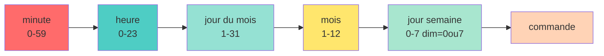

<a name="automatisation-scripts" id="automatisation-scripts"></a>

# 🤖 Module 8
## Automatisation, scripts et tâches planifiées

### Automatiser pour gagner du temps et éviter les erreurs

---

# Pourquoi automatiser ? 🤖

**Analogie : la machine à café programmable** ☕

Sans automatisation :
- Se lever à 6h pour faire le café
- Risque d'oublier
- Toujours la même tâche répétitive

Avec automatisation :
- Programmée pour 6h30
- Café prêt au réveil
- Zéro effort

---

#### Avantages de l'automatisation ✨

<div class="text-xs">

**1. Gain de temps**
- Tâches répétitives automatisées
- Vous dormez, le script travaille

**2. Fiabilité**
- Pas d'oubli
- Pas d'erreur humaine
- Traçabilité

**3. Cohérence**
- Toujours la même procédure
- Reproductible

**4. Scalabilité**
- Un script pour 1 serveur = un script pour 100 serveurs

</div>

---

# Shell scripting : bases 📝

**Script** : fichier texte contenant des commandes

**Premier script :**

```bash
#!/bin/bash
# Mon premier script

echo "Hello, World!"
echo "Date actuelle : $(date)"
echo "Utilisateur : $USER"
```

```bash
# Rendre exécutable
chmod +x script.sh

# Exécuter
./script.sh
```

---

# Le shebang #! 🔧

**Shebang** : première ligne qui indique l'interpréteur

```bash
#!/bin/bash      # Bash
#!/bin/sh        # Shell POSIX
#!/usr/bin/env python3    # Python
#!/usr/bin/env node       # Node.js
```

**Pourquoi `/usr/bin/env` ?**
- Cherche l'interpréteur dans le PATH
- Plus portable

---

# Variables 📦

```bash
#!/bin/bash

# Définir une variable
nom="Alice"
age=30

# Utiliser une variable
echo "Bonjour $nom"
echo "Vous avez $age ans"

# Ou avec accolades (recommandé)
echo "Bonjour ${nom}"
echo "Fichier : ${nom}.txt"
```

**⚠️ Pas d'espace autour du `=` !**

```bash
nom = "Alice"    # ERREUR
nom="Alice"      # CORRECT
```

---

# Variables d'environnement 🌍

```bash
#!/bin/bash

# Variables système
echo "Home : $HOME"
echo "User : $USER"
echo "Path : $PATH"
echo "Shell : $SHELL"
echo "PWD : $PWD"

# Définir une variable d'environnement
export MA_VARIABLE="valeur"

# Dans un autre script/programme, $MA_VARIABLE sera disponible
```

---

# Variables spéciales 🎁

```bash
#!/bin/bash

echo "Script : $0"           # Nom du script
echo "Premier arg : $1"      # Premier argument
echo "Deuxième arg : $2"     # Deuxième argument
echo "Tous les args : $@"    # Tous les arguments
echo "Nombre d'args : $#"    # Nombre d'arguments
echo "PID : $$"              # PID du script
echo "Dernier code retour : $?"  # Code retour dernière commande
```

**Analogie : une fonction en cuisine** 👨‍🍳

Imaginez une recette (script) avec des ingrédients (arguments) :
- **$0** : le nom de la recette ("Tarte aux pommes")
- **$1, $2** : les ingrédients ("pommes", "sucre")
- **$#** : nombre d'ingrédients (2)
- **$$** : le numéro de la cuisine (PID unique)
- **$?** : "est-ce que ça a réussi ?" (0=succès, autre=échec)

---

#### Exemple concret :

```bash
#!/bin/bash
# Script : backup.sh

if [ $# -lt 2 ]; then
    echo "Usage: $0 <source> <destination>"
    echo "Exemple: $0 /home/user /backup"
    exit 1
fi

echo "Sauvegarde de $1 vers $2..."
tar -czf "$2/backup-$(date +%Y%m%d).tar.gz" "$1"

if [ $? -eq 0 ]; then
    echo "✅ Sauvegarde réussie !"
else
    echo "❌ Erreur lors de la sauvegarde"
    exit 1
fi
```

---

# Exemple avec arguments 📋

```bash
#!/bin/bash

echo "Nombre d'arguments : $#"
echo "Premier argument : $1"
echo "Deuxième argument : $2"
echo "Tous les arguments : $@"

# Usage :
# ./script.sh alice bob
```

**Sortie :**

```
Nombre d'arguments : 2
Premier argument : alice
Deuxième argument : bob
Tous les arguments : alice bob
```

---

# Lire l'entrée utilisateur 🎤

```bash
#!/bin/bash

echo "Quel est votre nom ?"
read nom

echo "Bonjour $nom!"

# Lecture avec prompt
read -p "Votre âge : " age
echo "Vous avez $age ans"

# Lecture silencieuse (mot de passe)
read -sp "Mot de passe : " password
echo
echo "Mot de passe saisi (chut!)"
```

---

# Conditions : if/else 🔀

```bash
#!/bin/bash

age=25

if [ $age -ge 18 ]; then
    echo "Vous êtes majeur"
else
    echo "Vous êtes mineur"
fi
```

**⚠️ Espaces importants !**

```bash
if [ $age -ge 18 ]; then    # CORRECT
if [$age -ge 18]; then      # ERREUR
```

---

# Opérateurs de comparaison 🔢

**Nombres :**

```bash
-eq    # égal (equal)
-ne    # différent (not equal)
-lt    # inférieur (less than)
-le    # inférieur ou égal (less or equal)
-gt    # supérieur (greater than)
-ge    # supérieur ou égal (greater or equal)
```

**Exemple :**

```bash
if [ $age -ge 18 ]; then
    echo "Majeur"
fi
```

---

# Comparaison de chaînes 🔤

```bash
=      # égal
!=     # différent
-z     # chaîne vide
-n     # chaîne non vide
```

**Exemple :**

```bash
#!/bin/bash

nom="Alice"

if [ "$nom" = "Alice" ]; then
    echo "Bonjour Alice"
fi

if [ -z "$nom" ]; then
    echo "Nom vide"
fi
```

**⚠️ Toujours mettre les variables entre guillemets !**

---

# Tests de fichiers 📁

```bash
-e fichier    # existe
-f fichier    # est un fichier régulier
-d fichier    # est un répertoire
-r fichier    # est lisible
-w fichier    # est inscriptible
-x fichier    # est exécutable
-s fichier    # taille > 0
```

**Exemple :**

```bash
if [ -f "/etc/passwd" ]; then
    echo "Le fichier existe"
fi

if [ -d "/home/alice" ]; then
    echo "Le répertoire existe"
fi
```

---

# if/elif/else 🔀

```bash
#!/bin/bash

read -p "Votre note : " note

if [ $note -ge 16 ]; then
    echo "Très bien"
elif [ $note -ge 14 ]; then
    echo "Bien"
elif [ $note -ge 12 ]; then
    echo "Assez bien"
elif [ $note -ge 10 ]; then
    echo "Passable"
else
    echo "Insuffisant"
fi
```

---

# Opérateurs logiques 🧠

```bash
&&     # ET (AND)
||     # OU (OR)
!      # NON (NOT)
```

**Exemples :**

```bash
# ET
if [ $age -ge 18 ] && [ $permis = "oui" ]; then
    echo "Vous pouvez conduire"
fi

# OU
if [ $jour = "samedi" ] || [ $jour = "dimanche" ]; then
    echo "Week-end!"
fi

# NON
if [ ! -f "/tmp/lock" ]; then
    echo "Pas de fichier verrou"
fi
```

---

# Case : switch/case 🎯

```bash
#!/bin/bash

read -p "Entrez une commande (start/stop/restart) : " cmd

case $cmd in
    start)
        echo "Démarrage..."
        ;;
    stop)
        echo "Arrêt..."
        ;;
    restart)
        echo "Redémarrage..."
        ;;
    *)
        echo "Commande inconnue"
        ;;
esac
```

---

# Boucle for 🔁

```bash
#!/bin/bash

# Itérer sur une liste
for fruit in pomme banane orange; do
    echo "J'aime les ${fruit}s"
done

# Itérer sur des fichiers
for fichier in *.txt; do
    echo "Fichier : $fichier"
done

# Itérer sur une plage de nombres
for i in {1..5}; do
    echo "Numéro $i"
done
```

---

# Boucle for style C 🔁

```bash
#!/bin/bash

# Syntaxe C-style
for ((i=1; i<=10; i++)); do
    echo "Compteur : $i"
done

# Avec un pas de 2
for ((i=0; i<=20; i+=2)); do
    echo "Nombre pair : $i"
done
```

---

# Boucle while ♾️

```bash
#!/bin/bash

# Boucle tant que condition vraie
compteur=1

while [ $compteur -le 5 ]; do
    echo "Compteur : $compteur"
    ((compteur++))
done

# Lecture d'un fichier ligne par ligne
while read ligne; do
    echo "Ligne : $ligne"
done < fichier.txt
```

---

# Boucle until 🔄

```bash
#!/bin/bash

# Boucle jusqu'à ce que condition vraie
compteur=1

until [ $compteur -gt 5 ]; do
    echo "Compteur : $compteur"
    ((compteur++))
done
```

**Différence with/until :**
- `while` : continue tant que VRAI
- `until` : continue tant que FAUX

---

# Break et continue ⏭️

```bash
#!/bin/bash

# Break : sortir de la boucle
for i in {1..10}; do
    if [ $i -eq 5 ]; then
        break
    fi
    echo $i
done
# Affiche : 1 2 3 4

# Continue : passer à l'itération suivante
for i in {1..5}; do
    if [ $i -eq 3 ]; then
        continue
    fi
    echo $i
done
# Affiche : 1 2 4 5
```

---

# Fonctions 📦

```bash
#!/bin/bash

# Définir une fonction
saluer() {
    echo "Bonjour!"
}

# Appeler la fonction
saluer

# Fonction avec arguments
saluer_nom() {
    echo "Bonjour $1!"
}

saluer_nom "Alice"
saluer_nom "Bob"
```

---

# Fonctions avec retour 🔙

```bash
#!/bin/bash

# Fonction avec return (code de sortie 0-255)
est_pair() {
    if [ $(($1 % 2)) -eq 0 ]; then
        return 0    # Vrai
    else
        return 1    # Faux
    fi
}

if est_pair 4; then
    echo "4 est pair"
fi

# Fonction avec echo (retourner une valeur)
additionner() {
    echo $(($1 + $2))
}

resultat=$(additionner 5 3)
echo "Résultat : $resultat"
```

---

# Variables locales et globales 🌐

```bash
#!/bin/bash

global_var="Je suis globale"

ma_fonction() {
    local local_var="Je suis locale"
    echo $global_var    # Accessible
    echo $local_var     # Accessible
}

ma_fonction

echo $global_var        # Accessible
echo $local_var         # Vide (hors de portée)
```

---

# Tableaux 📊

```bash
#!/bin/bash

# Définir un tableau
fruits=("pomme" "banane" "orange")

# Accéder à un élément
echo ${fruits[0]}       # pomme
echo ${fruits[1]}       # banane

# Tous les éléments
echo ${fruits[@]}

# Nombre d'éléments
echo ${#fruits[@]}

# Ajouter un élément
fruits+=("kiwi")

# Parcourir le tableau
for fruit in "${fruits[@]}"; do
    echo $fruit
done
```

---

# Calculs arithmétiques 🧮

```bash
#!/bin/bash

# Méthode 1 : $(( ))
a=5
b=3
echo $((a + b))         # 8
echo $((a - b))         # 2
echo $((a * b))         # 15
echo $((a / b))         # 1 (division entière)
echo $((a % b))         # 2 (modulo)

# Incrémenter
((a++))
echo $a                 # 6

# Méthode 2 : expr (ancien)
resultat=$(expr $a + $b)

# Méthode 3 : bc pour décimaux
echo "scale=2; 10 / 3" | bc    # 3.33
```

---

# Substitution de commandes 💱

```bash
#!/bin/bash

# Méthode moderne : $( )
date_actuelle=$(date)
echo "Date : $date_actuelle"

fichiers=$(ls -1 | wc -l)
echo "Nombre de fichiers : $fichiers"

# Ancien style : ` ` (backticks)
date_actuelle=`date`
```

---

# Chaînes de caractères 🧵

```bash
#!/bin/bash

nom="Alice"

# Longueur
echo ${#nom}            # 5

# Sous-chaîne (à partir de position, longueur)
echo ${nom:0:2}         # Al

# Remplacement
phrase="J'aime les chats"
echo ${phrase/chats/chiens}    # J'aime les chiens

# Tout en majuscules
echo ${nom^^}           # ALICE

# Tout en minuscules
echo ${nom,,}           # alice
```

---

# Redirection dans les scripts 📤

```bash
#!/bin/bash

# Rediriger stdout vers un fichier
echo "Log entry" > log.txt

# Ajouter à un fichier
echo "Another entry" >> log.txt

# Rediriger stderr
commande_inexistante 2> erreurs.txt

# Rediriger tout
commande > tout.txt 2>&1

# Ignorer les erreurs
commande 2> /dev/null
```

---

# Gestion des erreurs 🚨

```bash
#!/bin/bash

# Exit si erreur
set -e

# Vérifier le code de retour
if ! commande; then
    echo "Erreur lors de l'exécution"
    exit 1
fi

# Ou avec $?
commande
if [ $? -ne 0 ]; then
    echo "Erreur"
    exit 1
fi

# Exit avec message
error_exit() {
    echo "Erreur : $1" >&2
    exit 1
}

[ -f "fichier.txt" ] || error_exit "Fichier manquant"
```

---

# set : options de script 🔧

```bash
#!/bin/bash

set -e    # Arrêter si une commande échoue
set -u    # Erreur si variable non définie
set -x    # Afficher les commandes exécutées (debug)
set -o pipefail    # Échec si une commande du pipe échoue

# Combiné (recommandé)
set -euo pipefail

# Ou sur la ligne shebang
#!/bin/bash -euo pipefail
```

---

# Exemple de script pratique : sauvegarde 💾

```bash
#!/bin/bash
set -euo pipefail

# Variables
SOURCE="/home/alice"
DESTINATION="/backup"
DATE=$(date +%Y%m%d_%H%M%S)
ARCHIVE="backup_${DATE}.tar.gz"

# Fonction de log
log() {
    echo "[$(date +%Y-%m-%d\ %H:%M:%S)] $1"
}

# Vérifier que la source existe
if [ ! -d "$SOURCE" ]; then
    log "ERREUR : $SOURCE n'existe pas"
    exit 1
fi
```

---

# Exemple de script pratique : sauvegarde (suite) 💾

```bash
# Créer le répertoire de destination si nécessaire
mkdir -p "$DESTINATION"

# Sauvegarde
log "Début de la sauvegarde de $SOURCE"

if tar -czf "${DESTINATION}/${ARCHIVE}" "$SOURCE"; then
    log "Sauvegarde réussie : ${ARCHIVE}"
else
    log "ERREUR lors de la sauvegarde"
    exit 1
fi

# Supprimer les sauvegardes de plus de 7 jours
find "$DESTINATION" -name "backup_*.tar.gz" -mtime +7 -delete
log "Anciennes sauvegardes supprimées"

log "Fin de la sauvegarde"
```

---

# cron : planificateur de tâches ⏰

**cron** : exécute des commandes à intervalles réguliers

**Analogie : l'alarme de votre téléphone**
- Programmée pour sonner à des moments précis
- Peut se répéter (tous les jours, toutes les semaines)
- Vous rappelle des tâches

```bash
# Éditer le crontab
crontab -e

# Voir le crontab actuel
crontab -l

# Supprimer le crontab
crontab -r
```

---

# Format du crontab 📋



**Format :** `* * * * * commande`

**Exemples :**

```bash
# Tous les jours à 2h30
30 2 * * * /chemin/script.sh

# Toutes les heures
0 * * * * /chemin/script.sh

# Tous les lundis à 9h
0 9 * * 1 /chemin/script.sh
```

---

# Exemples de crontab ⏰

```bash
# Toutes les 5 minutes
*/5 * * * * /chemin/script.sh

# Tous les jours à minuit
0 0 * * * /chemin/backup.sh

# Le premier jour de chaque mois à 6h
0 6 1 * * /chemin/rapport.sh

# Du lundi au vendredi à 8h
0 8 * * 1-5 /chemin/script.sh

# Samedis et dimanches à 10h
0 10 * * 6,7 /chemin/weekend.sh

# Au démarrage du système
@reboot /chemin/startup.sh
```

---

# Raccourcis cron 🔖

```bash
@reboot        # Au démarrage
@yearly        # Une fois par an : 0 0 1 1 *
@annually      # Idem
@monthly       # Une fois par mois : 0 0 1 * *
@weekly        # Une fois par semaine : 0 0 * * 0
@daily         # Une fois par jour : 0 0 * * *
@midnight      # Idem
@hourly        # Une fois par heure : 0 * * * *
```

**Exemple :**

```bash
@daily /usr/local/bin/cleanup.sh
@hourly /usr/local/bin/check_health.sh
```

---

# Variables d'environnement dans cron 🌍

```bash
# Définir des variables
SHELL=/bin/bash
PATH=/usr/local/bin:/usr/bin:/bin
MAILTO=admin@example.com

# Ensuite les tâches cron
0 2 * * * /chemin/backup.sh
```

**⚠️ Problème courant :** PATH limité dans cron
- Toujours utiliser des chemins absolus
- Ou définir PATH au début du crontab

---

# Redirection dans cron 📤

```bash
# Envoyer stdout vers un fichier
0 2 * * * /chemin/script.sh > /var/log/script.log

# Ajouter à un fichier
0 2 * * * /chemin/script.sh >> /var/log/script.log

# Rediriger stdout et stderr
0 2 * * * /chemin/script.sh >> /var/log/script.log 2>&1

# Ignorer toute sortie (silencieux)
0 2 * * * /chemin/script.sh > /dev/null 2>&1

# Envoyer par email (si MAILTO défini)
0 2 * * * /chemin/script.sh
```

---

# Cron système : /etc/cron.* 🗂️

**Répertoires système :**

```bash
/etc/cron.hourly/     # Scripts exécutés toutes les heures
/etc/cron.daily/      # Scripts quotidiens
/etc/cron.weekly/     # Scripts hebdomadaires
/etc/cron.monthly/    # Scripts mensuels
```

**Utilisation :**

```bash
# Copier un script dans le répertoire
sudo cp mon_script.sh /etc/cron.daily/

# Rendre exécutable
sudo chmod +x /etc/cron.daily/mon_script.sh
```

**Plus simple que crontab pour tâches standards !**

---

# anacron : pour les machines non 24/7 🏠

**anacron** : exécute les tâches manquées

**Différence avec cron :**
- **cron** : exécute à un moment précis
- **anacron** : exécute quand la machine est allumée

**Utile pour :**
- Ordinateurs portables
- Machines de bureau
- Serveurs redémarrés souvent

```bash
# Configuration : /etc/anacrontab
# Période  Délai  Identifiant  Commande
1         5      cron.daily   run-parts /etc/cron.daily
7         10     cron.weekly  run-parts /etc/cron.weekly
@monthly  15     cron.monthly run-parts /etc/cron.monthly
```

---

# at : tâche ponctuelle unique ⏱️

**at** : exécuter une commande une seule fois

```bash
# Installer
sudo apt install at

# Activer
sudo systemctl enable --now atd

# Planifier une tâche
at 10:30
> /chemin/script.sh
> Ctrl+D

# Autres formats
at now + 1 hour
at tomorrow
at 14:00 tomorrow
at 2:30 PM Friday
```

---

# Gérer les tâches at 🎛️

```bash
# Lister les tâches en attente
atq
# ou
at -l

# Voir les détails d'une tâche
at -c 1

# Supprimer une tâche
atrm 1

# Planifier depuis un fichier
at -f script.sh now + 1 hour
```

---

# systemd timers : alternative moderne ⏲️

**systemd timer** : remplaçant moderne de cron

**Avantages :**
- Intégration avec systemd
- Logs dans journalctl
- Dépendances
- Répétition flexible

**Inconvénient :**
- Plus complexe à configurer

---

# Créer un systemd timer 🛠️

**1. Créer le service : `/etc/systemd/system/mon-script.service`**

```ini
[Unit]
Description=Mon script de maintenance

[Service]
Type=oneshot
ExecStart=/usr/local/bin/mon-script.sh
```

---

# Créer un systemd timer (suite) 🛠️

**2. Créer le timer : `/etc/systemd/system/mon-script.timer`**

```ini
[Unit]
Description=Timer pour mon script

[Timer]
OnCalendar=daily
OnCalendar=*-*-* 02:30:00
Persistent=true

[Install]
WantedBy=timers.target
```

---

# Créer un systemd timer (suite) 🛠️

**3. Activer et démarrer**

```bash
# Recharger systemd
sudo systemctl daemon-reload

# Activer le timer
sudo systemctl enable mon-script.timer

# Démarrer le timer
sudo systemctl start mon-script.timer

# Vérifier l'état
systemctl status mon-script.timer

# Lister tous les timers
systemctl list-timers
```

---

# Syntaxe OnCalendar 📅

```ini
# Tous les jours à minuit
OnCalendar=daily

# Toutes les heures
OnCalendar=hourly

# Tous les lundis à 9h
OnCalendar=Mon *-*-* 09:00:00

# Tous les 15 minutes
OnCalendar=*:0/15

# Premier jour du mois
OnCalendar=*-*-01 00:00:00

# Vérifier la syntaxe
systemd-analyze calendar "Mon *-*-* 09:00:00"
```

---

# Logs : où sont-ils ? 📜

**Logs système :**

```bash
/var/log/syslog        # Logs système général (Debian/Ubuntu)
/var/log/messages      # Logs système (RHEL/Fedora)
/var/log/auth.log      # Authentification (Debian/Ubuntu)
/var/log/secure        # Authentification (RHEL/Fedora)
/var/log/kern.log      # Noyau
/var/log/dmesg         # Messages de boot
/var/log/cron          # Logs cron
```

---

# Voir les logs : tail et grep 🔍

```bash
# Dernières lignes d'un log
tail /var/log/syslog

# Suivre en temps réel
tail -f /var/log/syslog

# 50 dernières lignes
tail -n 50 /var/log/syslog

# Rechercher dans les logs
grep "error" /var/log/syslog

# Case insensitive
grep -i "error" /var/log/syslog

# Avec contexte (3 lignes avant/après)
grep -C 3 "error" /var/log/syslog
```

---

# journalctl : logs systemd 📚

```bash
# Tous les logs
journalctl

# Depuis le dernier boot
journalctl -b

# Logs d'un service
journalctl -u nginx

# Suivre en temps réel
journalctl -f

# Suivre un service
journalctl -u nginx -f

# Depuis une date
journalctl --since "2025-11-06"
journalctl --since "1 hour ago"
```

---

# journalctl : filtres avancés 🔎

```bash
# Par priorité
journalctl -p err         # Erreurs
journalctl -p warning     # Warnings et plus

# Période
journalctl --since "2025-11-06 10:00" --until "2025-11-06 12:00"

# Combinaisons
journalctl -u nginx -p err --since "1 day ago"

# Par utilisateur
journalctl _UID=1000

# Kernel messages
journalctl -k

# Export JSON
journalctl -u nginx -o json
```

---

# Gestion des logs : logrotate 🔄

**logrotate** : rotation automatique des logs

**Configuration : `/etc/logrotate.conf` et `/etc/logrotate.d/`**

**Exemple : `/etc/logrotate.d/nginx`**

```
/var/log/nginx/*.log {
    daily
    rotate 14
    compress
    delaycompress
    notifempty
    create 0640 www-data adm
    sharedscripts
    postrotate
        [ -f /var/run/nginx.pid ] && kill -USR1 $(cat /var/run/nginx.pid)
    endscript
}
```

---

# Configuration logrotate 📝

**Options courantes :**

```
daily         # Rotation quotidienne
weekly        # Rotation hebdomadaire
monthly       # Rotation mensuelle
rotate 7      # Garder 7 fichiers
compress      # Compresser les anciens logs
delaycompress # Compresser au prochain cycle
notifempty    # Ne pas tourner si vide
create 0644 user group  # Créer nouveau fichier avec permissions
size 100M     # Tourner si > 100M
```

---

# Tester logrotate 🧪

```bash
# Tester la configuration
sudo logrotate -d /etc/logrotate.conf

# Forcer la rotation
sudo logrotate -f /etc/logrotate.conf

# Voir l'état
cat /var/lib/logrotate/status
```

---

# Alertes et notifications 🔔

**Envoyer un email depuis un script :**

```bash
#!/bin/bash

# Installer mailutils
sudo apt install mailutils

# Envoyer un email simple
echo "Le script a terminé" | mail -s "Notification" admin@example.com

# Avec un fichier
mail -s "Rapport" admin@example.com < rapport.txt

# Dans un script
if ! /chemin/backup.sh; then
    echo "La sauvegarde a échoué" | mail -s "ERREUR Backup" admin@example.com
fi
```

---

# Notifications système : notify-send 💬

```bash
# Installer
sudo apt install libnotify-bin

# Notification simple
notify-send "Titre" "Message"

# Avec icône
notify-send -i info "Info" "Message informatif"

# Avec urgence
notify-send -u critical "Erreur" "Problème critique!"

# Dans un script
if [ $espace_libre -lt 10 ]; then
    notify-send -u critical "Disque plein" "Moins de 10% d'espace libre"
fi
```

---

# Exemple : script de monitoring 📊

```bash
#!/bin/bash

# Vérifier l'espace disque
espace=$(df -h / | awk 'NR==2 {print $5}' | tr -d '%')

if [ $espace -gt 80 ]; then
    echo "ALERTE : Disque à ${espace}%" | \
        mail -s "Alerte disque" admin@example.com
fi

# Vérifier si un service tourne
if ! systemctl is-active --quiet nginx; then
    echo "ALERTE : Nginx est arrêté" | \
        mail -s "Service down" admin@example.com
    systemctl start nginx
fi
```

---

# Bonnes pratiques de scripting 📋

1. **Toujours commencer par un shebang**
   ```bash
   #!/bin/bash
   ```

2. **Utiliser set -euo pipefail**
   ```bash
   set -euo pipefail
   ```

3. **Commenter votre code**
   ```bash
   # Ce script fait une sauvegarde
   ```

4. **Utiliser des variables pour les valeurs répétées**
   ```bash
   LOG_DIR=/var/log/mon-app
   ```

---

# Bonnes pratiques de scripting (suite) 📋

5. **Vérifier les dépendances au début**
   ```bash
   command -v rsync >/dev/null || { echo "rsync requis"; exit 1; }
   ```

6. **Toujours mettre les variables entre guillemets**
   ```bash
   echo "$variable"    # CORRECT
   echo $variable      # Risqué
   ```

7. **Utiliser des fonctions pour le code répété**

8. **Logger les actions importantes**

---

# Bonnes pratiques de scripting (suite) 📋

9. **Tester avant de déployer**
   - Toujours dans un environnement de test

10. **Gérer les erreurs**
    ```bash
    commande || { echo "Erreur"; exit 1; }
    ```

11. **Utiliser des chemins absolus dans cron**
    ```bash
    /usr/bin/python3 /home/user/script.py
    ```

12. **Ne jamais faire confiance aux entrées utilisateur**

---

# Débugger un script 🐛

```bash
# Mode debug (affiche les commandes)
bash -x script.sh

# Ou dans le script
set -x

# Activer/désactiver ponctuellement
set -x
commandes_à_debugger
set +x

# Vérifier la syntaxe sans exécuter
bash -n script.sh

# ShellCheck : outil de linting
sudo apt install shellcheck
shellcheck script.sh
```

---

# Récapitulatif du Module 8 ✅

**Ce que vous avez appris :**

✅ Bases du shell scripting (variables, conditions, boucles)

✅ Fonctions et tableaux

✅ Gestion des erreurs

✅ cron pour tâches récurrentes

✅ at pour tâches ponctuelles

✅ systemd timers (alternative moderne)

✅ Gestion des logs (journalctl, logrotate)

✅ Alertes et notifications

✅ Bonnes pratiques de scripting

---

# Prochaine étape 🎯

**Module 9 : Sécurité système**

- Durcissement SSH et fail2ban
- SELinux et AppArmor
- Pare-feu et durcissement système
- Audit et logs de sécurité
- Fail2ban
- Gestion des mots de passe

---
layout: default
---

# Questions ? 🤔

N'hésitez pas à poser vos questions maintenant !

Le prochain module se concentrera sur la sécurité du système Linux.

