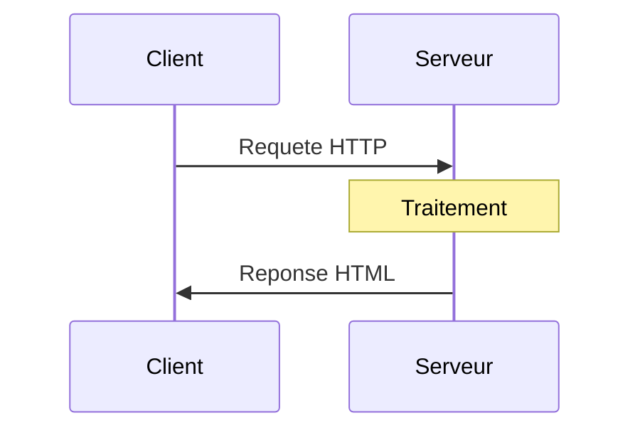

<a name="services-serveurs" id="services-serveurs"></a>

# ☁️ Module 9
## Services serveurs

### Installer et gérer des services courants

---

# Qu'est-ce qu'un serveur ? 🖥️

**Serveur** : ordinateur qui fournit des services à d'autres (clients)

**Analogie : un restaurant** 🍽️
- **Serveur web** : serveur qui apporte les plats (pages web)
- **Clients** : les convives (navigateurs)
- **Cuisine** : l'arrière-plan (traitement)
- **Menu** : l'API
- **Réservations** : gestion des sessions

**Linux** : système de prédilection pour les serveurs
- Stable, performant, gratuit
- Grande communauté
- Outils puissants

---

# Architecture client-serveur 🔄



**Exemples :**
- **Web** : navigateur ↔ Nginx/Apache
- **Email** : client mail ↔ serveur SMTP
- **Base de données** : app ↔ MySQL/PostgreSQL
- **DNS** : système ↔ serveur DNS

---

# Serveur web : Nginx 🚀

**Nginx** : serveur web moderne et performant

**Avantages :**
- Très performant (async)
- Faible consommation mémoire
- Reverse proxy efficace
- Load balancing
- Configuration simple

**Cas d'usage :**
- Servir des sites statiques
- Reverse proxy pour apps (Node, Python, etc.)
- Load balancer
- Cache

---

# Installer Nginx 📥

```bash
# Debian/Ubuntu
sudo apt update
sudo apt install nginx

# RHEL/Fedora
sudo dnf install nginx

# Démarrer
sudo systemctl start nginx
sudo systemctl enable nginx

# Vérifier
sudo systemctl status nginx
curl http://localhost
```

---

# Structure de Nginx 📁

```mermaid
graph LR
    A[\"/etc/nginx/\"]
    A --> B[\"nginx.conf<br/>Config principale\"]
    A --> C[\"sites-available/<br/>Sites disponibles\"]
    C --> C1[\"default\"]
    A --> D[\"sites-enabled/<br/>Sites actifs\"]
    D --> D1[\"default lien symbolique\"]
    A --> E[\"conf.d/<br/>Configs RHEL/Fedora\"]
    A --> F[\"snippets/<br/>Snippets reutilisables\"]
    
    G[\"/var/www/html/<br/>Repertoire web\"]
    H[\"/var/log/nginx/<br/>Logs\"]
    
    style A fill:#4ecdc4
    style G fill:#95e1d3
    style H fill:#ffe66d
```

---

# Configuration Nginx de base 📝

**Fichier : `/etc/nginx/sites-available/default`**

```nginx
server {
    listen 80;
    listen [::]:80;

    server_name example.com www.example.com;

    root /var/www/html;
    index index.html index.htm;

    location / {
        try_files $uri $uri/ =404;
    }

    access_log /var/log/nginx/access.log;
    error_log /var/log/nginx/error.log;
}
```

---

# Créer un virtual host 🌐

**1. Créer la configuration**

```bash
sudo nano /etc/nginx/sites-available/mon-site
```

```nginx
server {
    listen 80;
    server_name mon-site.local;

    root /var/www/mon-site;
    index index.html;

    location / {
        try_files $uri $uri/ =404;
    }
}
```

---

# Créer un virtual host (suite) 🌐

**2. Créer le répertoire et le contenu**

```bash
sudo mkdir -p /var/www/mon-site
echo "<h1>Mon Site</h1>" | sudo tee /var/www/mon-site/index.html
sudo chown -R www-data:www-data /var/www/mon-site
```

---

# Créer un virtual host (suite) 🌐

**3. Activer le site**

```bash
# Créer le lien symbolique
sudo ln -s /etc/nginx/sites-available/mon-site /etc/nginx/sites-enabled/

# Tester la configuration
sudo nginx -t

# Recharger Nginx
sudo systemctl reload nginx
```

---

# Créer un virtual host (suite) 🌐

**4. Ajouter au /etc/hosts (pour tests locaux)**

```bash
sudo nano /etc/hosts
```

```
127.0.0.1   mon-site.local
```

**Tester :**

```bash
curl http://mon-site.local
```

---

# Nginx comme reverse proxy 🔄

**Reverse proxy** : Nginx devant une application

```nginx
server {
    listen 80;
    server_name api.example.com;

    location / {
        proxy_pass http://localhost:3000;
        proxy_http_version 1.1;
        proxy_set_header Upgrade $http_upgrade;
        proxy_set_header Connection 'upgrade';
        proxy_set_header Host $host;
        proxy_set_header X-Real-IP $remote_addr;
        proxy_set_header X-Forwarded-For $proxy_add_x_forwarded_for;
        proxy_set_header X-Forwarded-Proto $scheme;
        proxy_cache_bypass $http_upgrade;
    }
}
```

---

# HTTPS avec Let's Encrypt 🔒

**Certbot** : obtenir des certificats SSL gratuits

```bash
# Installer Certbot
sudo apt install certbot python3-certbot-nginx

# Obtenir et installer le certificat
sudo certbot --nginx -d example.com -d www.example.com

# Renouvellement automatique
sudo systemctl status certbot.timer

# Tester le renouvellement
sudo certbot renew --dry-run
```

---

# Configuration HTTPS générée 🔐

```nginx
server {
    listen 443 ssl http2;
    listen [::]:443 ssl http2;
    server_name example.com;

    ssl_certificate /etc/letsencrypt/live/example.com/fullchain.pem;
    ssl_certificate_key /etc/letsencrypt/live/example.com/privkey.pem;
    include /etc/letsencrypt/options-ssl-nginx.conf;
    ssl_dhparam /etc/letsencrypt/ssl-dhparams.pem;

    # ... reste de la config
}

server {
    listen 80;
    server_name example.com;
    return 301 https://$server_name$request_uri;
}
```

---

# Nginx : commandes utiles 🔧

```bash
# Tester la configuration
sudo nginx -t

# Recharger (sans downtime)
sudo systemctl reload nginx

# Redémarrer
sudo systemctl restart nginx

# Arrêter
sudo systemctl stop nginx

# Voir les logs en temps réel
sudo tail -f /var/log/nginx/access.log
sudo tail -f /var/log/nginx/error.log
```

---

# Apache : alternative à Nginx 🪶

**Apache** : serveur web historique

**Avantages :**
- Très mature et stable
- Modules nombreux
- .htaccess (config par répertoire)
- Documentation extensive

```bash
# Installer
sudo apt install apache2

# Démarrer
sudo systemctl start apache2
sudo systemctl enable apache2
```

---

# Structure Apache 📁

```mermaid
graph LR
    A[\"/etc/apache2/\"]
    A --> B[\"apache2.conf<br/>Config principale\"]
    A --> C[\"sites-available/<br/>Sites disponibles\"]
    C --> C1[\"000-default.conf\"]
    A --> D[\"sites-enabled/<br/>Sites actifs\"]
    D --> D1[\"000-default lien symbolique\"]
    A --> E[\"mods-available/<br/>Modules disponibles\"]
    A --> F[\"mods-enabled/<br/>Modules actifs\"]
    A --> G[\"conf-available/<br/>Configs disponibles\"]
    
    H[\"/var/www/html/<br/>Repertoire web\"]
    I[\"/var/log/apache2/<br/>Logs\"]
    
    style A fill:#ff6b6b
    style H fill:#95e1d3
    style I fill:#ffe66d
```

---

# Virtual host Apache 🌐

**Fichier : `/etc/apache2/sites-available/mon-site.conf`**

```apache
<VirtualHost *:80>
    ServerName mon-site.local
    ServerAdmin admin@mon-site.local
    DocumentRoot /var/www/mon-site

    <Directory /var/www/mon-site>
        Options Indexes FollowSymLinks
        AllowOverride All
        Require all granted
    </Directory>

    ErrorLog ${APACHE_LOG_DIR}/mon-site_error.log
    CustomLog ${APACHE_LOG_DIR}/mon-site_access.log combined
</VirtualHost>
```

---

# Activer un site Apache 🔌

```bash
# Activer le site
sudo a2ensite mon-site.conf

# Désactiver le site par défaut
sudo a2dissite 000-default.conf

# Recharger
sudo systemctl reload apache2

# Commandes utiles
sudo a2enmod rewrite    # Activer module rewrite
sudo a2dismod status    # Désactiver module
```

---

# PHP avec Apache ou Nginx 🐘

**Installer PHP :**

```bash
# Debian/Ubuntu
sudo apt install php-fpm php-mysql php-cli php-curl php-gd

# RHEL/Fedora
sudo dnf install php-fpm php-mysqlnd php-cli php-curl php-gd
```

---

# PHP avec Nginx ⚙️

```nginx
server {
    listen 80;
    server_name example.com;
    root /var/www/html;
    index index.php index.html;

    location ~ \.php$ {
        include snippets/fastcgi-php.conf;
        fastcgi_pass unix:/run/php/php8.1-fpm.sock;
    }

    location ~ /\.ht {
        deny all;
    }
}
```

```bash
# Redémarrer PHP-FPM
sudo systemctl restart php8.1-fpm
```

---

# PHP avec Apache ⚙️

```bash
# Installer le module PHP pour Apache
sudo apt install libapache2-mod-php

# Redémarrer Apache
sudo systemctl restart apache2

# Tester
echo "<?php phpinfo(); ?>" | sudo tee /var/www/html/info.php
curl http://localhost/info.php
```

---

# Base de données : MySQL/MariaDB 🗄️

**MariaDB** : fork open source de MySQL

```bash
# Installer MariaDB
sudo apt install mariadb-server

# Démarrer
sudo systemctl start mariadb
sudo systemctl enable mariadb

# Sécuriser l'installation
sudo mysql_secure_installation
```

---

# mysql_secure_installation 🔒

**Questions posées :**

1. Définir un mot de passe root
2. Supprimer les utilisateurs anonymes
3. Interdire le login root à distance
4. Supprimer la base de test
5. Recharger les tables de privilèges

**Répondre "Y" à tout pour une installation sécurisée**

---

# Se connecter à MySQL 🔗

```bash
# En tant que root
sudo mysql

# Avec mot de passe
mysql -u root -p

# Commandes MySQL
mysql> SHOW DATABASES;
mysql> USE mysql;
mysql> SHOW TABLES;
mysql> SELECT user, host FROM user;
mysql> EXIT;
```

---

# Créer une base et un utilisateur 👤

```sql
-- Créer une base de données
CREATE DATABASE ma_base;

-- Créer un utilisateur
CREATE USER 'alice'@'localhost' IDENTIFIED BY 'mot_de_passe_fort';

-- Donner tous les privilèges sur la base
GRANT ALL PRIVILEGES ON ma_base.* TO 'alice'@'localhost';

-- Appliquer les changements
FLUSH PRIVILEGES;

-- Vérifier
SHOW GRANTS FOR 'alice'@'localhost';
```

---

# Sauvegarder et restaurer MySQL 💾

```bash
# Sauvegarder une base
mysqldump -u root -p ma_base > ma_base_backup.sql

# Sauvegarder toutes les bases
mysqldump -u root -p --all-databases > all_databases.sql

# Restaurer une base
mysql -u root -p ma_base < ma_base_backup.sql

# Restaurer tout
mysql -u root -p < all_databases.sql
```

---

# PostgreSQL : alternative à MySQL 🐘

```bash
# Installer PostgreSQL
sudo apt install postgresql postgresql-contrib

# Démarrer
sudo systemctl start postgresql
sudo systemctl enable postgresql

# Se connecter
sudo -u postgres psql

# Commandes PostgreSQL
postgres=# \l                    -- Lister les bases
postgres=# \c ma_base            -- Se connecter à une base
postgres=# \dt                   -- Lister les tables
postgres=# \du                   -- Lister les utilisateurs
postgres=# \q                    -- Quitter
```

---

# Serveur DNS : BIND 🌐

**BIND** : Berkeley Internet Name Domain

```bash
# Installer
sudo apt install bind9 bind9utils bind9-doc

# Démarrer
sudo systemctl start named
sudo systemctl enable named

# Configuration
/etc/bind/
├── named.conf              # Configuration principale
├── named.conf.options      # Options
├── named.conf.local        # Zones locales
└── named.conf.default-zones
```

---

# Configuration DNS simple 📝

**Fichier : `/etc/bind/named.conf.local`**

```
zone "exemple.local" {
    type master;
    file "/etc/bind/zones/db.exemple.local";
};

zone "1.168.192.in-addr.arpa" {
    type master;
    file "/etc/bind/zones/db.192.168.1";
};
```

---

# Fichier de zone DNS 🗺️

**Fichier : `/etc/bind/zones/db.exemple.local`**

```
$TTL    604800
@       IN      SOA     ns1.exemple.local. admin.exemple.local. (
                              3         ; Serial
                         604800         ; Refresh
                          86400         ; Retry
                        2419200         ; Expire
                         604800 )       ; Negative Cache TTL
;
@       IN      NS      ns1.exemple.local.
@       IN      A       192.168.1.10
ns1     IN      A       192.168.1.10
www     IN      A       192.168.1.20
mail    IN      A       192.168.1.30
```

---

# Tester le DNS 🧪

```bash
# Vérifier la configuration
sudo named-checkconf
sudo named-checkzone exemple.local /etc/bind/zones/db.exemple.local

# Redémarrer BIND
sudo systemctl restart named

# Tester avec dig
dig @localhost exemple.local
dig @localhost www.exemple.local

# Tester avec nslookup
nslookup www.exemple.local localhost
```

---

# Serveur de cache DNS : dnsmasq 🚀

**dnsmasq** : DNS + DHCP léger

```bash
# Installer
sudo apt install dnsmasq

# Configuration simple
sudo nano /etc/dnsmasq.conf
```

```
# Écouter sur localhost
listen-address=127.0.0.1

# Upstream DNS
server=8.8.8.8
server=1.1.1.1

# Taille du cache
cache-size=1000

# Résolution locale
address=/mon-serveur.local/192.168.1.10
```

---

# Serveur FTP : vsftpd 📂

**vsftpd** : Very Secure FTP Daemon

```bash
# Installer
sudo apt install vsftpd

# Sauvegarder la config originale
sudo cp /etc/vsftpd.conf /etc/vsftpd.conf.backup

# Éditer
sudo nano /etc/vsftpd.conf
```

---

# Configuration vsftpd 📝

```bash
# Désactiver les connexions anonymes
anonymous_enable=NO

# Autoriser les utilisateurs locaux
local_enable=YES

# Autoriser l'écriture
write_enable=YES

# Chrooter les utilisateurs dans leur home
chroot_local_user=YES

# Ports passifs
pasv_min_port=40000
pasv_max_port=40100

# Logs
xferlog_enable=YES
xferlog_file=/var/log/vsftpd.log
```

```bash
# Redémarrer
sudo systemctl restart vsftpd
```

---

# Serveur de mail : Postfix 📧

**Postfix** : MTA (Mail Transfer Agent) moderne

```bash
# Installer
sudo apt install postfix

# Pendant l'installation, choisir "Internet Site"
# Entrer le nom de domaine

# Configuration
sudo nano /etc/postfix/main.cf
```

---

# Configuration Postfix de base 📝

```bash
myhostname = mail.exemple.com
mydomain = exemple.com
myorigin = $mydomain
inet_interfaces = all
mydestination = $myhostname, localhost.$mydomain, $mydomain
mynetworks = 127.0.0.0/8, 192.168.1.0/24
home_mailbox = Maildir/
```

```bash
# Redémarrer
sudo systemctl restart postfix

# Tester
echo "Test" | mail -s "Sujet" user@exemple.com
```

---

# Monitoring : Netdata 📊

**Netdata** : monitoring en temps réel

```bash
# Installation automatique
bash <(curl -Ss https://my-netdata.io/kickstart.sh)

# Accéder à l'interface
# http://localhost:19999
```

**Fonctionnalités :**
- CPU, RAM, disque, réseau
- Temps réel (1s d'actualisation)
- Pas de base de données
- Alertes

---

# Monitoring : Prometheus + Grafana 📈

**Prometheus** : collecte de métriques

```bash
# Installer Prometheus
sudo apt install prometheus

# Démarrer
sudo systemctl start prometheus
sudo systemctl enable prometheus

# Interface : http://localhost:9090
```

---

# Grafana : visualisation 📊

```bash
# Ajouter le dépôt
sudo apt install -y software-properties-common
wget -q -O - https://packages.grafana.com/gpg.key | sudo apt-key add -
echo "deb https://packages.grafana.com/oss/deb stable main" | \
  sudo tee /etc/apt/sources.list.d/grafana.list

# Installer
sudo apt update
sudo apt install grafana

# Démarrer
sudo systemctl start grafana-server
sudo systemctl enable grafana-server

# Interface : http://localhost:3000
# Login : admin / admin
```

---

# Logs centralisés : ELK Stack 📜

**ELK** : Elasticsearch + Logstash + Kibana

**Elasticsearch** : stockage et recherche
**Logstash** : collecte et transformation
**Kibana** : visualisation

**Alternative moderne :** **Loki + Promtail + Grafana**

---

# Haute disponibilité : concepts 🔄

**HA** : High Availability (disponibilité élevée)

**Objectif :** minimiser le downtime

**Techniques :**
- **Load balancing** : répartir la charge
- **Failover** : basculement automatique
- **Réplication** : copies multiples
- **Monitoring** : détection de panne

**SLA** : Service Level Agreement
- 99.9% = 8h46min de downtime/an
- 99.99% = 52min/an
- 99.999% = 5min/an

---

# Load balancing avec Nginx ⚖️

```nginx
upstream backend {
    server backend1.example.com:8080;
    server backend2.example.com:8080;
    server backend3.example.com:8080;
}

server {
    listen 80;
    server_name example.com;

    location / {
        proxy_pass http://backend;
        proxy_set_header Host $host;
        proxy_set_header X-Real-IP $remote_addr;
    }
}
```

---

# Méthodes de load balancing 🎯

```nginx
# Round-robin (par défaut)
upstream backend {
    server backend1.example.com;
    server backend2.example.com;
}

# Least connections
upstream backend {
    least_conn;
    server backend1.example.com;
    server backend2.example.com;
}

# IP hash (sticky sessions)
upstream backend {
    ip_hash;
    server backend1.example.com;
    server backend2.example.com;
}
```

---

# Health checks 🏥

```nginx
upstream backend {
    server backend1.example.com max_fails=3 fail_timeout=30s;
    server backend2.example.com max_fails=3 fail_timeout=30s;
    server backend3.example.com backup;  # Serveur de secours
}
```

**Options :**
- `max_fails` : nombre d'échecs avant marquage "down"
- `fail_timeout` : durée avant nouvelle tentative
- `backup` : utilisé seulement si les autres sont down

---

# Keepalived : IP virtuelle 🔄

**Keepalived** : basculement d'IP entre serveurs

```bash
# Installer
sudo apt install keepalived

# Configuration
sudo nano /etc/keepalived/keepalived.conf
```

```
vrrp_instance VI_1 {
    state MASTER
    interface eth0
    virtual_router_id 51
    priority 100
    advert_int 1
    authentication {
        auth_type PASS
        auth_pass secret
    }
    virtual_ipaddress {
        192.168.1.100
    }
}
```

---

# Réplication MySQL 🔄

**Master-Slave Replication**

**Sur le Master :**

```sql
CREATE USER 'repl'@'%' IDENTIFIED BY 'password';
GRANT REPLICATION SLAVE ON *.* TO 'repl'@'%';

SHOW MASTER STATUS;
-- Noter File et Position
```

**Configuration : `/etc/mysql/my.cnf`**

```ini
[mysqld]
server-id = 1
log_bin = /var/log/mysql/mysql-bin.log
```

---

# Réplication MySQL (suite) 🔄

**Sur le Slave :**

**Configuration : `/etc/mysql/my.cnf`**

```ini
[mysqld]
server-id = 2
```

```sql
CHANGE MASTER TO
    MASTER_HOST='master_ip',
    MASTER_USER='repl',
    MASTER_PASSWORD='password',
    MASTER_LOG_FILE='mysql-bin.000001',
    MASTER_LOG_POS=154;

START SLAVE;
SHOW SLAVE STATUS\G
```

---

# Containers : Docker 🐳

**Docker** : conteneurisation d'applications

```bash
# Installer Docker
curl -fsSL https://get.docker.com -o get-docker.sh
sudo sh get-docker.sh

# Ajouter l'utilisateur au groupe docker
sudo usermod -aG docker $USER

# Tester
docker run hello-world
```

---

# Docker : commandes de base 🐳

```bash
# Lancer un conteneur
docker run -d -p 80:80 nginx

# Lister les conteneurs
docker ps

# Arrêter un conteneur
docker stop <container_id>

# Voir les logs
docker logs <container_id>

# Entrer dans un conteneur
docker exec -it <container_id> bash

# Supprimer un conteneur
docker rm <container_id>
```

---

# Docker Compose : orchestration 🎼

```bash
# Installer Docker Compose
sudo apt install docker-compose
```

**Fichier : `docker-compose.yml`**

```yaml
version: '3'
services:
  web:
    image: nginx
    ports:
      - "80:80"
    volumes:
      - ./html:/usr/share/nginx/html
  db:
    image: mariadb
    environment:
      MYSQL_ROOT_PASSWORD: example
    volumes:
      - db_data:/var/lib/mysql
volumes:
  db_data:
```

---

# Docker Compose : utilisation 🎮

```bash
# Démarrer les services
docker-compose up -d

# Voir l'état
docker-compose ps

# Logs
docker-compose logs -f

# Arrêter
docker-compose down

# Reconstruire
docker-compose up -d --build
```

---

# Bonnes pratiques serveurs 📋

1. **Sécurité**
   - Pare-feu activé
   - Services exposés minimaux
   - Mises à jour automatiques

2. **Monitoring**
   - Surveiller CPU, RAM, disque
   - Alertes configurées
   - Logs centralisés

3. **Sauvegardes**
   - Automatiques et régulières
   - Testées
   - Hors site

---

# Bonnes pratiques serveurs (suite) 📋

4. **Documentation**
   - Procédures déploiement
   - Configurations
   - Contacts

5. **Haute disponibilité**
   - Load balancing
   - Réplication
   - Failover

6. **Performance**
   - Cache (Redis, Memcached)
   - CDN pour le contenu statique
   - Optimisation des requêtes DB

---

# Récapitulatif du Module 9 ✅

**Ce que vous avez appris :**

✅ Serveurs web (Nginx, Apache)
✅ Virtual hosts et HTTPS
✅ Bases de données (MySQL, PostgreSQL)
✅ Serveur DNS (BIND, dnsmasq)
✅ Serveurs mail, FTP
✅ Monitoring (Netdata, Prometheus, Grafana)
✅ Haute disponibilité et load balancing
✅ Docker et containerisation
✅ Bonnes pratiques de gestion de serveurs

---

# Félicitations ! 🎉

**Vous avez complété les 9 modules de la formation Unix/Linux - Initiation !**

**Compétences acquises :**
✅ Maîtrise des fondamentaux Unix/Linux
✅ Gestion des utilisateurs et permissions
✅ Administration système (processus, services, stockage)
✅ Configuration réseau
✅ Automatisation et scripting
✅ Sécurité système
✅ Gestion de services serveurs

**Prochaines étapes :**
- Exercices pratiques
- QCM de validation
- Projet final

---

# Pour aller plus loin 🚀

**Certifications :**
- **LPIC-1** : Linux Professional Institute Certification
- **RHCSA** : Red Hat Certified System Administrator
- **CompTIA Linux+**

**Ressources :**
- Linux Documentation Project
- ArchWiki (excellente doc)
- man pages et info
- Reddit : r/linux, r/linuxadmin

**Pratique :**
- Installer une VM ou un Raspberry Pi
- Contribuer à des projets open source
- Monter son propre serveur

---
layout: default
---

# Questions ? 🤔

N'hésitez pas à poser vos questions maintenant !

Prochaines étapes : exercices pratiques et QCM de validation.

