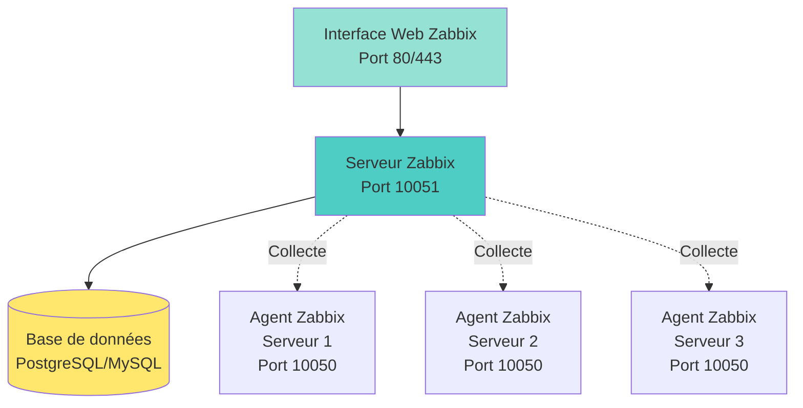

<a name="supervision-avancee" id="supervision-avancee"></a>

# 🚨 Module 5
## Supervision Avancée & Alertes

### Monitoring professionnel avec Zabbix

---

# Pourquoi un outil de supervision avancé ? 🤔

**Limites des outils en ligne de commande** :
- top/htop : données instantanées uniquement
- Pas d'historique graphique
- Pas d'alertes automatiques
- Surveillance manuelle
- Pas de vue d'ensemble multi-serveurs

**Solution : outil de monitoring centralisé**
- **Zabbix** ← On va utiliser celui-ci !
- Nagios
- Prometheus + Grafana
- Munin

---

# Zabbix : présentation 📊

**Zabbix** : solution de monitoring open source entreprise

**Fonctionnalités :**
- Surveillance serveurs, réseaux, applications
- Historique et graphiques
- Alertes automatiques (email, SMS, Slack...)
- Templates prêts à l'emploi
- Interface web intuitive
- API REST pour automatisation
- Découverte automatique

**Architecture :** Client/Serveur
- **Serveur Zabbix** : collecte et stocke les données
- **Agent Zabbix** : installé sur chaque machine à surveiller

---

# Architecture Zabbix 🏗️



---

# Prérequis installation 📋

**Machine serveur Zabbix :**
- 2 CPU minimum
- 2 Go RAM minimum (4 Go recommandé)
- 10 Go espace disque minimum
- Debian 12 / Ubuntu 22.04+ ou RHEL 9+

**Composants à installer :**
- Serveur Zabbix
- Interface web (Apache/Nginx + PHP)
- Base de données (PostgreSQL ou MySQL/MariaDB)

**On va installer sur Ubuntu 24.04**

---

# Installation Zabbix Server 📥

```bash
# 1. Télécharger le dépôt Zabbix 7.0 LTS
wget https://repo.zabbix.com/zabbix/7.0/ubuntu/pool/main/z/zabbix-release/zabbix-release_latest_7.0+ubuntu24.04_all.deb
sudo dpkg -i zabbix-release_latest_7.0+ubuntu24.04_all.deb
sudo apt update

# 2. Installer serveur, frontend, agent
sudo apt install zabbix-server-mysql zabbix-frontend-php zabbix-apache-conf zabbix-sql-scripts zabbix-agent -y

# 3. Installer MariaDB
sudo apt install mariadb-server -y
```

---

# Configuration base de données 🗄️

```bash
# Se connecter à MySQL
sudo mysql

# Créer la base et l'utilisateur
CREATE DATABASE zabbix CHARACTER SET utf8mb4 COLLATE utf8mb4_bin;
CREATE USER 'zabbix'@'localhost' IDENTIFIED BY 'MotDePasseSecurise';
GRANT ALL PRIVILEGES ON zabbix.* TO 'zabbix'@'localhost';
SET GLOBAL log_bin_trust_function_creators = 1;
FLUSH PRIVILEGES;
EXIT;

# Importer le schéma initial
sudo zcat /usr/share/zabbix-sql-scripts/mysql/server.sql.gz | mysql --default-character-set=utf8mb4 -uzabbix -p zabbix
# Entrer le mot de passe
```

---

# Configuration Zabbix Server ⚙️

```bash
# Éditer la config
sudo nano /etc/zabbix/zabbix_server.conf
```

**Modifier ces lignes :**

```
DBName=zabbix
DBUser=zabbix
DBPassword=MotDePasseSecurise
```

```bash
# Redémarrer MySQL pour désactiver log_bin_trust
sudo mysql -e "SET GLOBAL log_bin_trust_function_creators = 0;"

# Démarrer Zabbix
sudo systemctl restart zabbix-server zabbix-agent apache2
sudo systemctl enable zabbix-server zabbix-agent apache2
```

---

# Configuration interface web 🌐

**Accéder à l'interface :**

```
http://ip-serveur/zabbix
```

**Assistant d'installation :**

1. **Welcome** : Next
2. **Pre-requisites** : vérifier que tout est OK → Next
3. **Database connection** :
   - Type : MySQL
   - Host : localhost
   - Database : zabbix
   - User : zabbix
   - Password : MotDePasseSecurise
4. **Settings** : donner un nom au serveur
5. **Summary** : Next
6. **Install** : Finish

---

# Première connexion 🔑

**Identifiants par défaut :**
- **User :** `Admin`
- **Password :** `zabbix`

**⚠️ IMPORTANT : Changer le mot de passe immédiatement !**

```
Administration → Users → Admin → Change password
```

**Interface :** en anglais par défaut

Pour passer en français :
```
User settings (icône utilisateur) → Language : French
```

---

# Interface Zabbix : tour rapide 🖥️

**Menu principal :**

- **Monitoring → Hosts** : liste des serveurs surveillés
- **Monitoring → Latest data** : dernières données collectées
- **Monitoring → Graphs** : graphiques
- **Monitoring → Dashboards** : tableaux de bord
- **Configuration → Hosts** : gérer les hôtes
- **Configuration → Templates** : templates pré-configurés
- **Reports → Availability** : disponibilité

---

# Le serveur Zabbix se surveille lui-même 👀

**Host "Zabbix server" déjà configuré**

**Voir les données :**

1. Allez dans **Monitoring → Hosts**
2. Cliquez sur "Zabbix server"
3. Onglet **Latest data** : voir CPU, RAM, disque en temps réel
4. Onglet **Graphs** : graphiques des dernières heures

**C'est votre premier host surveillé !**

---

# Installer l'agent Zabbix sur un serveur 📡

**Sur le serveur à surveiller (ex: serveur web) :**

```bash
# Debian/Ubuntu
wget https://repo.zabbix.com/zabbix/7.0/ubuntu/pool/main/z/zabbix-release/zabbix-release_latest_7.0+ubuntu24.04_all.deb
sudo dpkg -i zabbix-release_latest_7.0+ubuntu24.04_all.deb
sudo apt update
sudo apt install zabbix-agent -y

# Configuration
sudo nano /etc/zabbix/zabbix_agentd.conf
```

---

# Configuration agent Zabbix ⚙️

```bash
sudo nano /etc/zabbix/zabbix_agentd.conf
```

**Modifier ces lignes :**

```
Server=<IP_SERVEUR_ZABBIX>
ServerActive=<IP_SERVEUR_ZABBIX>
Hostname=serveur-web-01
```

**Exemple :**
```
Server=192.168.1.10
ServerActive=192.168.1.10
Hostname=serveur-web-01
```

```bash
# Redémarrer l'agent
sudo systemctl restart zabbix-agent
sudo systemctl enable zabbix-agent
```

---

# Ajouter un host dans Zabbix 🖥️

**Dans l'interface web Zabbix :**

1. **Configuration → Hosts → Create host**
2. Remplir :
   - **Host name :** `serveur-web-01`
   - **Groups :** `Linux servers` (créer si besoin)
   - **Interfaces :** Add → Agent
     - IP address : `192.168.1.20` (IP du serveur)
     - Port : `10050`
3. **Templates :** Select → chercher `Linux by Zabbix agent`
4. **Add** (pour ajouter le template)
5. **Add** (en bas pour créer l'hôte)

---

# Vérifier la connexion 🔍

**Dans Configuration → Hosts :**

- Colonne **Availability** :
  - **Vert (ZBX)** : agent accessible ✅
  - **Rouge** : problème de connexion ❌

**Si rouge :**

```bash
# Sur le serveur agent, vérifier :
sudo systemctl status zabbix-agent

# Vérifier le firewall
sudo ufw allow 10050/tcp

# Tester depuis le serveur Zabbix
telnet <IP_AGENT> 10050
```

---

# Voir les données collectées 📊

**Monitoring → Latest data**

1. Filtrer par host : sélectionner `serveur-web-01`
2. Voir toutes les métriques collectées :
   - CPU utilization
   - Memory utilization
   - Disk space usage
   - Network traffic
   - Processes
   - ...

**Cliquer sur "Graph"** pour voir l'évolution dans le temps

---

# Créer une alerte simple 🚨

**Objectif :** Recevoir un email si CPU > 80%

**Étape 1 : Créer un trigger**

1. **Configuration → Hosts** → `serveur-web-01`
2. **Triggers** → **Create trigger**
3. Remplir :
   - **Name :** `CPU élevé sur {HOST.NAME}`
   - **Severity :** High
   - **Expression :** Add → Sélectionner :
     - Item : `CPU utilization`
     - Function : `avg`
     - Last of (T) : `5m`
     - Result : `> 80`
4. **Add**

---

# Créer une alerte : configuration email 📧

**Étape 2 : Configurer l'envoi d'emails**

1. **Administration → Media types** → **Email**
2. **SMTP server :** `smtp.gmail.com`
3. **SMTP server port :** `587`
4. **SMTP helo :** `gmail.com`
5. **SMTP email :** `votre-email@gmail.com`
6. **Connection security :** STARTTLS
7. **Authentication :** Username and password
8. **Username :** `votre-email@gmail.com`
9. **Password :** (mot de passe d'application Gmail)
10. **Update**

**Note :** Pour Gmail, créer un mot de passe d'application

---

# Créer une alerte : assigner l'email 📬

**Étape 3 : Assigner l'email à l'utilisateur**

1. **Administration → Users** → **Admin**
2. **Media** → **Add**
3. **Type :** Email
4. **Send to :** `votre-email@example.com`
5. **When active :** 1-7, 00:00-24:00 (toujours actif)
6. **Use if severity :** cocher toutes les cases
7. **Add** → **Update**

---

# Créer une alerte : action 🎬

**Étape 4 : Créer une action**

1. **Configuration → Actions** (onglet Trigger actions) → **Create action**
2. **Action** (onglet) :
   - **Name :** `Alerte CPU élevé`
   - **Conditions :** Trigger severity >= High
3. **Operations** (onglet) → **Add** :
   - **Send to users :** Admin
   - **Send only to :** Email
   - **Add**
4. **Add** (en bas)

**C'est prêt ! Dès que CPU > 80% pendant 5 min → email**

---

# Tester l'alerte 🧪

**Simuler une charge CPU :**

```bash
# Sur le serveur surveillé
# Lancer un stress test (installer si besoin)
sudo apt install stress -y

# Stresser le CPU pendant 5 minutes
stress --cpu 4 --timeout 300s
```

**Observer dans Zabbix :**
- **Monitoring → Problems** : voir le trigger activé
- **Boîte mail** : recevoir l'email d'alerte

---

# Dashboards personnalisés 📈

**Créer un dashboard :**

1. **Monitoring → Dashboards** → **Create dashboard**
2. **Name :** `Mon serveur web`
3. **Add widget** :
   - **Type :** Graph
   - **Name :** `CPU usage`
   - **Host :** `serveur-web-01`
   - **Item :** `CPU utilization`
4. **Add** → **Apply**
5. Ajouter d'autres widgets (RAM, disque, etc.)

**Résultat :** Vue d'ensemble graphique de votre serveur

---

# Templates : gagner du temps 📦

**Template** : ensemble pré-configuré d'items, triggers et graphiques

**Templates fournis :**
- `Linux by Zabbix agent` : métriques Linux de base
- `Apache by HTTP` : monitoring Apache
- `Nginx by HTTP` : monitoring Nginx
- `MySQL by Zabbix agent` : monitoring MySQL
- ...

**Pour appliquer un template :**
1. **Configuration → Hosts** → cliquer sur le host
2. **Templates** → **Select**
3. Chercher et sélectionner le template
4. **Add** → **Update**

---

# Bonnes pratiques Zabbix ✅

**1. Organisation**
- Grouper les hosts par fonction (Web servers, DB servers, etc.)
- Nommer clairement (serveur-web-prod-01, bdd-mysql-01)

**2. Alertes**
- Ne pas alerter sur tout !
- Définir des seuils réalistes
- Tester les alertes

**3. Maintenance**
- Nettoyer l'historique ancien (> 90 jours)
- Surveiller l'espace disque de la BDD
- Mettre à jour Zabbix régulièrement

---

# Récapitulatif du Module 5 ✅

**Ce que vous avez appris :**

✅ Architecture et concepts Zabbix

✅ Installation serveur et agent

✅ Configuration base de données

✅ Ajout de hosts à surveiller

✅ Création de triggers (alertes)

✅ Configuration notifications email

✅ Dashboards personnalisés

✅ Utilisation des templates

---

# Prochaine étape 🎯

**Module 6 (BONUS) : Optimisation & Performances**

- Tuning sysctl
- Optimisation Nginx
- Optimisation MySQL
- Cache système

---
layout: default
---

# Questions ? 🤔

N'hésitez pas à poser vos questions maintenant !

Vous disposez maintenant d'un outil professionnel de supervision.

